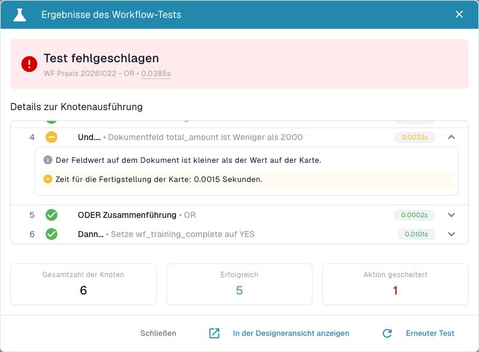
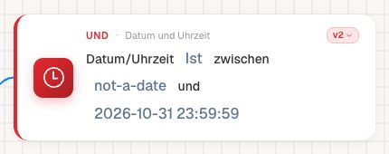
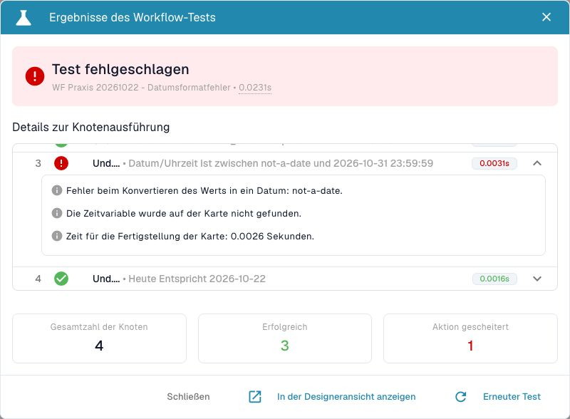

# Workflow-Meldungen richtig einordnen



[Video mit deutschen Untertiteln und Sprechertext öffnen](https://docbits-videos.fra1.cdn.digitaloceanspaces.com/settings-assistant/workflow-masterclass-12-admin/v1/de.html).

Beginnen Sie mit dem konkreten Knoten und seiner tatsächlichen Eingabe. Eine technische Meldung ist ein Diagnosehinweis; sie benennt nicht immer eindeutig die fachliche Ursache. Unterscheiden Sie `failed_condition`, `error`, einen übersprungenen Knoten und das Gesamtergebnis.

Die folgenden Meldungen wurden in den genannten Prüfumgebungen tatsächlich beobachtet. Sie sind keine vollständige Liste aller möglichen Versionen. Variierende IDs und interne Diagnosedaten gehören nicht in einen öffentlich geteilten Fehlerbericht.

| Meldung / Ergebnis | Beobachteter Zusammenhang | Erste Prüfung | Nachtest |
| --- | --- | --- | --- |
| `not_found_in_document` | Im synthetischen Advanced-Test trat die Meldung auch bei einem nicht numerisch auswertbaren Betragswert auf. | Technischen Feldschlüssel, vorhandenen Wert und Datentyp gemeinsam prüfen. Nicht ausschließlich nach einem fehlenden Feld suchen. | Dieselbe Konfiguration mit Zahl, fehlendem Wert und ungültigem Text testen. |
| `error_card_setup` bei Run Workflow | Der geprüfte Test mit einem Selbstaufruf nahm den Error-Ausgang. | Tatsächlichen Aufrufer und ausgewähltes Ziel vergleichen; nicht nur ihre Anzeigenamen. | Eigenen getrennten Zielworkflow wählen und sein Ergebnis prüfen. |
| `missing_variable` bei Run Workflow | Ein unbekanntes Ziel erzeugte diese Meldung im geprüften Advanced-Test. | Zielauswahl, gespeicherten Zielbezug und Verfügbarkeit in der Organisation prüfen. | Ein vorhandenes eigenes Ziel auswählen und die Zielbedingungen erneut abnehmen. |
| `ALL block: 1/2 sources succeeded (2 edges connected)` | Im Dev-Advanced-Test erfüllte nur eine von zwei tatsächlich ausgeführten Quellen ihren verbundenen Success-Ausgang. | Beide Quellen und ihre angeschlossenen Ausgänge einzeln lesen. | Mit zwei passenden Quellen testen; danach denselben negativen Fall wiederholen. |
| `failed_condition` ohne technischen Kartenfehler | Die Bedingung ist regulär falsch. | Erwartung, Operator und exakten Grenzwert prüfen. | Negativfall beibehalten; zusätzlich einen passenden Positivfall prüfen. |
| `Unsupported export version: 1.0` | Der Dev-Importer wies eine Datei mit einer falsch angegebenen Exportversion zurück. | Mit einer tatsächlich exportierten Datei und ihren unveränderten Metadaten vergleichen. | Gültigen Export als eigene inaktive Kopie importieren und anschließend neu laden. |
| SDK: `args.0.placeholder` / `Input should be a valid dictionary` | Die SDK-Strukturprüfung lehnte einen einfachen Text anstelle des erwarteten lokalisierten Objekts ab. | Den tatsächlichen Parametertyp der aktuellen SDK-Schnittstelle prüfen. | Beispielsweise ein unterstütztes Sprachobjekt verwenden und die Strukturprüfung erneut ausführen. |

Die Feld- und Unterworkflow-Beispiele stammen aus synthetischen Advanced-Tests des Lernpakets. Der konkrete ALL-Vergleich und die Import-/SDK-Meldungen wurden zusätzlich auf Dev am 22. Oktober 2026 beobachtet. Diese Nachweise ersetzen keinen tatsächlichen Dokumentlauf.

## Einen regulären Nichttreffer erkennen

Im Beispiel prüfen A `total_amount > 1000` und B `total_amount < 2000`. Bei 2500 ist A wahr und B falsch. ANY und OR können anschließend ihren Success-Ausgang nehmen; im beobachteten Advanced-Test bleibt das Gesamtergebnis dennoch `failed_condition`. Eine grüne Zusammenführung hebt den Nichttreffer einer vorgelagerten Prüfung nicht auf.

ALL nimmt in demselben Fall `failed_condition`, besitzt den oben gezeigten Fehlerhinweis und beendet den Test insgesamt mit `error`. Halten Sie deshalb Knotenpfad, Meldung und Gesamtergebnis getrennt fest.

## Eine Korrektur belegen

1. Sichern Sie die vollständige relevante Eingabe und den Konfigurationsstand.
2. Ändern Sie genau den nachgewiesenen Fehler, etwa einen Parametertyp oder eine falsche Zielauswahl.
3. Wiederholen Sie denselben Fall und die betroffenen positiven und negativen Kontrollen.
4. Prüfen Sie für reale Wirkungen einen neuen Dokumentlauf und das jeweilige Ziel.

Bei SDK-Verbesserungsvorschlägen prüfen Sie die heruntergeladenen Dateien erneut. Eine erzeugte Erwartung von einer Logzeile passt nicht zu einer Implementierung, die zwei Logzeilen schreibt. Ein zuvor grüner Prüflauf gilt für seine damaligen Dateien.

[Systematische Fehlerdiagnose](workflow-troubleshooting.md) · [Workflow-Protokolle](workflow-logs.md) · [Kontrollknoten](masterclass/control-nodes.md) · [Run Workflow](masterclass/run-workflow.md) · [Card SDK](card-sdk.md)

## Nichttreffer im Knotenprotokoll erkennen

Im folgenden Advanced-Test ist `2500 < 2000` falsch. Die Bedingung hat ein gelbes Minus, während OR und die Abschlussaktion grün sind. Die Anzeige „Test fehlgeschlagen“ und „Aktion gescheitert: 1“ fasst hier auch den fachlichen Nichttreffer zusammen. Der allgemeine Erklärungstext der Karte ist kein Beleg für ein wahres Ergebnis. Entscheidend sind Pfad und Ergebnis des betroffenen Knotens.

<figure><figcaption>
Normaler fachlicher Nichttreffer im Advanced-Test, kein Nachweis eines technischen Kartenfehlers.
</figcaption></figure>

## Ein unlesbares Datum ist ein technischer Fehler

Bei der Eingabe `not-a-date` konnte Version 2 der Datums-/Zeitkarte die linke Grenze nicht lesen. Das aktuelle Dev-Ergebnis enthält `missing_variable` und den Knotenpfad `error`. Das Protokoll zeigt zuerst den Konvertierungsfehler und danach die nicht gelesene Zeitvariable. Korrigieren Sie in diesem Fall die betroffene Eingabe; ein Wechsel des fachlichen Vergleichsoperators behebt das Format nicht.

<figure><figcaption>
Die absichtlich ungültige linke Grenze ist auf der Karte sichtbar.
</figcaption></figure>

<figure><figcaption>
Technischer Fehler mit Konvertierungsmeldung; die unabhängige Heute-Karte bleibt erfolgreich.
</figcaption></figure>
