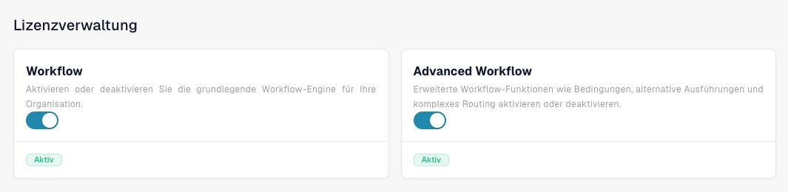
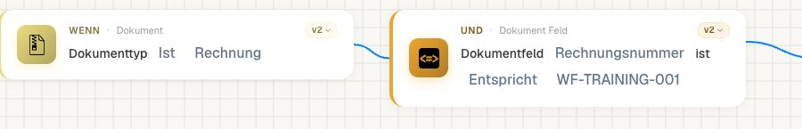
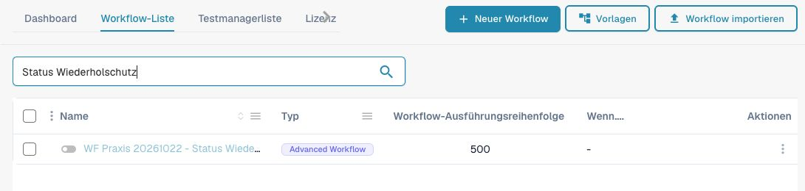
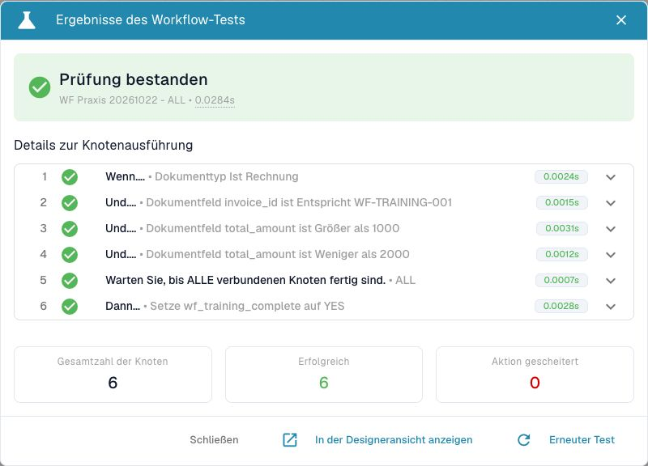

# Vom Test zur kontrollierten Aktivierung



[Video mit deutschen Untertiteln und Sprechertext öffnen](https://docbits-videos.fra1.cdn.digitaloceanspaces.com/settings-assistant/workflow-masterclass-11-admin/v1/de.html).

Eine gespeicherte Regel, ein bestandener Test und ein automatisch ausgelöster Dokumentlauf sind drei unterschiedliche Nachweise. Beginnen Sie mit genau einer eigenen Trainingsrechnung und einer Regel, deren Aktionen Sie vollständig überblicken. Verwenden Sie für Nachrichten und Exporte ausschließlich vorgesehene Testziele.

## 1. Den Ausgangszustand festhalten

Notieren Sie Organisation, Rolle, Workflow-Name, Kartenversionen, Aktivzustand und Ausführungsreihenfolge. Prüfen Sie die Workflow-Lizenz und gegebenenfalls die Advanced-Freigabe. Sichern Sie die Konfiguration vor der Änderung. Ein nachträglich erstellter Export ersetzt diese Sicherung nicht.

Begrenzen Sie das Beispiel durch **Dokumenttyp = Rechnung** und **Rechnungsnummer = WF-TRAINING-001**. Der Dokumenttyp grenzt passende Dokumente ein; die Trainingsnummer schützt andere Rechnungen vor der Übungsaktion. Verwenden Sie diesen Beleg nur in Ihrer eigenen Testorganisation.

Wählen Sie als erste Wirkung eine nachvollziehbare Trainingsmarkierung statt Versand oder Export. Prüfen Sie anschließend die Wirkung am tatsächlichen Beleg. Die Routenmarkierungen des [Advanced-Geschäftsfalls](advanced-workflow-case-study.md) lassen sich zunächst mit vollständigen Custom Data untersuchen; diese Simulation verändert den Beleg nicht.

<figure><figcaption>
Die vorhandenen Funktionen vor der Übung lesen. Die Aufnahme verändert keinen Lizenzschalter.
</figcaption></figure>

<figure><figcaption>
Dieser eigene Graph berücksichtigt ausschließlich Rechnungen mit WF-TRAINING-001. Organisation und Administratorrolle wurden vor dem Test separat geprüft.
</figcaption></figure>

<figure><figcaption>
Die gefilterte Liste zeigt den gespeicherten Inaktivzustand. Ein ausdrücklich gestarteter Auftrag kann bereits in Verarbeitung sein; Abschalten ersetzt die Kontrolle dieses Auftrags nicht.
</figcaption></figure>

## 2. Den passenden Test auswählen

| Prüfung | Was sie bestätigt | Zusätzlicher Nachweis |
| --- | --- | --- |
| Validieren im Advanced Designer | Der Graph erfüllt die geprüften Strukturregeln. | Richtige Eingabewerte und fachliche Ergebnisse prüfen. |
| Advanced Test mit Custom Data | Die konkreten synthetischen Daten erreichen bestimmte Knoten und Ergebnisausgänge. | Dokumentänderung und externe Zustellung separat nachweisen. |
| Gespeichertes Testszenario im Test Manager | Das tatsächlich ausgeführte Ergebnis stimmt mit der hinterlegten Erwartung überein. | Vorher prüfen, welche realen Aktionen dieser Testweg auslösen kann. |
| Manueller Aufruf am Trainingsdokument | Der gewählte Aufruf wurde für dieses Dokument verarbeitet. | Den vorgesehenen automatischen Anlass zusätzlich auslösen. |
| Dokumentereignis nach Aktivierung | Dieser Anlass berücksichtigt die aktivierte Regel. | Tatsächlich erreichte Aktion und fachliche Wirkung prüfen. |

Ein Test Manager kann reale Dokumentänderungen oder Exporte auslösen. Der ausgeschaltete Aktivzustand einer Regel schützt vor ihrer automatischen Berücksichtigung; er ist keine allgemeine Sperre für ausdrücklich gestartete Aufrufe. Lesen Sie dazu [Regressionstests](workflow-regression-tests.md).

## 3. Zuerst die fachlichen Grenzen prüfen

Testen Sie den passenden Beleg, eine andere Rechnungsnummer, einen Betrag unterhalb der Grenze, den exakten Grenzwert und eine fehlende oder ungültige Eingabe. Bewahren Sie die Erwartungen unverändert auf. Ändern Sie nicht gleichzeitig Regel und Erwartung, nur damit die Ergebnisliste grün bleibt.

Bei `total_amount > 1000` muss `1000` die Bedingung verfehlen; `1000.01` muss sie erfüllen. Prüfen Sie bei einer falschen Eingabe den vorgesehenen Fehlerweg. Eine fehlende Zahl darf nicht stillschweigend als erteilte Freigabe gewertet werden.

## 4. Genau einen Ausführungsanlass abnehmen

Aktivieren Sie nur die eigene, begrenzte Trainingsregel. Lösen Sie danach genau den Anlass aus, den der spätere Betrieb verwenden soll. Ein manueller Start ist kein Nachweis eines Dokumentereignisses; eine Datumsbedingung ist für sich kein Zeitplan.

Vergleichen Sie Zeitpunkt, Workflow-Name und Dokumentreferenz mit einem **neuen** Eintrag unter [Workflow-Protokolle](workflow-logs.md). Öffnen Sie den relevanten Lauf und verfolgen Sie Bedingung, Ausgang und Aktion. Prüfen Sie die Trainingsmarkierung am Beleg. Ein alter grüner Eintrag gehört weiterhin zu seinem damaligen Stand.

Der [Status-Praxisnachweis](masterclass/status-and-reentry.md#zwei-echte-dokumentereignisse-am-selben-trainingsbeleg) zeigt diesen Unterschied am echten Ereignis: Vorübergehend wurde ausschließlich die begrenzte eigene Regel aktiviert, danach ein normaler Dokumentstatuswechsel angefordert. Die erste unmittelbare Antwort war noch ausstehend. Erst der gespeicherte Lauf und die gelesene Trainingsmarkierung bestätigten die Ausführung. Beim zweiten Anlass stoppte die nicht mehr leere Markierung beide Aktionen. Die Regel wurde anschließend wieder inaktiv geprüft.

Bei mehreren Regeln mit Reihenfolge 100 und 200 müssen Sie zusätzlich zeigen, welchen vorbereiteten Wert die zweite Regel tatsächlich gelesen hat. Die Position einer Karte auf dem Advanced-Canvas bestimmt keine Ausführungsreihenfolge.

## 5. Eine Wiederholung bewusst prüfen

Lösen Sie denselben vorgesehenen Anlass erneut aus. Vergleichen Sie neue Laufanzahl, Dokumentzustand und Anzahl der erzeugten Aufgaben oder Zielbelege. Eine Bedingung am Bearbeitungszustand kann Wiederholungen begrenzen; bei gleichzeitigen Aufrufen benötigt der Zielprozess gegebenenfalls einen zusätzlichen Schutz gegen Doppelverarbeitung.

Setzen Sie die Trainingsregel nach der Übung wieder inaktiv und kontrollieren Sie den gespeicherten Zustand nach dem Neuladen. Halten Sie absichtlich erhaltene Trainingsdaten im Abnahmeprotokoll fest.

## Abschlusskriterium

Die Regel hat ihre positiven, negativen und fehlerhaften Fälle bestanden. Der vorgesehene Anlass erzeugt einen zugeordneten neuen Lauf, und die fachliche Wirkung ist am richtigen Ziel belegt. Ein erneuter Lauf verhält sich wie festgelegt. Nicht geprüfte Zustellung oder ERP-Verarbeitung bleibt ausdrücklich offen.

[Lernweg](workflow-learning-path.md) · [Ausführungsmodell](workflow-execution-model.md) · [Status und erneute Ausführung](masterclass/status-and-reentry.md) · [Änderung und Wiederherstellung](workflow-change-and-recovery.md)

<figure><figcaption>
Synthetischer Betrag 1785: sechs erfolgreiche Knoten. Dieser Nachweis bestätigt den manuellen Test; die Prüfung des echten Dokumentlaufs folgt separat.
</figcaption></figure>
