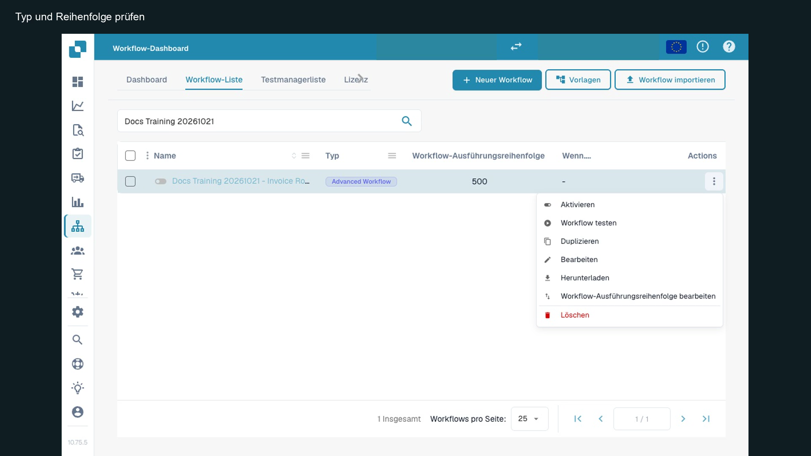
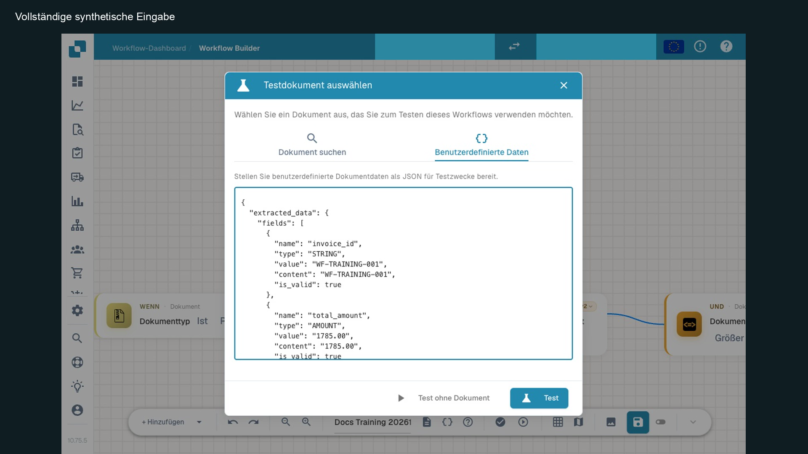

# Workflow-Übungspaket

Das Paket gehört zum [Advanced-Geschäftsfall](advanced-workflow-case-study.md). Es enthält einen synthetischen Rechnungsbeleg, den importierbaren Workflow, sieben vollständige Dokumenteingaben, unabhängige Erwartungen und die tatsächlich gespeicherten Testantworten. Die technischen Schlüssel und Routennamen bleiben in allen Sprachfassungen gleich.


Workflow-Übungspaket mit Beispielen und Ergebnissen


## Inhalt und Formate

| Datei | Verwendung |
| --- | --- |
| `training-invoice.pdf` | Synthetischer Beleg: 1500 Euro netto, 285 Euro Steuer, 1785 Euro gesamt. Kein zahlbarer Beleg. |
| `advanced-workflow.json` | Über **Import Workflow** importieren; keine globale Variable; auf Rechnung und exakte Trainingsnummer begrenzt, inaktiv importieren. |
| `*-input.json` | Vollständige Dokumentdaten für den Testdialog **Benutzerdefinierte Daten**. |
| `expectations.json` | Erwartete Wege, Statusmeldungen und Gesamtergebnisse. Eine fachliche Prüfliste, keine Test-Manager-Upload-Datei. |
| `*-result.json` | Echte Antworten des Dev-Testdienstes mit Knotenergebnissen und Meldungen; sensible Organisationsreferenzen sind ersetzt. |
| `prepare_inputs.py` | Ersetzt die synthetische Organisationsreferenz in beiden erforderlichen Positionen. |
| `verify_results.py` | Prüft die gespeicherten Antworten gegen die unabhängig definierten Erwartungen. Benötigt Python 3, keinen Zugangsschlüssel. |

## Verwendung

1. Entpacken Sie das ZIP. Lesen Sie die beigefügte Anleitung.
2. Importieren Sie den Workflow in Ihre Testorganisation und prüfen Sie den inaktiven Zustand.
3. Ermitteln Sie die Organisations-ID Ihres eigenen Testkontos. Führen Sie lokal aus:

```bash
python3 prepare_inputs.py --org-id YOUR_TEST_ORGANIZATION_UUID --out prepared
python3 verify_results.py
```

4. Verwenden Sie die Dateien aus `prepared/` im Advanced-Testdialog. Ersetzen Sie keine Dokument-ID durch eine laufende Kundenrechnung.
5. Prüfen Sie alle sieben Fälle anhand der [Ergebnistabelle](advanced-workflow-case-study.md). Die abweichenden Beträge sind gezielte Testvarianten; sie ändern den beigefügten Beleg nicht.

Die Daten enthalten `id`, `org_id`, `doc_type`, `status` und `extracted_data` einschließlich `layout.groups`, `fields` und `tables`. Die Organisationsreferenz muss oben und in `extracted_data` zum angemeldeten Konto passen. Feldwerte ohne die zugehörige Layoutdefinition können von einer Karte nicht als vorhandenes Dokumentfeld gelesen werden.

## Import, Eingabe und Testantwort am Bildschirm zuordnen

Öffnen Sie **Workflow importieren** für `advanced-workflow.json` und kontrollieren Sie danach die eigene importierte Regel. Der folgende Ausschnitt aus dem bestehenden Lernfilm zeigt, woran der inaktive Zustand und der getrennte Testzugang zu erkennen sind. Er behauptet keinen erneuten Import in der aktuellen Sitzung.

<figure><figcaption><p>Zustandskontrolle an der vorhandenen Trainingsregel: Schalter aus, Menüeintrag „Aktivieren“, eigener Testzugang. Aufnahme aus dem bereits veröffentlichten deutschen Lernvideo, Stufe 1. Das Bild zeigt den kontrollierten Zustand; es ist kein neuer Importnachweis.</p></figcaption></figure>

Öffnen Sie im Designer den Testdialog und wechseln Sie zu **Benutzerdefinierte Daten**. Verwenden Sie die vollständige, für Ihre Organisation vorbereitete Datei. Das Eingabefeld ist scrollbar; `fields` allein ersetzen nicht die erforderlichen Dokument- und Layoutdaten.

<figure><figcaption><p>Ausschnitt der vollständigen synthetischen Eingabe für 1785.00. Weitere Schlüssel und Layoutdaten liegen in der Übungsdatei und sind im Eingabefeld scrollbar. Nicht nur den sichtbaren Ausschnitt als JSON übernehmen. Bild aus dem bestehenden deutschen Lernvideo, Stufe 2.</p></figcaption></figure>

Laden Sie für den separaten Grenzfall 1000,01 dessen eigene Eingabedatei. Prüfen Sie nach dem Test den gewählten Weg und die erreichten Knoten. Die folgende Antwort gehört zu diesem Grenzfall und nicht zum oben abgebildeten Wert 1785,00.

<figure><figcaption><p>Separat ausgeführter Grenzfall 1000,01: sechs erfolgreiche Knoten, REVIEW und simulierte Statusaktion. Die Eingabeabbildung mit 1785.00 gehört zu einem anderen Übungsfall. Für die Abnahme immer Eingabe und Antwort desselben Falls gemeinsam prüfen. Bild aus dem bestehenden deutschen Lernvideo, Stufe 2.</p></figcaption></figure>

Der [bestehende Film Stufe 2 mit deutschen Untertiteln](https://docbits-videos.fra1.cdn.digitaloceanspaces.com/settings-assistant/workflow-learning-step-02-admin/v1/de.html) zeigt die Eingabe ab etwa 0:48 und die Grenzfälle danach. Der [breite vollständige Graph](advanced-workflow-case-study.md) ist zusätzlich auf zwei überlappenden Bildern dokumentiert.

## Grenzen der Übung

Die Erwartungsdatei prüft mehr als einen Dokumentstatus: gewählte Wege, Routentext, Statusmeldung und erreichte Abschlussknoten. Sie ist deshalb nicht mit dem Statusvergleich eines gespeicherten Test-Manager-Szenarios gleichzusetzen.

Ein erfolgreicher Advanced-Test bestätigt die Verarbeitung der Testdaten. Simulierte Dokumentaktionen sind keine erfolgte Benutzerzuweisung, E-Mail oder Zustellung. Für die spätere Aktivierung benötigen Sie einen passenden Ereigniseinstieg und einen gesondert nachgewiesenen echten Lauf. Nutzen Sie dazu [Wann läuft mein Workflow?](workflow-execution-model.md).

## WF-03: Übung und Abnahme

Entpacken Sie v2, passen Sie die Organisation mit prepare_inputs.py an und führen Sie verify_results.py aus. Verwenden Sie decision-table-setup.json als Aufbauhilfe und acceptance-record-template.json als Protokollvorlage; beide sind keine Workflow-Importdateien. Prüfen Sie vor dem Import den inaktiven Zustand.

[Lernweg](workflow-learning-path.md)
