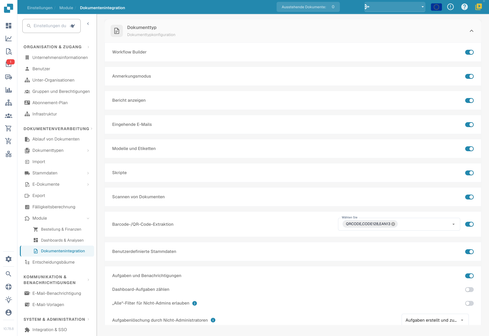
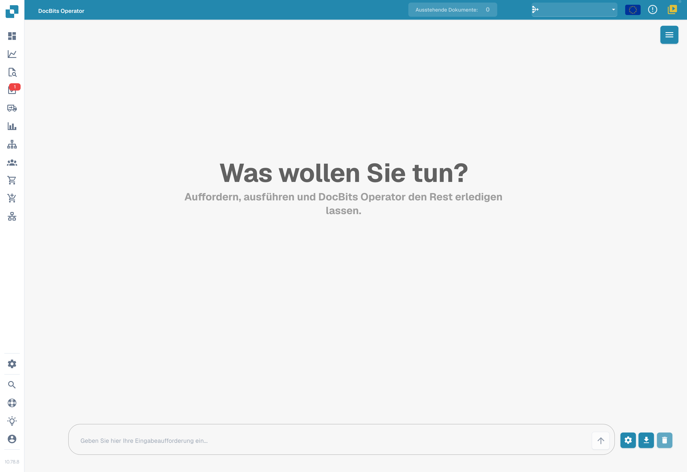
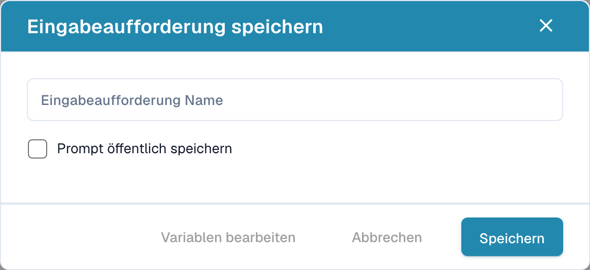

# DocBits Operator

DocBits Operator führt Aufgaben anhand Ihrer Anweisungen aus. Eine Anweisung beschreibt die einzelnen Schritte; Variablen liefern die Daten für den jeweiligen Durchlauf.

## Aktivieren und öffnen

1. Öffnen Sie **Einstellungen → Module → Dokumentintegration**.
2. Scrollen Sie zu **DocBits Operator** und aktivieren Sie die Funktion, sofern Sie die nötigen Berechtigungen haben.
3. Öffnen Sie **DocBits Operator** über die Hauptnavigation der Anwendung.

<figure><figcaption>
Module der Dokumentintegration: Skripte, Dokumentenscan, Barcode-Erkennung und benutzerdefinierte Stammdaten.
</figcaption></figure>

## Anweisung eingeben

Beschreiben Sie im Eingabefeld am unteren Bildschirmrand das gewünschte Ergebnis und die Arbeitsschritte. Variablen stehen in geschweiften Klammern, etwa `{invoice_number}` oder `{url}`. Über das Zahnrad öffnen Sie das Fenster für Variablennamen und deren Werte.

<figure><figcaption>
Deutsche Oberfläche des DocBits Operators mit leerem Eingabefeld. Es wurde keine Aufgabe gestartet.
</figcaption></figure>

Die Pfeilschaltfläche startet die Ausführung. Das Download-Symbol öffnet den Dialog zum Speichern der Anweisung; der Papierkorb leert die Unterhaltung. Durch das Öffnen des Speicherdialogs wird noch keine Vorlage gespeichert.

Beispiele finden Sie in der [Anleitung zum Formulieren von Anweisungen](prompt-writing-guide.md).

## Anweisung speichern

Geben Sie im Speicherdialog einen **Namen für die Anweisung** ein. Die Option zur öffentlichen Freigabe bestimmt die Weitergabe der Vorlage. Verwenden Sie in einer geteilten Vorlage Variablennamen und ergänzen Sie die für den jeweiligen Durchlauf benötigten Werte vor der Ausführung.

<figure><figcaption>
Ungefüllter deutscher Speicherdialog für eine Anweisung. Es wurden keine Werte eingegeben und die abschließende Speicherschaltfläche wurde nicht betätigt.
</figcaption></figure>

Die Schaltfläche zum Bearbeiten der Variablen öffnet deren Definitionen, sofern sie für die aktuelle Eingabe aktiviert ist. Die Speicherschaltfläche speichert die Vorlage. Über das Kreuz oben rechts schließen Sie den Dialog ohne zu speichern.

In der abgebildeten Version schließt **Abbrechen** den Dialog ohne Speichern. **Variablen bearbeiten** kann bei leerer Eingabe deaktiviert sein; hinterlegen Sie zuerst die vorgesehene Anweisung und deren Variablen.

## Gespeicherte Anweisungen

Das Menü oben rechts öffnet die Seitenleiste mit gespeicherten Anweisungen. Sie enthält getrennte Bereiche für Organisationsvorlagen und öffentliche Vorlagen sowie eine Suche nach Namen.

Bei Organisationsvorlagen stehen Symbole zum Ausführen, Bearbeiten und Löschen zur Verfügung. Im öffentlichen Bereich startet der Pfeil die ausgewählte Vorlage. Ergänzen Sie vor dem Start deren Variablenwerte.

## Ausführung steuern

Während der Ausführung können Sie pausieren, fortsetzen, abbrechen oder die Steuerung übernehmen. Eine Pause hält weitere Schritte an, damit Sie den aktuellen Zustand prüfen können. Fortsetzen führt die Arbeit weiter; Abbrechen beendet den Durchlauf. Durch Übernahme der Steuerung können Sie die Browseransicht manuell bedienen.

<figure><figcaption>
Beispiel der Symbole zum Fortsetzen und Stoppen.
</figcaption></figure>

## Detailansicht

Das Symbol zum Vergrößern öffnet die Detailansicht der Ausführung. Dort können Sie die Aktionen, den aktuellen Schritt und die Meldungen des Operators verfolgen und die Ausführung steuern.

<figure><figcaption>
Symbol zum Vergrößern der Detailansicht.
</figcaption></figure>
