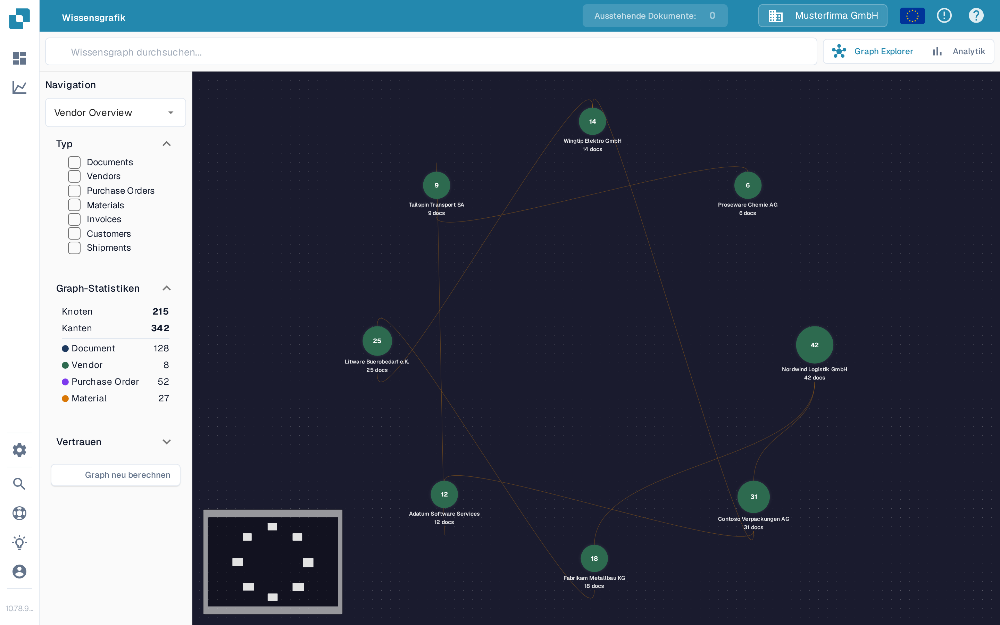

# Wissensgraph-Explorer

Der **Wissensgraph-Explorer** zeigt Ihnen die Verbindungen zwischen Lieferanten, Dokumenten, Bestellungen und anderen Datensätzen. Nutzen Sie ihn, wenn Sie einer Beziehung nachgehen oder prüfen möchten, wie viele zusammenhängende Elemente verfügbar sind. Das Beispiel unten zeigt einen gefüllten Graphen in der deutschen Sandbox-Testorganisation.

<figure><figcaption>
Der Beispielgraph zeigt verknüpfte Lieferanten. Suchen Sie ein Element oder berechnen Sie den Graphen neu, um eigene Verbindungen zu sehen.
</figcaption></figure>

## Erste Schritte

1. Öffnen Sie **Graph Explorer** in DocBits. Prüfen Sie, ob die oben angezeigte Organisation die ist, die Sie untersuchen möchten.
2. Steht in der Mitte **Balisez un nœud ou calculez le graphe pour commencer**, wählen Sie **Graph neu berechnen** und warten Sie, bis die Fortschrittsmeldung verschwindet. Damit werden die Graphdaten aufbereitet; das kann dauern. Hat die Organisation noch keine passenden Beziehungen, können **Knoten** und **Kanten** auf null bleiben.
3. Geben Sie einen Namen oder einen anderen Suchbegriff in **Wissensgraph durchsuchen** ein und drücken Sie die Eingabetaste oder wählen Sie das Suchsymbol. Erscheinen mehrere Treffer, wählen Sie den benötigten aus. Ein einzelner Treffer öffnet seinen Graphen direkt.
4. Wählen Sie einen Knoten aus, um seine Details zu sehen. Schließen Sie das Detailfenster mit **X**, wenn Sie zum Graphen zurückkehren möchten.

## Auswählen, was Sie sehen

| Bedienelement | Was es bewirkt |
| --- | --- |
| **Navigation** | Wechselt zwischen **Vendor Overview** (verbundene Lieferanten), **Vendor Intelligence** (eine Lieferantentabelle), **Document Journey** (Schritte und Varianten in der Dokumentenverarbeitung) und **Anomalien** (ungewöhnliche Beziehungen). |
| **Typ** | Wählt die Arten von Elementen aus, auf die Sie sich konzentrieren möchten, etwa Documents, Vendors, Purchase Orders oder Invoices. Ausgewählte Typen grenzen auch die Suchergebnisse ein. |
| **Graph-Statistiken** | Zeigt die Anzahl der aktuell verfügbaren Knoten (Elemente) und Kanten (Verbindungen). Blenden Sie diesen Bereich nach Bedarf ein oder aus. |
| **Vertrauen** | Legen Sie hier die minimale Beziehungs-Konfidenz fest, die beim Erweitern eines Knotens gilt. Ein höherer Wert engt die angezeigten Verbindungen ein. |
| **Graph neu berechnen** | Startet eine neue Graphberechnung. Warten Sie, bis der Fortschritt abgeschlossen ist, bevor Sie erneut suchen. |
| **Graph Explorer / Analytik** | Wechselt zwischen dem interaktiven Graphen und zusammenfassenden Diagrammen. **Analytik** zeigt Zahlen und Diagramme, wenn Graphdaten vorhanden sind; ein leerer Graph lässt auch **Analytik** leer. |

Wenn Sie eine Abweichung zwischen einer Rechnung und ihrer Bestellung klären müssen, fahren Sie mit dem [Bestellnummer Abgleich Bildschirm](../end-user-and-partner-section/end-user-section/purchase-order-matching/README.md) fort. Für umfassendere Kennzahlen außerhalb des Graphen siehe das [Analyse-Dashboard](../administration-and-setup/analytics-dashboard.md).
