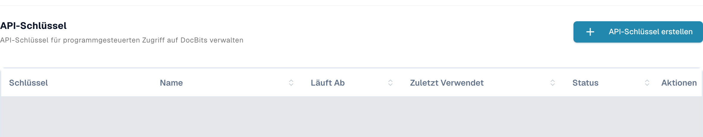
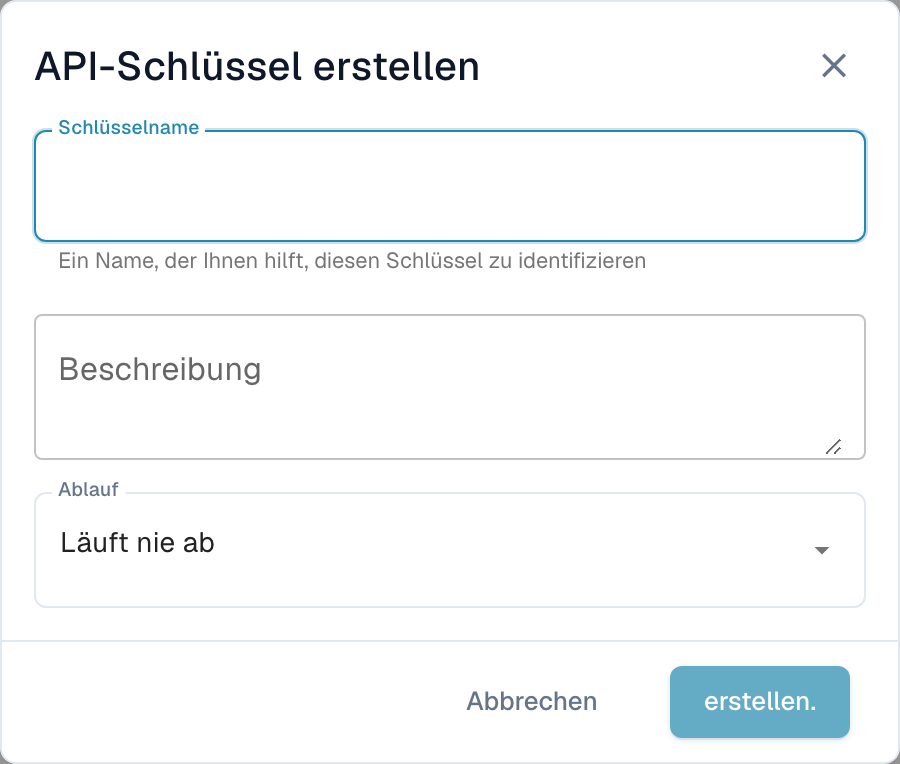

# Postman für DocBits

Mit Postman können Sie HTTP-Anfragen an die DocBits-API senden. Beginnen Sie in einer für Sie freigegebenen Umgebung mit einer lesenden Anfrage. Verwenden Sie getrennte Postman-Umgebungen für Test und Produktion und bewahren Sie Zugangsdaten in privaten Variablen oder einem Vault auf.

## Einrichtung

### DocBits API

Öffnen Sie die API-Dokumentation Ihrer Umgebung, beispielsweise die [Sandbox-API](https://sandbox.api.docbits.com/docs) oder die [Produktions-API](https://api.docbits.com/docs). Übernehmen Sie die aktuellen Operationspfade und den dort angezeigten Wert **Servers**. Ein relativer Serverpfad wird an den API-Ursprung angehängt.

In der [hier geprüften Dev-API-Dokumentation](https://eu.dev.api.docbits.com/docs) lautet dieser Pfad `/dev-api`. Die vollständige Basis-URL ist damit `https://eu.dev.api.docbits.com/dev-api`. Andere Umgebungen können einen anderen Serverpfad verwenden.

Die API-Spezifikation führt mehrere getrennte Header-Schemata auf:

| Header | Zweck |
| --- | --- |
| `X-ORG-ID` | Kennzeichnet die Zielorganisation, sofern die Operation ihn benötigt. |
| `Authorization` | Enthält den vom jeweiligen Authentifizierungsverfahren verlangten Autorisierungswert. |
| `X-API-KEY` | Enthält einen API-Schlüssel bei Operationen, die dieses Schema verwenden. |

Diese Header sind nicht austauschbar. Der globale Dialog **Authorize** zeigt verfügbare Schemata; nicht jede Operation benötigt alle davon. Prüfen Sie die Parameter und Autorisierung der konkreten Operation.

Passende Zugangsdaten erhalten Sie von Ihrer Administration. In DocBits finden berechtigte Benutzer die Schlüsselverwaltung unter **Einstellungen → Integration & SSO → API-Schlüssel**. Die Ansicht zeigt Schlüsselpräfix, Name, Ablauf, letzte Verwendung und Status. Vorhandene Einträge sind im folgenden Bild abgedeckt.

<figure><figcaption><p>Deutsche Dev-Ansicht API-Schlüssel mit der Schaltfläche API-Schlüssel erstellen und den Tabellenspalten Schlüssel, Name, Läuft Ab, Zuletzt Verwendet, Status und Aktionen; vorhandene Zeilen sind abgedeckt.</p></figcaption></figure>

**API-Schlüssel erstellen** öffnet zunächst ein Formular mit **Schlüsselname**, **Beschreibung** und **Ablauf**. Erst dessen Absenden erzeugt einen Schlüssel. Die Aufnahme zeigt das leere Formular; es wurde mit **Abbrechen** geschlossen. Es wurde kein Schlüssel erzeugt, angezeigt, kopiert oder widerrufen. Legen Sie neue Schlüssel nur im Rahmen Ihrer Berechtigung und der Vorgaben Ihrer Organisation an.

<figure><figcaption><p>Leeres deutsches Formular API-Schlüssel erstellen mit Schlüsselname, Beschreibung, Ablauf und den Schaltflächen Abbrechen und erstellen.; die Schaltfläche zum Erstellen ist ohne Namen deaktiviert.</p></figcaption></figure>

### Neuen Arbeitsbereich in Postman erstellen

Öffnen Sie Postman und verwenden Sie einen Arbeitsbereich mit der für Ihre Organisation geeigneten Sichtbarkeit. Legen Sie eine Umgebung mit der Variablen `base_url` an. Ihr Wert ist die vollständige Basis-URL einschließlich Serverpfad. Wählen Sie diese Umgebung vor dem Senden aus. Die [Postman-Anleitung zu Umgebungen](https://learning.postman.com/docs/use/send-requests/variables/managing-environments/) erklärt die Auswahl und Verwendung der Variablen.

Erstellen Sie eine Anfrage oder fügen Sie sie Ihrer Sammlung hinzu. Die folgenden Postman-Bezeichnungen sind die technischen Beschriftungen der Anwendung; die Bilder oben zeigen die deutsche DocBits-Schlüsselverwaltung.

## Beispiel für die GET-Methode

Wählen Sie **GET** und die URL `{{base_url}}/version`. Wählen Sie unter **Authorization** den Typ **No Auth** und anschließend **Send**. Der geprüfte lesende Dev-Aufruf war:

```http
GET https://eu.dev.api.docbits.com/dev-api/version
```

Der Endpunkt lieferte ohne API-Schlüssel HTTP 200. Er prüft die Erreichbarkeit der API und liefert Versionsinformationen. Er belegt keinen Zugriff auf Dokumente oder Benutzer einer Organisation. Prüfen Sie Antwortstatus und Inhalt; bei Fehlern zuerst die gewählte Umgebung, den API-Ursprung und den Serverpfad.

Für eine Operation mit API-Schlüssel wählen Sie in Postman **Authorization → API Key**. Tragen Sie unter **Key** `X-API-KEY` ein, verwenden Sie für **Value** ein privates Geheimnis und wählen Sie unter **Add to** den Wert **Header**. Ergänzen Sie `X-ORG-ID` unter **Headers**, falls die Operation ihn verlangt. Beachten Sie die offiziellen Anleitungen zur [API-Key-Autorisierung](https://learning.postman.com/docs/use/send-requests/authorization/authorization-types/#api-key) und zu [Vault-Geheimnissen](https://learning.postman.com/docs/use/postman-vault/use-vault-secrets/).

## Beispiel für die POST-Methode

**POST** kann Daten anlegen oder Verarbeitung auslösen. Übernehmen Sie Methode, Pfad, Pflichtparameter und Body-Schema aus der aktuellen API-Spezifikation. Führen Sie solche Anfragen nur für die konkret beauftragte und autorisierte Aufgabe aus. Ein erfolgreicher Versionsabruf sagt nichts über den Erfolg einer schreibenden Anfrage aus.

### Dokument hochladen

Prüfen Sie vor einem Upload die aktuell dokumentierte Operation. Verlangt sie Multipart-Formulardaten, wählen Sie den entsprechenden Body-Typ und verwenden Sie die dort genannten Feldnamen und Dateitypen. Leiten Sie sie nicht aus einer Aufnahme einer älteren API-Version ab. Für diese Anleitung wurde kein Dokument hochgeladen.

## Beispiel für die DELETE-Methode

**DELETE** kann Daten dauerhaft entfernen. Prüfen Sie die konkrete Operation, Ziel-ID und erforderlichen Berechtigungen. Eine Löschung wurde hier nicht ausgeführt oder als erfolgreich getestet.

## Beispiel für die PUT-Methode

**PUT** kann bestehende Daten ändern. Verwenden Sie ausschließlich die Parameter und das Body-Schema der aktuellen Operation und prüfen Sie den beauftragten Änderungsumfang. Eine Änderung wurde hier nicht ausgeführt.

## E-Mail-Adresse eines Benutzers ändern

Leiten Sie den aktuellen Pfad und die erforderlichen Felder aus der API-Spezifikation ab und lassen Sie die Benutzeränderung vor der Ausführung fachlich prüfen. Diese Anleitung verwendet keine echten Benutzer- oder Organisationsdaten und belegt keine erfolgreiche E-Mail-Änderung.

Geprüft wurden die aktuelle Dev-API-Spezifikation, der nicht authentifizierte Versionsabruf sowie die tatsächlichen deutschen DocBits-Ansichten der Schlüsselverwaltung und des leeren Formulars. Authentifizierte Datenabrufe, Schlüsselanlage, Uploads, Benutzeranlage, Änderungen und Löschungen wurden nicht ausgeführt. In der Postman-Anwendung selbst wurde keine Anfrage getestet.
