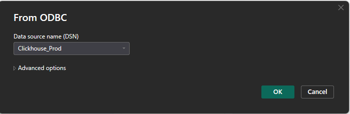
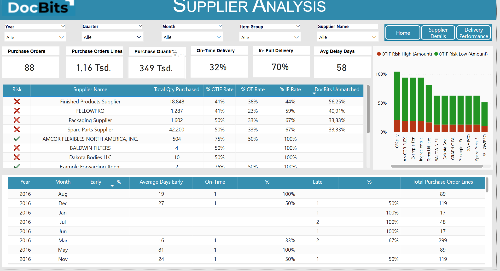

# Verbindung über ClickHouse

Diese Anleitung führt Sie durch die Verbindung von **ClickHouse** mit **Power BI Desktop** über den **ODBC-Treiber**. Sie behandelt die Treiberinstallation, die ODBC-Konfiguration, die Power-BI-Integration und die Einrichtung der Datenaktualisierung.




#### 1. ClickHouse-ODBC-Treiber installieren

* Laden Sie den aktuellen **ClickHouse-ODBC-Treiber** hier herunter:
  * [ClickHouse GitHub - clickhouse-odbc](https://github.com/ClickHouse/clickhouse-odbc)
* Starten Sie das Installationsprogramm und folgen Sie dem Setup-Assistenten.

#### 2. ODBC-Datenquelle konfigurieren

* Öffnen Sie den **ODBC-Datenquellen-Administrator (64-Bit)** über die Systemsteuerung oder die Windows-Suche.
* Wechseln Sie zur Registerkarte **System-DSN** und klicken Sie auf **Hinzufügen**.
* Wählen Sie **ClickHouse ODBC Driver** aus der Liste aus und klicken Sie auf **Fertig stellen**.
*   Füllen Sie die erforderlichen Felder aus. Die benötigten Informationen finden Sie unter:

    **DocBits** → **Settings** → **Document Processing** → **Module** → **AI Dashboard** → **ClickHouse Direct Access**

    <figure><figcaption></figcaption></figure>

    **Erforderliche Felder:**

    * **Name**: Ein Name für die Verbindung (z. B. `ClickHouse_Prod`)
    * **Description**: Eine kurze Beschreibung zur eigenen Orientierung (optional)
    * **Host**: Kopieren Sie den Host-Wert aus DocBits
    * **Port**: Kopieren Sie den Port-Wert aus DocBits
    * **Database**: Kopieren Sie den Datenbanknamen aus DocBits
    * **Username**: Kopieren Sie den Benutzernamen aus DocBits
    * **Password**: Kopieren Sie das Passwort aus DocBits

#### 3. ClickHouse mit Power BI verbinden

* Öffnen Sie **Power BI Desktop**.
*   Wählen Sie **Daten abrufen** → **ODBC** → **Verbinden**.\

    <figure><figcaption></figcaption></figure>
*   Wählen Sie in der DSN-Liste Ihre konfigurierte Datenquelle aus (z. B. `ClickHouse_Prod`).\

    <figure><figcaption></figcaption></figure>
* Klicken Sie auf **OK**. Geben Sie die Zugangsdaten erneut ein, wenn Sie dazu aufgefordert werden.

#### 4. Daten laden und transformieren

* Durchsuchen Sie im Bereich **Navigator** die Tabellen oder Ansichten und wählen Sie die zu importierenden aus.
* Wählen Sie:
  * **Laden**: für den direkten Import
  *   **Daten transformieren**: öffnet Power Query zum Aufbereiten der Daten\

      <figure><figcaption></figcaption></figure>

#### 5. Daten visualisieren

* Erstellen Sie Visualisierungen auf der Berichtsfläche.
* Ziehen Sie Felder, fügen Sie Datenschnitte hinzu, wählen Sie Diagrammtypen aus und verwenden Sie bei Bedarf **DAX**-Ausdrücke.
* &#x20;Nutzen Sie den **Power Query-Editor**, um Ihre ClickHouse-Daten zu bereinigen oder zu pivotieren, bevor Sie Visualisierungen erstellen.
* Power-BI-Dokumentation:  [https://learn.microsoft.com/en-us/power-bi/](https://learn.microsoft.com/en-us/power-bi/)

#### 6. Geplante Aktualisierung aktivieren (optional)

Die geplante Aktualisierung hängt von Lizenz bzw. Kapazität des Arbeitsbereichs, Connector und Verbindungsmodus ab. Konfigurieren Sie für diese ODBC-Verbindung ein erreichbares Gateway mit passendem Treiber, DSN und Zugangsdaten. Prüfen Sie die aktuellen Voraussetzungen in der offiziellen Dokumentation.

* So halten Sie Ihre Berichte mit ClickHouse synchron:
* Veröffentlichen Sie Ihre `.pbix`-Datei im **Power BI-Dienst**.
* Installieren Sie das **Power BI Gateway** (Standardmodus) auf einem Rechner mit Netzwerkzugriff auf ClickHouse.
* Im Power BI-Dienst:
  * Gehen Sie zu Ihrem Dataset → **Einstellungen** → **Geplante Aktualisierung**
  * Ordnen Sie Ihren DSN zu und geben Sie die Zugangsdaten an
* Weitere Informationen finden Sie [hier](https://learn.microsoft.com/en-us/power-bi/connect-data/service-gateway-deployment-guidance).&#x20;

#### 7. Beispiel-Dashboards und Datenansichten&#x20;

<figure><figcaption></figcaption></figure> <figure><figcaption></figcaption></figure> <figure><figcaption></figcaption></figure> <figure><figcaption></figcaption></figure>

[Offizielle Dokumentation — ODBC](https://learn.microsoft.com/en-us/power-query/connectors/odbc)

[Offizielle Dokumentation — psqlODBC](https://odbc.postgresql.org/docs/config-opt.html)

[Offizielle Dokumentation — Power BI](https://learn.microsoft.com/en-us/power-bi/connect-data/refresh-scheduled-refresh)
