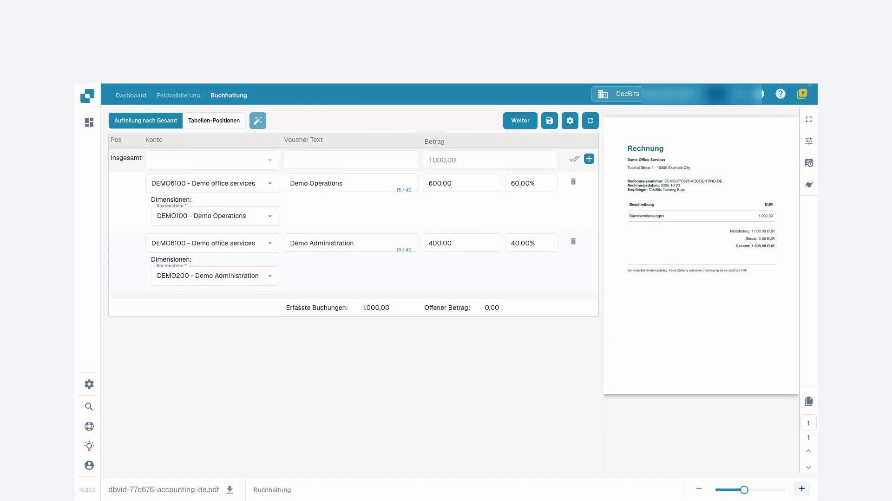

# Buchhaltung für Kostenrechnungen und indirekte Verkäufe

## Einführung

Willkommen im Modul Buchhaltung für Kostenrechnungen und indirekte Verkäufe! Dieses Modul ist darauf ausgelegt, Ihnen zu helfen, Ihre finanziellen Transaktionen innerhalb Ihres ERP-Systems effizient zu verwalten und abzugleichen. Mit Funktionen wie automatischer Datenerfassung, Dokumentenabgleich und detaillierter Nachverfolgung können Sie sicherstellen, dass Ihre Finanzunterlagen genau und aktuell sind.

<figure><figcaption></figcaption></figure>

## Erste Schritte

Um das Buchhaltungsmodul zu nutzen, stellen Sie sicher, dass Sie die erforderlichen Berechtigungen von Ihrem Systemadministrator eingerichtet haben. Sie benötigen Zugriff auf sowohl das Kostenrechnungs- als auch das Verkaufsrechnungsmodul innerhalb des ERP-Systems.

## Systemanforderungen

* Zugriff auf die Kostenrechnungs- und Verkaufsrechnungsmodule innerhalb des ERP-Systems.
* Angemessene Benutzerberechtigungen zum Anzeigen und Verarbeiten von Finanzdokumenten.

## Hauptfunktionen

1. **Automatische Datenerfassung**: Extrahiert und interpretiert automatisch Daten aus digitalen Rechnungen und anderen Dokumenten.
2. **Datenvergleich**: Vergleicht extrahierte Rechnungsdaten mit vorhandenen Bestelldaten.
3. **Abgleichsüberprüfung**: Überprüft Abgleiche basierend auf vordefinierten Regeln und Toleranzen.
4. **Abweichungsbericht**: Identifiziert und meldet Abweichungen zwischen Rechnungen und Bestellungen.
5. **Prüfpfad**: Führt ein Protokoll aller Aktionen für Compliance und Überprüfung.
6. **Dokumententraining**: Trainiert das System, neue Dokumente mit minimalem Aufwand zu erkennen, normalerweise nur einmal.
7. **Betragsteilung**: Teilt Beträge nach Abteilung für eine detaillierte finanzielle Nachverfolgung auf.
8. **Hauptbuchkontendefinition**: Das APS-Team (Accounting and Procurement System) kann das Hauptbuchkonto definieren, sobald die Daten extrahiert sind.

## Benutzeroberfläche

Die Benutzeroberfläche des Buchhaltungsmoduls umfasst typischerweise die folgenden Komponenten:

* **Dashboard**: Übersicht über den Status von Rechnungen und Verkäufen sowie aktuelle Aktivitäten.
* **Such- und Filterwerkzeuge**: Möglichkeiten, Rechnungen und Verkaufsunterlagen zu suchen und zu filtern.
* **Abgeglichene Datensätze**: Abschnitt, der erfolgreich abgeglichene Datensätze anzeigt.
* **Abweichungen**: Abschnitt, der Datensätze mit Abweichungen zeigt, die überprüft oder bearbeitet werden müssen.
* **Berichte**: Zugriff auf detaillierte Berichte und Exportoptionen.

## Schritt-für-Schritt-Anleitung zur Nutzung des Buchhaltungsmoduls

### 1. Zugriff auf das Buchhaltungsmodul

Navigieren Sie zum Buchhaltungsmodul über das Hauptmenü Ihres ERP-Systems.

### 2. Rechnungen importieren oder darauf zugreifen

* **Automatischer Import**: Wenn Ihr System für die automatische Datenerfassung eingerichtet ist, werden Rechnungen automatisch in das System importiert.
* **Manueller Upload**: Falls erforderlich, laden Sie Rechnungsdateien manuell über die bereitgestellte Benutzeroberfläche in das System hoch.

### 3. Automatisch abgeglichene Rechnungen überprüfen

* Überprüfen Sie Rechnungen, die automatisch mit Bestellungen abgeglichen wurden.
* Überprüfen Sie die Details des Abgleichs, einschließlich Artikelnummern, Mengen und Preise.

### 4. Abweichungen behandeln

* Greifen Sie auf den Abschnitt Abweichungen zu, um Rechnungen zu überprüfen, die nicht automatisch abgeglichen werden konnten.
* Passen Sie bei Bedarf Mengen oder Preise manuell an oder markieren Sie die Rechnung zur weiteren Überprüfung.

### 5. Manuelles Abgleichen

Für Rechnungen, die nicht automatisch abgeglichen wurden:

* Verwenden Sie die Such- und Filterwerkzeuge, um die entsprechende Bestellung zu finden.
* Überprüfen und gleichen Sie die Rechnung manuell mit der Bestellung ab.

### 6. Das System trainieren

* Für neue Dokumenttypen trainieren Sie das System, indem Sie ein Muster bereitstellen.
* In der Regel müssen Sie das System nur einmal trainieren, damit es ähnliche Dokumente in Zukunft genau erkennt.

### 7. Buchungen erfassen

* Navigieren Sie zur Registerkarte "Positionen", um Buchungen für jede Rechnung anzuzeigen und zu erfassen.
* Weisen Sie die Beträge den entsprechenden Konten, Kostenstellen und Dimensionen zu, die spezifisch für Infor LN/M3 sind.

**Beispiel: Buchen einer Kostenrechnung**

1. **Position auswählen**: Wählen Sie die Position für die Kostenrechnung.
2. **Konto zuweisen**: Weisen Sie das entsprechende Konto zu, z.B. "71200 - Nichtbetrieblicher Aufwand".
3. **Dimensionen festlegen**: Legen Sie zusätzliche Dimensionen wie Kostenstelle, Produktgruppe und Projekt fest.
4. **Betrag aufteilen**: Teilen Sie bei Bedarf den Betrag nach Abteilung für eine detailliertere Nachverfolgung auf.
5. **Betrag eingeben**: Geben Sie den Betrag für die Position ein.

### 8. Hauptbuchkonten definieren

* Sobald die Daten extrahiert sind, kann das APS-Team die Hauptbuchkonten definieren.
* Dies stellt sicher, dass jede Transaktion unter dem richtigen Konto für eine genaue Finanzberichterstattung erfasst wird.

### 9. Berichte erstellen

* Greifen Sie auf den Abschnitt "Berichte" zu, um detaillierte Berichte über finanzielle Transaktionen zu erstellen.
* Verwenden Sie die Exportoptionen, um Berichte für weitere Analysen oder Aufzeichnungen zu speichern.

### Beispielverwendung

1. **Dokumente hochladen**: Benutzer können verschiedene Dokumente (Rechnungen, Lieferscheine usw.) in das System hochladen.
2. **Automatischer Abgleich**: Das System gleicht die hochgeladenen Dokumente automatisch mit vorhandenen Bestellungen ab.
3. **Abgleiche überprüfen**: Benutzer können die Abgleiche überprüfen, Details verifizieren und Statusanzeigen sehen.
4. **Abweichungen beheben**: Alle Unstimmigkeiten oder Abweichungen werden hervorgehoben, damit der Benutzer sie manuell überprüfen und korrigieren kann.
5. **Daten exportieren**: Abgeglichene Daten können für die weitere Verarbeitung oder Aufzeichnung exportiert werden.

## Videoanleitung: Kostenrechnung kontieren und auf Kostenstellen aufteilen

Figur und Stimme sind synthetisch. Die Aufnahme zeigt die echte DocBits-Testoberfläche mit synthetischen Schulungsrechnungen.


Kostenrechnung kontieren und auf Kostenstellen aufteilen


[Mit Untertiteln und Kapiteln ansehen](https://docbits-videos.fra1.cdn.digitaloceanspaces.com/settings-assistant/cost-invoice-accounting-customer/v1/de.html)

Einzelne native Produktbeschriftungen können abweichend übersetzt sein. Technische Feld-IDs bleiben erhalten.

Zuerst prüfe ich unsere Schulungsrechnung im Original. Der Lieferant, die Rechnungsnummer und der Betrag müssen zum Beleg passen. In diesem Beispiel sind es tausend Euro ohne Steuer. Die Rechnung enthält keine Bestellung.

Ich öffne die Kontierung und arbeite mit der Aufteilung nach dem Gesamtbetrag. Die verfügbaren Sachkonten und Kostenstellen wurden vorher von unserem Administrator eingerichtet. Ich wähle nur Werte, die fachlich zu dieser Rechnung passen.

Mit der Aufteilungsfunktion lege ich zwei Teilzeilen an. DocBits beginnt hier mit einer gleichmäßigen Verteilung. Für unser Beispiel brauche ich aber sechzig und vierzig Prozent. Die ursprüngliche Rechnungssumme bleibt dabei tausend Euro.

Für beide Teilzeilen wähle ich das vorbereitete Sachkonto für Bürodienstleistungen. Die erste Zeile gehört zur Kostenstelle für den operativen Bereich, die zweite zur Verwaltung. Die Kostenstelle ist in diesem Beispiel ein Pflichtfeld. Zusätzlich ergänze ich einen verständlichen Buchungstext.

In der ersten Zeile trage ich sechzig Prozent ein und bestätige mit Enter. Ich warte, bis der Betrag sechshundert Euro zeigt. Danach bestätige ich in der zweiten Zeile vierzig Prozent und warte auf vierhundert Euro. So kontrolliere ich jede Neuberechnung, bevor ich weiterarbeite.

Jetzt prüfe ich die beiden Beträge, Sachkonten und Kostenstellen zusammen. Sechshundert plus vierhundert ergibt tausend Euro. Auch die erfasste Summe muss tausend Euro zeigen, und der offene Restbetrag muss null sein. Eine abweichende Summenanzeige kläre ich vor dem Speichern.

<figure><figcaption>
Kostenstellen mit abgestimmter Gesamtsumme von 1.000 Euro
</figcaption></figure>

Ich speichere die Kontierung und warte auf die Rückmeldung. Anschließend lade ich die Rechnung erneut. Beide Kostenstellen, die Prozentwerte und die Beträge sind weiterhin vorhanden. Ich prüfe auch nach dem Neuladen die Summe und den Restbetrag.

<figure><figcaption>
Kontierung gespeichert und nach erneutem Öffnen geprüft
</figcaption></figure>
