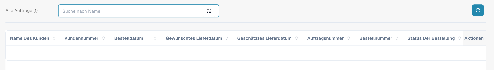
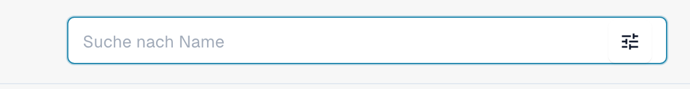

# Avis-Dashboard

Dieser Abschnitt bietet einen detaillierten Überblick über alle Vorab-Sendungen (Avise). Er enthält eine Suchleiste mit verschiedenen Filtern, die Sie auswählen können, um Ihre Ergebnisse schnell einzugrenzen. Darüber hinaus können Sie die Anordnung der Spaltenüberschriften mithilfe der Drag-and-Drop-Funktion individuell anpassen, um ein maßgeschneiderteres Anzeigeerlebnis zu erhalten.

<figure><figcaption>
Aktuelles deutsches Avis-Dashboard mit Suche und Spaltenüberschriften. Vorhandene Auftragswerte sind aus Datenschutzgründen ausgeblendet; die Aufnahme zeigt keinen leeren Datenbestand.
</figcaption></figure>

<figure><figcaption>
Detail der deutschen Suche nach Name mit der Schaltfläche zum Öffnen der Filter im Avis-Dashboard.
</figcaption></figure>
