# AI Table

Die **KI Extrahierte Tabelle** ist die Positionstabelle, die DocBits mit KI liest, wenn ein Lieferant keine trainierten Tabellenregeln hat. Sie erscheint im Validierungsbildschirm unterhalb der Kopffelder. Diese Seite erklärt jedes Bedienelement rund um die Tabelle: wie Sie eine falsche Spalte korrigieren, wie Sie der KI Anweisungen geben, wie Sie eine Änderung testen, bevor Sie sie behalten, wie Sie sehen, was die KI getan hat, was der Assistent für Sie tun kann und was nicht, und wer was speichern darf.

## Wann Sie die KI-Tabelle erhalten

* Ein Administrator hat **AI-Tabellen-Extraktion** eingeschaltet (Einstellungen → Dokumentenverarbeitung → Klassifizierung und Extraktion, siehe [Einstellungen für Administratoren](./#einstellungen-fur-administratoren)). Ist sie ausgeschaltet, zeigt der Tabellenbereich _Hier wird die KI-Tabelle angezeigt. Aktivieren in …_.
* Der Lieferant hat **keine gespeicherten Regeln**. Sobald jemand die Tabelle des Lieferanten trainiert und die Regeln speichert, ersetzen die gespeicherten Regeln die KI-Tabelle für diesen Lieferanten. Die Zeilen erscheinen dann im Tab **Extrahierte Tabelle**, und der Tab **KI Extrahierte Tabelle** ist ausgegraut, mit dem Tooltip _Tabelle AI Deaktiviert: Es wird eine benutzerdefinierte Tabelle verwendet._
* Ausnahme: Spalten, die in den Tabellenspalten-Einstellungen mit **KI nutzen** markiert sind, werden auch bei Lieferanten mit gespeicherten Regeln von der KI gefüllt, siehe [KI pro Spalte nutzen](./#ki-pro-spalte-nutzen).

Welche KI-Stufe die Tabelle liest (Fast, Full, Nexus), wird pro Organisation festgelegt und kann pro Lieferant überschrieben werden, siehe Lieferantenspezifisches KI-Modell.

## Die KI-Tabelle im Überblick

<figure>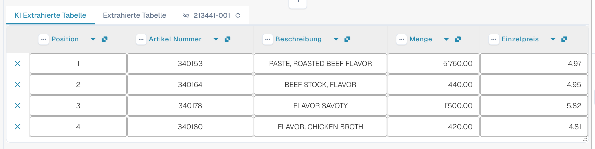<figcaption>
Die zwei Tabs, die KI Extrahierte Tabelle und ihre Spaltenüberschriften.
</figcaption></figure>

* **Tabs.** _KI Extrahierte Tabelle_ zeigt, was die KI gelesen hat. _Extrahierte Tabelle_ ist die klassische Tabelle aus trainierten Regeln. Der KI-Tab öffnet sich standardmäßig, wenn das Dokument eine KI-Tabelle hat.
* **Spaltenüberschrift.** Jede Spalte zeigt ihren Namen, ein kleines **Herkunfts**-Symbol (fahren Sie mit der Maus darüber: _KI · Zuordnung_, _KI · Synonym_ und so weiter zeigen, wie die KI die Spalte zugeordnet hat), ein **Drei-Punkte**-Menü und, bei einer zugeordneten Spalte, eine **Namensschaltfläche**, mit der Sie ändern können, um welche Spalte es sich handelt.
* **Zeilenschaltflächen.** Das **x** am Zeilenanfang entfernt die Zeile. Per Rechtsklick auf eine Zeile erscheint _Als Zusatzkosten auswählen_ / _Als zusätzliche Kosten entfernen_.
* **Symbolleiste im Fußbereich.** Die Symbole am unteren Bildschirmrand fügen Spalten und Zeilen hinzu oder blenden sie aus, siehe [Symbolleiste im Fußbereich](./#symbolleiste-im-fussbereich).
* **Karte „Anweisungen für die KI“** unter der Tabelle: Prompt, zusätzliche Spalten, **Änderung testen**, **Anwenden**, **Als Training speichern**, **Löschen**, **Exportieren**, siehe [KI-Anweisungen geben](./#ki-anweisungen-geben).


Die Spaltenfunktionen arbeiten nur, wenn Sie das Dokument bearbeiten können. Sind sie ausgegraut, ist das Dokument schreibgeschützt oder in einer anderen Sitzung gesperrt. Meldet das rote Banner, dass das Dokument von Ihrem eigenen Benutzer in einer anderen Sitzung gesperrt ist, übernimmt **Freischalten** die Sperre.


## Eine Spalte ändern

### Die richtige Spalte wählen (neu zuordnen)

Verwenden Sie dies, wenn ein Wert in der falschen Spalte steht, zum Beispiel der Nettobetrag in _Gesamtbetrag_ oder _Menge_ leer ist, obwohl die Rechnung sie enthält.

1. Klicken Sie in der Überschrift auf den **Spaltennamen**.
2. Wählen Sie die konfigurierte Tabellenspalte, zu der die Werte tatsächlich gehören.

<figure>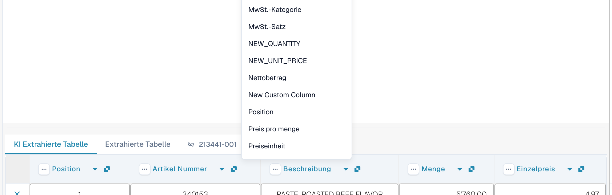<figcaption>
Klicken Sie auf den Spaltennamen und wählen Sie die gewünschte Spalte. Die Liste zeigt jede konfigurierte Tabellenspalte.
</figcaption></figure>

DocBits formatiert die Tabelle sofort neu, nur für dieses Dokument. Wird die gewählte Spalte bereits von einer anderen Spalte verwendet, warnt ein Dialog, dass die andere Spalte danach nicht mehr zugeordnet ist. Bestätigen Sie, um fortzufahren. Die andere Spalte zeigt dann das Fehlersymbol _Wählen Sie aus der Dropdown-Liste eine Spalte aus, die Sie zuordnen möchten._, damit Sie auch für sie eine Spalte wählen können.

### Das Drei-Punkte-Menü

<figure>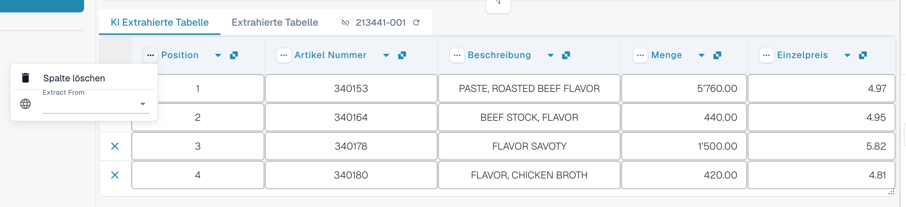<figcaption>
Das Drei-Punkte-Menü einer Spalte.
</figcaption></figure>

| Eintrag                 | Was er bewirkt                                                                                                                                                                                                                                                          |
| ----------------------- | ----------------------------------------------------------------------------------------------------------------------------------------------------------------------------------------------------------------------------------------------------------------------- |
| **Spalte löschen**      | Blendet die Spalte aus. Eine Bestätigung meldet _Änderungen werden verworfen_; wählen Sie **Fertig**. Die Tabelle wird ohne die Spalte neu aufgebaut. Mit **Tabellenspalte wiederherstellen** in der Symbolleiste im Fußbereich holen Sie ausgeblendete Spalten zurück. |
| **Spalte deaktivieren** | Für eine Spalte, die Sie selbst hinzugefügt haben: blendet sie aus, ohne die KI erneut auszuführen.                                                                                                                                                                     |
| **Betragsformatierung** | Nur für Betragsspalten. Legen Sie fest, wie Zahlen gelesen werden (Dezimal- und Tausendertrennzeichen). **Auto** lässt DocBits entscheiden.                                                                                                                             |
| **Extract From**        | Weist die KI an, den Wert aus der Zeile **Above** (darüber) oder **Below** (darunter) der Spaltenbezeichnung zu übernehmen. Lassen Sie das Feld leer, wenn der Wert an der üblichen Stelle steht.                                                                       |

### Symbolleiste im Fußbereich

<figure><figcaption>
Die Tabellensymbole im Fußbereich des Validierungsbildschirms, von links nach rechts.
</figcaption></figure>

| Symbol (Tooltip)                                                                  | Was es bewirkt                                                                                                                                                                                                                                          |
| --------------------------------------------------------------------------------- | ------------------------------------------------------------------------------------------------------------------------------------------------------------------------------------------------------------------------------------------------------- |
| **Zur Ansicht der Tabellenextraktion wechseln**                                   | Öffnet das klassische Tabellentraining. Hat das Dokument eine KI-Tabelle, warnt DocBits: _Die Tabelle wurde bereits von der KI extrahiert. Möchten Sie manuell trainieren? In Zukunft wird die KI-Tabelle für diesen Lieferanten nicht mehr extrahiert_ |
| **Leere gemappte Spalten hinzufügen**                                             | Öffnet **Einstellungen für Spalten**, um konfigurierte Spalten hinzuzufügen, die die KI nicht gefüllt hat, damit Sie die Werte von Hand eintragen können.                                                                                               |
| **Nicht zugeordnete Spalten anzeigen** / **Nicht zugeordnete Spalten ausblenden** | Zeigt oder verbirgt die Spalten, die die KI geliefert hat und die keiner konfigurierten Spalte zugeordnet sind. Standardmäßig sind sie ausgeblendet. Das ändert nur die Ansicht dieses Dokuments.                                                       |
| **Tabelle für diesen Lieferanten blockieren**                                     | Schaltet die Tabellenextraktion für den Lieferanten aus.                                                                                                                                                                                                |
| **Tabelle löschen**                                                               | Leert die Tabelle im Editor.                                                                                                                                                                                                                            |
| **Neue Tabellenspalte hinzufügen**                                                | Fügt eine benutzerdefinierte Spalte hinzu. Nur für Administratoren.                                                                                                                                                                                     |
| **Neue Tabellenzeile hinzufügen**                                                 | Fügt eine leere Zeile hinzu.                                                                                                                                                                                                                            |
| **Tabellenvalidierung ignorieren**                                                | Ignoriert die Tabellenvalidierung für dieses Dokument.                                                                                                                                                                                                  |
| **Tabellenspalte wiederherstellen**                                               | Holt jede Spalte zurück, die Sie gelöscht haben.                                                                                                                                                                                                        |

<figure>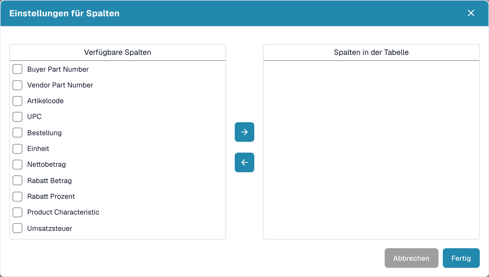<figcaption>
Einstellungen für Spalten: Verschieben Sie Spalten mit den Pfeiltasten von <em>Verfügbare Spalten</em> nach <em>Spalten in der Tabelle</em> und wählen Sie dann <strong>Fertig</strong>.
</figcaption></figure>

## KI-Anweisungen geben

Unter der Tabelle sagt die Karte **Anweisungen für die KI**, was die KI anders machen soll. Sie hat zwei Eingabefelder und vier Schaltflächen, die Sie ständig benutzen.

<figure>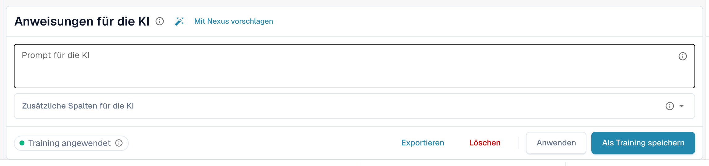<figcaption>
Die Karte Anweisungen für die KI.
</figcaption></figure>

* **Prompt für die KI.** Schreiben Sie eine Anweisung pro Zeile, in einfacher Sprache. Tippen Sie **@**, um einen Spaltennamen einzufügen, damit die KI genau weiß, welche Spalte Sie meinen.
* **Zusätzliche Spalten für die KI.** Wählen Sie Spalten, die die KI zusätzlich zu den üblichen liefern muss.
* **Trainingsstatus.** Der Chip zeigt **Training angewendet**, wenn im letzten Lauf ein gespeichertes Training verwendet wurde, andernfalls **Kein Training angewendet**.

<figure>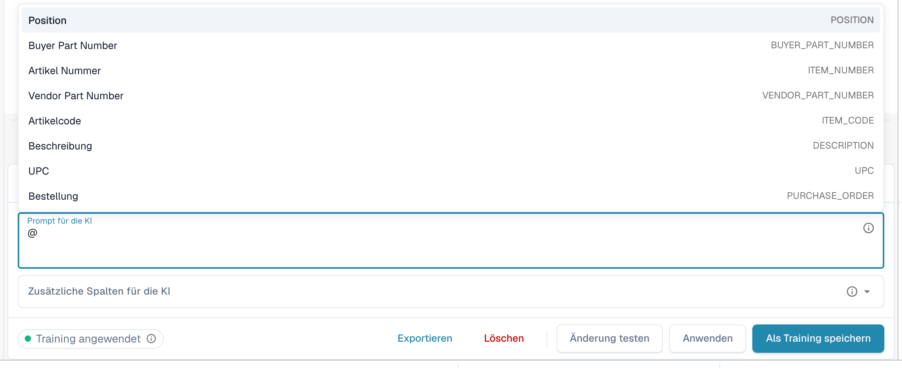<figcaption>
Tippen Sie im Prompt <strong>@</strong>, um eine Spalte zu wählen. Sobald sich etwas geändert hat, erscheint <strong>Änderung testen</strong> neben <strong>Anwenden</strong>.
</figcaption></figure>


Ein geänderter Prompt lässt die KI die Tabelle erneut lesen, und das kann jede Spalte verändern, nicht nur die, an die Sie gedacht haben. Prüfen Sie anschließend die gesamte Tabelle.


### Mit Nexus vorschlagen

Sie wissen nicht, was Sie schreiben sollen? Klicken Sie auf **Mit Nexus vorschlagen**. DocBits sieht sich die Extraktion dieses Dokuments an und schlägt Anweisungen oder zusätzliche Spalten vor. Nichts wird angewendet, bis Sie auf **Einfügen** (fügt die Zeile Ihrem Prompt hinzu) oder **Add column** klicken.

<figure>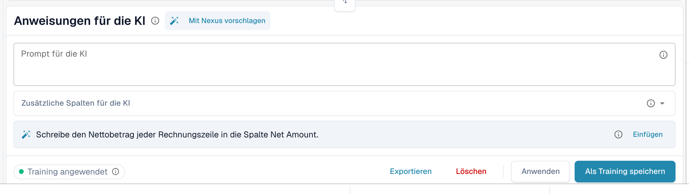<figcaption>
Ein Vorschlag von Nexus. <strong>Einfügen</strong> kopiert ihn in den Prompt.
</figcaption></figure>

Hat Ihre Organisation den KI-Berater ausgeschaltet, teilt DocBits Ihnen das mit, statt Vorschläge zu machen.

### Testen, anwenden, speichern: was jede Schaltfläche bewirkt

| Schaltfläche                                            | Was passiert                                                                                                                                                                                                                             | Für die nächsten Dokumente gespeichert? |
| ------------------------------------------------------- | ---------------------------------------------------------------------------------------------------------------------------------------------------------------------------------------------------------------------------------------- | --------------------------------------- |
| **Änderung testen**                                     | Führt Ihre Änderung aus und zeigt einen Vergleich. **Es wird nichts geschrieben**, weder in das Dokument noch als Regel.                                                                                                                 | Nein                                    |
| **Anwenden**                                            | Liest die Tabelle mit Ihren Änderungen erneut und übernimmt das Ergebnis in dieses Dokument im Editor. Dauerhaft wird es erst, wenn Sie das Dokument speichern.                                                                          | Nein                                    |
| **Als Training speichern** (Tooltip _Regeln speichern_) | Speichert Prompt, zusätzliche Spalten, Spaltenzuordnung, ausgeblendete Spalten, Betragsformate und **Extract From**-Einstellungen für dieses Lieferantenlayout. Die nächsten Dokumente dieses Layouts werden auf dieselbe Weise gelesen. | Ja                                      |
| **Löschen** (Tooltip _Regeln löschen_)                  | Löscht die gespeicherten Tabellenregeln dieses Lieferantenlayouts ohne zusätzliche Bestätigung und führt die KI erneut ohne sie aus. Entfernt auch klassisches Tabellentraining, das für dasselbe Layout gespeichert wurde.              | Entfernt sie                            |
| **Exportieren**                                         | Lädt die Tabelle als CSV-Datei herunter.                                                                                                                                                                                                 | Nein                                    |


Überschriften-Zuordnungen, **Spalte löschen**, **Betragsformatierung**, **Extract From** und **Tabellenspalte wiederherstellen** verhalten sich wie **Anwenden**: Sie bauen die Tabelle für dieses Dokument sofort neu auf und werden mit dem Dokument gespeichert, nicht als Regel. Nur **Als Training speichern** bringt DocBits etwas für die nächsten Dokumente bei.


Hat das Dokument bereits Zeilen, die einer Bestellung zugeordnet sind, warnen Anwenden und Speichern, dass **Bestellzuordnungen verloren gehen können**. Wählen Sie **Fertig**, um fortzufahren, und gleichen Sie anschließend erneut ab.

<figure>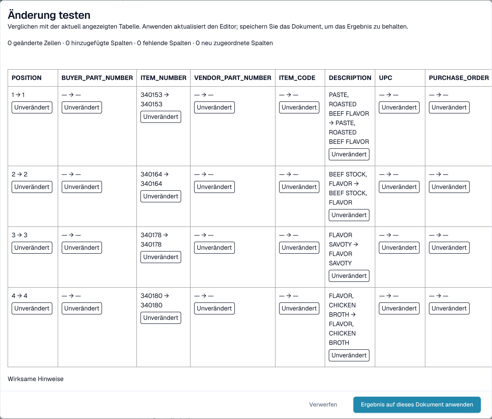<figcaption>
Der Dialog <strong>Änderung testen</strong> vergleicht das neue Ergebnis mit der Tabelle, die Sie gerade sehen.
</figcaption></figure>

Der Dialog **Änderung testen** zählt, was sich ändern würde: geänderte Zellen, hinzugefügte Spalten, fehlende Spalten und neu zugeordnete Spalten. Jede Zelle ist als **Hinzugefügt**, **Geändert**, **Fehlend**, **Neu zugeordnet** oder **Unverändert** markiert. Unten listet der Dialog die Nachweise für den Lauf auf: _Wirksame Hinweise_, _Ausgewähltes Training_, _Spaltenrichtlinie_ und _Überschreibungen aus der Anfrage verwendet_. Wählen Sie **Ergebnis auf dieses Dokument anwenden**, um es zu übernehmen (speichern Sie dann das Dokument), oder **Verwerfen**, um es zu verwerfen. Ändern Sie den Prompt nach dem Testen, gilt das Ergebnis als veraltet, und Sie müssen erneut testen.

Nach **Als Training speichern** meldet DocBits, dass das Training bei der nächsten Neuverarbeitung verwendet wird; der aktuelle Lauf hat es noch nicht verwendet. Prüfen Sie beim nächsten Dokument des Lieferanten, dass der Chip **Training angewendet** anzeigt.

## Sehen, was die KI getan hat

Vier Schaltflächen unter der Tabelle erklären die Extraktion.

<figure>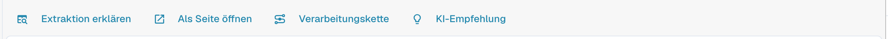<figcaption>
Die Erklär-Schaltflächen.
</figcaption></figure>

* **Extraktion erklären** öffnet _Wie die KI-Tabelle auf die Werte kommt_: das Dokument, die KI-Extraktion (Stufe, Anzahl der Rohspalten und Zeilen), die Zuordnung zu Ihrer Struktur und das Ergebnis pro Spalte mit der Herkunft jeder Spalte.
* **Als Seite öffnen** zeigt dieselbe Erklärung in einem eigenen Fenster.
* **Verarbeitungskette** listet die Verarbeitungsschritte des Dokuments auf und zeigt, wo es stehen geblieben ist.
* **KI-Empfehlung** fragt Nexus, wie die Extraktion besser werden kann, und listet konkrete Empfehlungen auf, zum Beispiel _Strukturierte Ausgabe einschalten_ oder _Anleitungs-Tag hinzufügen_ für Net Amount. Es ist nur ein Rat; Sie entscheiden.

<figure>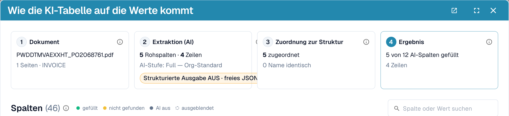<figcaption>
Extraktion erklären: vier Schritte vom Dokument zum Ergebnis.
</figcaption></figure>

<figure>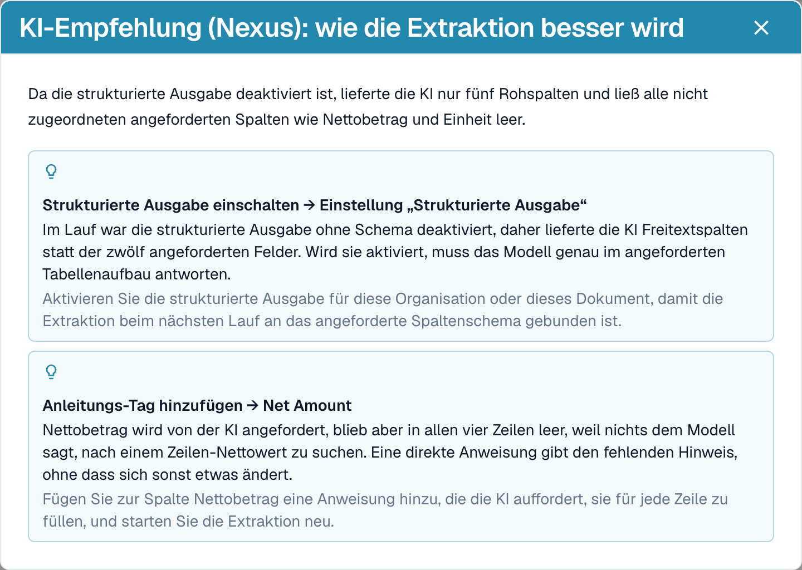<figcaption>
Die KI-Empfehlung schlägt die nächsten Schritte vor.
</figcaption></figure>

<figure>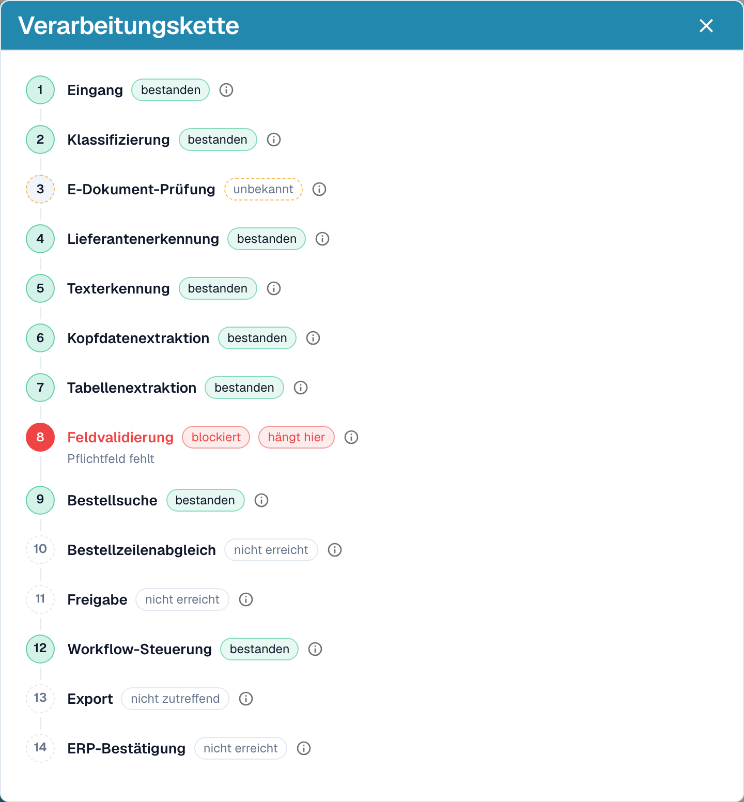<figcaption>
Die Verarbeitungskette zeigt, wo ein Dokument stehen geblieben ist, hier bei der Feldvalidierung.
</figcaption></figure>

Diese Erklärungen gehören zum Modul „Analytics Dashboard“. Ohne die Modullizenz oder wenn Ihre Rolle keinen Zugriff auf den Tab Analytics hat, sagt DocBits Ihnen, was Sie bei Ihrem Administrator anfragen müssen (das Modul unter Einstellungen → Module aktivieren oder den Tab für Ihre Rolle unter Einstellungen → Rollen freigeben).

## Praktische Beispiele

| Situation                                                                                | Was zu tun ist                                                                                                                                                                                                                                                                                                 |
| ---------------------------------------------------------------------------------------- | -------------------------------------------------------------------------------------------------------------------------------------------------------------------------------------------------------------------------------------------------------------------------------------------------------------- |
| Ein Wert steht in der falschen Spalte, zum Beispiel steht _Einzelpreis_ in _Nettobetrag_ | Klicken Sie auf den Spaltennamen und ordnen Sie ihn der richtigen Spalte zu. Wählen Sie dann **Als Training speichern**, wenn der Lieferant es immer so druckt.                                                                                                                                                |
| Eine Spalte bleibt in jeder Zeile leer, zum Beispiel _Rabatt Betrag_                     | Fügen Sie die Spalte unter **Zusätzliche Spalten für die KI** hinzu oder schreiben Sie eine Anweisung mit der Bezeichnung, die die Rechnung verwendet, etwa _Fülle die Spalte Rabatt Betrag aus der Spalte „Preisnachlass“ der Rechnung._ Prüfen Sie mit **Änderung testen** und wählen Sie dann **Anwenden**. |
| Die KI weiß nicht, was sie tun soll (nichts im Prompt)                                   | Klicken Sie auf **Mit Nexus vorschlagen** und fügen Sie ein, was passt.                                                                                                                                                                                                                                        |
| Ein Preis muss dividiert oder gerundet werden                                            | Schreiben Sie die Regel in den Prompt, zum Beispiel _Der Einzelpreis ist der Nettobetrag geteilt durch die Menge._                                                                                                                                                                                             |
| Beträge werden mit den falschen Trennzeichen gelesen (1.234,50 gegenüber 1,234.50)       | Öffnen Sie das Drei-Punkte-Menü der Spalte, wählen Sie **Betragsformatierung** und wählen Sie das richtige Format.                                                                                                                                                                                             |
| Die Bezeichnung steht unter dem Wert                                                     | Drei-Punkte-Menü → **Extract From** → **Below**.                                                                                                                                                                                                                                                               |
| Eine Spalte wird für diesen Lieferanten nicht gebraucht                                  | Drei-Punkte-Menü → **Spalte löschen**. **Als Training speichern** hält sie für den Lieferanten ausgeblendet.                                                                                                                                                                                                   |
| Eine Zeile ist falsch oder fehlt                                                         | Entfernen Sie sie mit dem **x** oder fügen Sie mit **Neue Tabellenzeile hinzufügen** eine hinzu und tragen Sie die Werte ein.                                                                                                                                                                                  |
| Dieselben Korrekturen sind immer wieder nötig                                            | Verwenden Sie **Als Training speichern**, damit die nächsten Dokumente dieses Lieferanten richtig herauskommen. Bei komplexen Layouts [trainieren Sie stattdessen die Tabelle](../../../administration-and-setup/setup/document-training/training-line-fields-table-training/).                                |


Nicht jede umbrochene Beschreibungszeile lässt sich mit einer Anweisung reparieren. Sind die Zeilen einer Position auf mehrere Zeilen verteilt, bearbeiten Sie die Zeilen oder verwenden Sie das klassische Tabellentraining.


## Der Assistent und die KI-Tabelle

Klicken Sie auf den **Assistenten** (Lampen-Symbol neben Speichern im Validierungsbildschirm), um Fragen zum Dokument zu stellen.

<figure>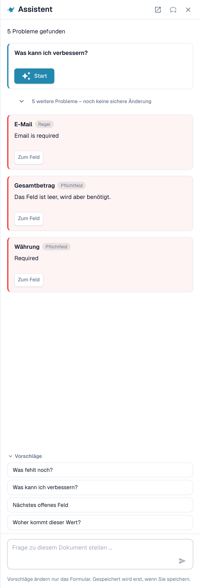<figcaption>
Der Assistent listet die offenen Probleme auf und bietet Fragen an.
</figcaption></figure>

**Was der Assistent für Tabellen tut.** Er kann Sie zu einer Tabellenzelle führen und, wenn Sie das Dokument bearbeiten dürfen, einen Zellenwert setzen oder eine Tabellenzeile hinzufügen. Das funktioniert in der KI Extrahierten Tabelle ebenso wie in der Extrahierten Tabelle. Er beantwortet auch Fragen wie _Was fehlt noch?_ und _Was kann ich verbessern?_.

<figure>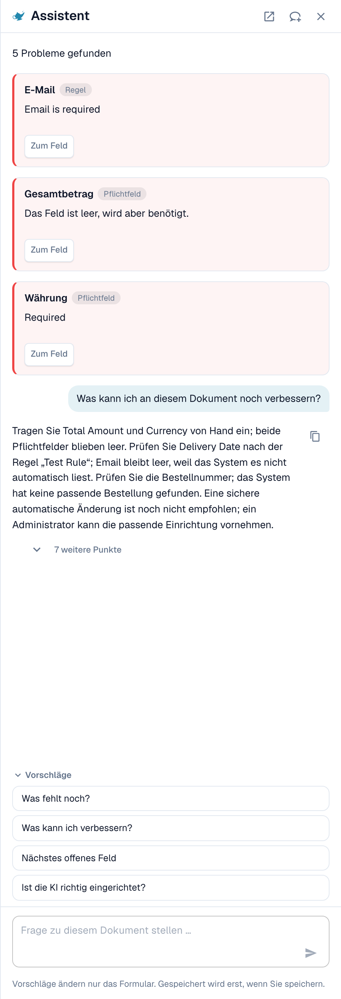<figcaption>
Fragen Sie <em>Was kann ich verbessern?</em>, um eine kurze Liste zu erhalten, was Sie als Nächstes beheben sollten.
</figcaption></figure>

**Was er nicht tut.** Der Assistent ändert **keine** KI-Anweisungen, zusätzlichen Spalten, Spaltenzuordnung oder Trainings. Verwenden Sie dafür die Karte **Anweisungen für die KI** (**Mit Nexus vorschlagen**, **Änderung testen**, **Anwenden**, **Als Training speichern**). Administratoren können fragen _Ist die KI richtig eingerichtet?_, um Hinweise zu den Einstellungen zu sehen, zum Beispiel zur Kombination von KI-Tabellenlesung mit gespeicherten Tabellenregeln.

### Einem Administrator eine Regel vorschlagen

Viele Probleme kommen von einem **Feld**, nicht von der Tabelle: eine E-Mail, die immer erforderlich, aber leer ist, ein Datum im falschen Format, eine Lieferanten-ID, die eine Nachschlageregel braucht. Dafür kann jeder, der das Dokument öffnen kann, über den Assistenten einen Vorschlag senden:

1. Fragen Sie _Was kann ich verbessern?_ oder öffnen Sie im Assistenten eine Befundkarte.
2. Sind Sie Administrator, bietet die Karte **Anwenden**. Sind Sie es nicht, weist sie darauf hin, dass ein Administrator diesen Vorschlag prüfen kann, und zeigt **Suggest improvement**. Klicken Sie darauf.
3. DocBits meldet, dass Ihr Vorschlag an die Administratoren gesendet wurde. Hat jemand denselben Vorschlag schon früher gesendet, wird Ihre Anfrage darauf mitgezählt, statt einen zweiten zu erzeugen.
4. Die Karte zeigt dann den Status „angefragt“, später „umgesetzt“ oder **Abgelehnt** (mit der Begründung, falls der Administrator eine angegeben hat).

Der Vorschlag kann eine **Transformationsregel**, eine **Validierungsregel** oder ein **Lookup** sein. Sie senden ihn aus dem Dokument, und der Server erstellt den Regelentwurf selbst aus dem gefundenen Problem, Sie müssen also nichts schreiben. Die Zahl der Vorschläge ist auf 20 pro Benutzer und Stunde begrenzt.


**KI-Tabellenanweisungen, Spaltenzuordnung oder Training** können Sie auf diesem Weg nicht vorschlagen. Braucht eine Tabelle eine Korrektur, korrigieren Sie sie im Dokument und informieren Sie einen Administrator, oder bitten Sie Ihren Administrator, bei einem Dokument dieses Lieferanten **Als Training speichern** zu wählen. Administratoren können Regeln speichern; siehe [Wer darf was](./#wer-darf-was).


**Was der Administrator sieht.** Administratoren werden per Aufgabe und E-Mail benachrichtigt. Sie öffnen **Touchless Intelligence** und finden den Vorschlag unter **Offene Verbesserungen** (Tab _Offen_, Verlauf unter _Verlauf_). Ein Klick öffnet ein Seitenpanel mit Beispieldokumenten und einer Vorschau. Der Administrator kann **Genehmigen** oder **Ablehnen**. Beim Genehmigen legt **Switch on right away** fest, ob die neue Regel sofort aktiv ist; ohne diese Option wird die Regel inaktiv angelegt, und der Administrator schaltet sie in der Regelliste ein. Beim Ablehnen wird nach einer Begründung und optional nach einer Notiz für die Anfragenden gefragt. Siehe [Touchless Intelligence](../../../administration-and-setup/analytics-dashboard/touchless-intelligence/).

<figure>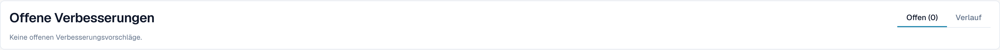<figcaption>
Administratoren finden Vorschläge unter <strong>Offene Verbesserungen</strong>.
</figcaption></figure>

## Wer darf was

| Aktion                                                                                                                                        | Wer                                                                                                                                                                                                                                                   |
| --------------------------------------------------------------------------------------------------------------------------------------------- | ----------------------------------------------------------------------------------------------------------------------------------------------------------------------------------------------------------------------------------------------------- |
| Eine Spalte neu zuordnen, **Spalte löschen**, **Betragsformatierung**, **Extract From**, **Änderung testen**, **Anwenden**, Zeilen bearbeiten | Jeder, der das Dokument bearbeiten kann                                                                                                                                                                                                               |
| **Als Training speichern**                                                                                                                    | Jeder, der bearbeiten kann, es sei denn, die Organisationseinstellung **Extraktionsregeln speichern (nur für Administratoren)** ist eingeschaltet. Dann können nur Organisationsadministratoren Regeln speichern; andere erhalten eine Fehlermeldung. |
| **Neue Tabellenspalte hinzufügen**                                                                                                            | Administratoren                                                                                                                                                                                                                                       |
| Über den Assistenten eine Regel vorschlagen                                                                                                   | Jeder, der das Dokument öffnen kann                                                                                                                                                                                                                   |
| Einen Vorschlag genehmigen oder ablehnen                                                                                                      | Administratoren                                                                                                                                                                                                                                       |
| **Extraktion erklären**, **KI-Empfehlung**                                                                                                    | Benutzer, deren Rolle Zugriff auf das Modul Analytics Dashboard hat                                                                                                                                                                                   |

## Einstellungen für Administratoren

Öffnen Sie **Einstellungen → Dokumentenverarbeitung → Dokumenttypen → Klassifizierung und Extraktion**, Tab **Allgemein**, Abschnitt **Extraktion**.

<figure>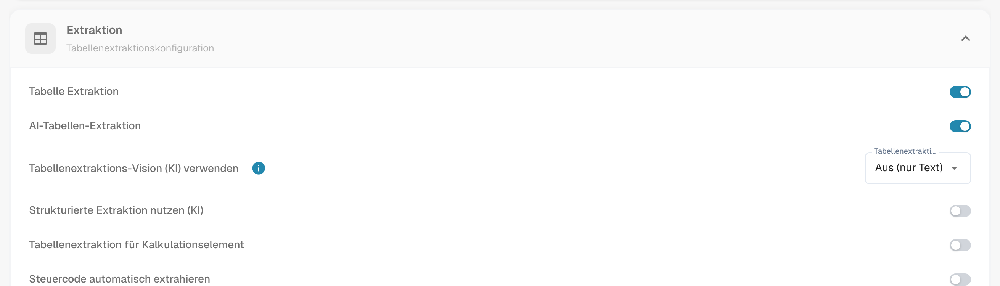<figcaption>
Die Schalter, die entscheiden, ob es die KI-Tabelle gibt.
</figcaption></figure>

* **Tabelle Extraktion** schaltet die klassische Tabelle ein.
* **AI-Tabellen-Extraktion** schaltet die KI-Tabelle für die Organisation ein oder aus.
* **Strukturierte Extraktion nutzen (KI)**: Die KI liefert die Tabelle in einer festen Struktur, die direkt auf Ihre konfigurierten Spalten abgebildet wird, statt die Überschriften des Lieferanten zu übernehmen. Die Spaltennamen entsprechen dann immer Ihrer Konfiguration; eine Spalte, die der Lieferant druckt, die Sie aber nicht konfiguriert haben, wird nicht extrahiert.
* **Extraktionsregeln speichern (nur für Administratoren)**: Ist sie eingeschaltet, können nur Organisationsadministratoren Extraktionsregeln speichern und exportieren.

<figure>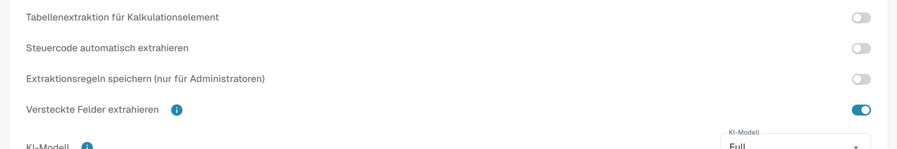<figcaption>
<strong>Extraktionsregeln speichern (nur für Administratoren)</strong> steuert, wer <strong>Als Training speichern</strong> verwenden darf.
</figcaption></figure>

### KI pro Spalte nutzen

Jede Tabellenspalte hat ein Kennzeichen **KI nutzen** (Einstellungen → Globale Einstellungen → Dokumenttypen → [Tabellenspalten](../../../administration-and-setup/settings/global-settings/document-types/table-columns/)). Ist es gesetzt, füllt die KI diese Spalte auch dann, wenn der Lieferant gespeicherte Regeln hat; die übrigen Spalten kommen weiterhin aus den Regeln. Typische Anwendung: eine Freitext-Beschreibungsspalte, die trainierte Regeln schlecht erfassen.

Die KI errät diese Spalte dann aus der gesamten Zeile. Setzt sie dort durchgehend den falschen Wert ein, zum Beispiel die Positionssumme in _Zusatzkosten_, schalten Sie **KI nutzen** für diese Spalte aus oder fügen Sie eine Anweisung hinzu, die der KI sagt, was die Spalte ist.

## Verwandte Seiten

* [KI-Tabellen-Tags und Anweisungen](ai-table-tags.md)
* [Training Line Fields/Table Training](../../../administration-and-setup/setup/document-training/training-line-fields-table-training/)
* [Touchless Intelligence](../../../administration-and-setup/analytics-dashboard/touchless-intelligence/)
