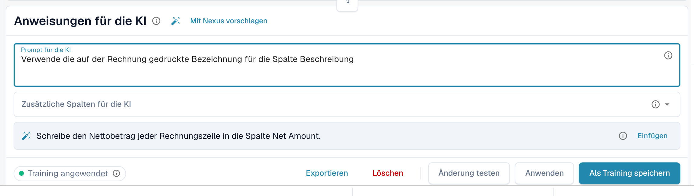

# KI-Tabellen-Tags und Anweisungen

Tags sind die Art, der KI zu sagen, was sie mit einer Tabelle tun soll. In der Karte **Anweisungen für die KI** unter der KI-Tabelle (siehe [KI-Tabelle](README.md)) geben Sie zwei Arten von Tags an:

| Art | Wo Sie sie eingeben | Was die KI damit tut |
| --- | --- | --- |
| **Anweisung** | **Prompt für die KI**, eine Anweisung pro Zeile | Befolgt sie beim Lesen der Tabelle, zum Beispiel wie zu rechnen ist oder welche Bezeichnung zu verwenden ist. |
| **Spalte** | **Zusätzliche Spalten für die KI** | Muss diese Spalte zusätzlich zu den üblichen liefern, auch wenn das Dokument sie nicht eindeutig beschriftet. |

Beide werden zusammen als KI-Tags des Lieferanten gespeichert, wenn Sie **Als Training speichern** wählen.

<figure><figcaption>
Eine Anweisung pro Zeile im Feld <strong>Prompt für die KI</strong>.
</figcaption></figure>

## Tags Schritt für Schritt hinzufügen

1. Öffnen Sie das Dokument im Validierungsbildschirm und bleiben Sie im Tab **KI Extrahierte Tabelle**.
2. Schreiben Sie im Feld **Prompt für die KI**, was die KI tun soll, eine Anweisung pro Zeile. Tippen Sie **@**, um eine Spalte aus Ihrer Konfiguration einzufügen.
3. Oder öffnen Sie **Zusätzliche Spalten für die KI** und wählen Sie die Spalten, die die KI liefern muss.
4. Sie wissen nicht, was Sie schreiben sollen? Klicken Sie auf **Mit Nexus vorschlagen** und verwenden Sie bei einem Vorschlag **Einfügen** oder **Add column**.
5. Klicken Sie auf **Änderung testen**, um das Ergebnis mit der aktuellen Tabelle zu vergleichen. Es wird noch nichts geschrieben.
6. Zufrieden? Klicken Sie auf **Anwenden** (oder im Testdialog auf **Ergebnis auf dieses Dokument anwenden**), um das Ergebnis in dieses Dokument zu übernehmen.
7. Wenn jedes Dokument dieses Lieferanten es braucht, klicken Sie auf **Als Training speichern**. **Löschen** entfernt die gespeicherten Tags und Regeln des Lieferantenlayouts.


Jede Zeile in **Prompt für die KI** ist eine Anweisung, auch ein einzelnes Wort (DocBits ergänzt einen Punkt, damit die KI es nicht mit einem Spaltennamen verwechselt). Spalten gehören in **Zusätzliche Spalten für die KI**.


## Gute Anweisungen schreiben

* **Nennen Sie die Spalte und die Bezeichnung im Dokument.** *Fülle die Spalte Rabatt Betrag aus der Spalte „Preisnachlass“.* funktioniert besser als *finde den Rabatt*.
* **Eine Sache pro Zeile.** Kurze Zeilen lassen sich leichter testen und entfernen.
* **Beschreiben Sie Berechnungen schlicht.** *Der Einzelpreis ist der Nettobetrag geteilt durch die Menge.*
* **Sagen Sie, was unberührt bleiben soll.** *Ignoriere die Versandzeilen am Ende der Tabelle.*
* **Prüfen Sie die gesamte Tabelle.** Ein geänderter Prompt lässt die KI neu laufen und kann jede Spalte verändern.
* **Wiederholen Sie nichts, was schon bekannt ist.** Ein Spalten-Tag, der einen anderen Tag dupliziert oder einem Kopffeld entspricht, wird ignoriert.

## Beispiele

| Problem | Tag |
| --- | --- |
| Die Spalte Rabatt bleibt leer | Zusätzliche Spalte **Rabatt Betrag** und die Anweisung *Fülle die Spalte Rabatt Betrag aus der Spalte „Preisnachlass“.* |
| Menge und Einheit stehen in einer Zelle | *Schreibe die Zahl in die Spalte Menge und die Mengeneinheit in die Spalte Einheit.* |
| Der Einzelpreis ist nicht gedruckt | *Der Einzelpreis ist der Nettobetrag geteilt durch die Menge.* |
| Datumsangaben müssen im ISO-Format sein | *Schreibe alle Datumsangaben als JJJJ-MM-TT.* |
| Beträge in Fremdwährung | *Runde alle Beträge auf zwei Nachkommastellen.* |

Die Spalten, die Sie wählen können, sind die für den Dokumenttyp konfigurierten Tabellenspalten, siehe [Tabellenspalten](../../../administration-and-setup/settings/global-settings/document-types/table-columns/README.md).

## Bevor Sie speichern

* Wählen Sie zuerst **Änderung testen**. Das schreibt nie etwas.
* **Als Training speichern** gilt für das Layout des Lieferanten, damit die nächsten Dokumente mit Ihren Tags gelesen werden. Prüfen Sie beim nächsten Dokument, dass der Chip **Training angewendet** anzeigt.
* Ist **Extraktionsregeln speichern (nur für Administratoren)** eingeschaltet, bitten Sie einen Organisationsadministrator zu speichern.
* Tags verändern, wie die KI die Tabelle liest. Für stabile Spaltenpositionen eines wiederkehrenden Layouts [trainieren Sie stattdessen die Tabelle](../../../administration-and-setup/setup/document-training/training-line-fields-table-training/README.md).
