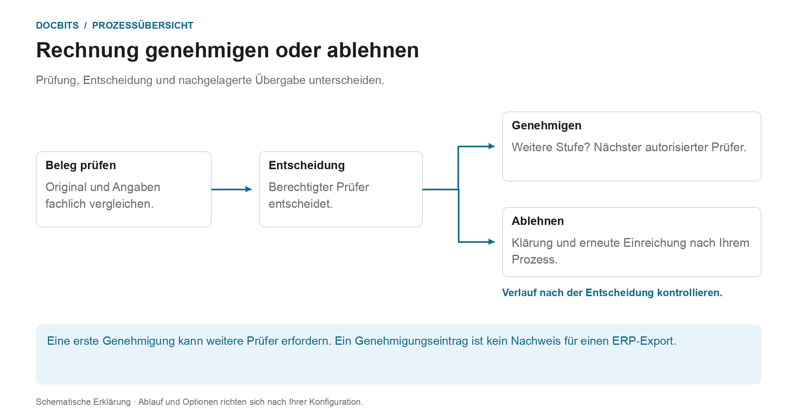
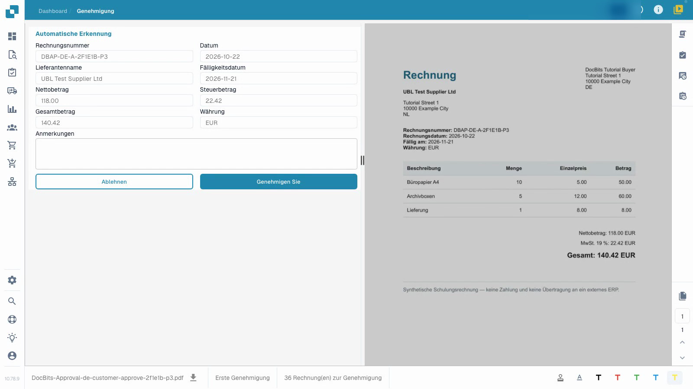
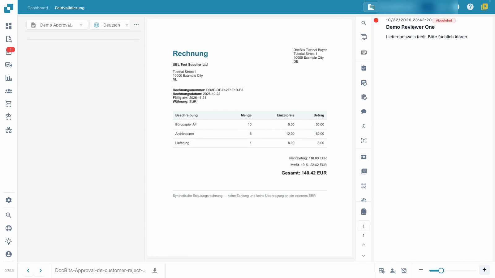

# Rechnung genehmigen oder ablehnen

## Wie die fachliche Entscheidung weiterwirkt

<figure><figcaption>
Prüfung, Entscheidung und nachgelagerte Übergabe unterscheiden. Die Grafik ist schematisch; maßgeblich sind die aktiven Einstellungen Ihrer Organisation.
</figcaption></figure>

Die technische Validierung prüft Dokumentdaten; die Genehmigung hält die fachliche Entscheidung eines berechtigten Prüfers fest. Auch eine technisch valide Rechnung kann noch eine oder mehrere Genehmigungen benötigen.

1. **Zuständigkeit prüfen:** Öffnen Sie die zugewiesene Rechnung und kontrollieren Sie, für welche Genehmigungsstufe Sie entscheiden dürfen.
2. **Beleg fachlich prüfen:** Vergleichen Sie Kopfwerte, Positionen und Steuer mit dem Original und den Vorgaben Ihres Unternehmens.
3. **Entscheidung dokumentieren:** Genehmigen Sie eine korrekte Rechnung oder lehnen Sie sie mit einer konkreten Begründung ab. Warten Sie auf die Rückmeldung und prüfen Sie anschließend den Genehmigungsverlauf.
4. **Nächsten Schritt unterscheiden:** Sind weitere Stufen eingerichtet, wartet die Rechnung auf deren Entscheidung. Bei Ablehnung folgen Klärung, Korrektur und gegebenenfalls erneute Einreichung nach Ihrem eingerichteten Prozess. Erst die getrennte Exportverarbeitung beantwortet, ob Daten das Zielsystem erreicht haben.

### Drei Aussagen, die nicht dasselbe bedeuten

| Aussage | Was sie nicht automatisch belegt |
| --- | --- |
| **Die Daten sind validiert.** | Dass ein fachlich berechtigter Prüfer zugestimmt hat. |
| **Ein Prüfer hat genehmigt.** | Dass alle erforderlichen Genehmigungsstufen abgeschlossen sind. |
| **Die Genehmigungen sind abgeschlossen.** | Dass die Rechnung bereits exportiert oder im ERP gebucht wurde. |

Nutzen Sie [Dokumentenaufgaben](tasks.md) für die Bearbeitung zugewiesener Arbeit und [Dokumentstatus](dashboard/document-status.md) zur Einordnung des aktuellen Zustands.

Das Video zeigt die Freigabe aus Sicht einer Prüferin.


Rechnung genehmigen oder ablehnen


[Video mit Untertiteln ansehen](https://docbits-videos.fra1.cdn.digitaloceanspaces.com/settings-assistant/invoice-approval-customer/v1/de.html)

Gezeigt wird die tatsächliche Anwendung. Die Bezeichnungen können je nach eingesetzter Version abweichen.

Verwenden Sie die Genehmigung, um Ihre fachliche Entscheidung zu einer bereits validierten Rechnung festzuhalten. Sie benötigen Zugriff auf das Dokument und die Berechtigung für die aktuelle Genehmigungsstufe. Das Video verwendet ein normales Prüferkonto.

## Prüfen und entscheiden

1. Öffnen Sie die Ihnen zugewiesene Rechnung und prüfen Sie die aktuelle Genehmigungsstufe.
2. Vergleichen Sie Rechnungsnummer, Lieferant, Datumsangaben und Gesamtbetrag mit dem Original. Prüfen Sie auch die Positionen und die Steuer. Die technische Validierung ersetzt nicht Ihre fachliche Prüfung.
3. Erfassen Sie eine klare Prüfnotiz. Genehmigen Sie eine korrekte Rechnung oder lehnen Sie sie mit einer konkreten Begründung ab, wenn Klärungsbedarf besteht. Warten Sie, bis der Vorgang abgeschlossen ist.
4. Öffnen Sie das Dokument erneut und prüfen Sie den Genehmigungsverlauf. Kontrollieren Sie, ob Prüfer, Zeitpunkt, Entscheidung und vollständige Notiz korrekt gespeichert sind.

<figure><figcaption>
Ausgefülltes Rechnungsformular im Vergleich zum Original.
</figcaption></figure>

<figure><figcaption>
Gespeicherte Ablehnung mit nachvollziehbarer Begründung.
</figcaption></figure>

## Nächste Stufe prüfen

Wenn eine zweite Genehmigung konfiguriert ist, wartet die Rechnung nach Ihrer ersten Genehmigung auf einen weiteren autorisierten Prüfer. Sie ist noch nicht vollständig genehmigt. Eine Ablehnung erfordert eine fachliche Klärung; Korrektur und erneute Einreichung folgen Ihrem konfigurierten Prozess.

Ein Eintrag im Genehmigungsverlauf beweist nicht, dass Daten ein ERP-System erreicht haben. In diesem isolierten Beispiel hat der Abrufkanal kein externes ERP-Ziel. Der technische Status `pending_data_fetch`, wenn er angezeigt wird, bedeutet, dass das Dokument auf den Datenabruf wartet.

## Verwandte Seiten

- [Validierungsbildschirm](validation-screen/README.md)
- [Dokumentenaufgaben](tasks.md)
