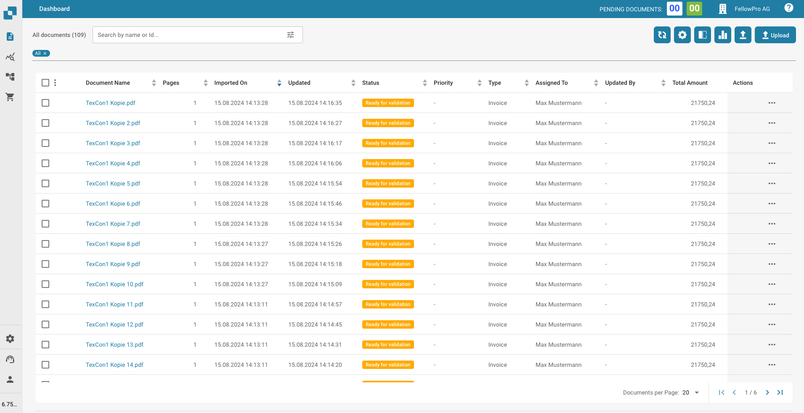

# Dashboard

Nachdem Sie sich mit Ihren Anmeldedaten angemeldet haben, werden Sie zur Startseite des DocBits-Dashboards weitergeleitet. Dies ist die Hauptseite, auf der Sie alle Ihre importierten Dokumente sehen und verwalten können.

<figure><figcaption></figcaption></figure>


So nutzt du Annotation Mode in DocBits (Setup + Download mit/ohne Notizen)



