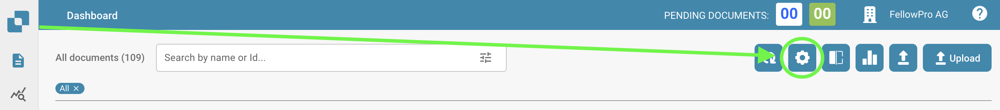
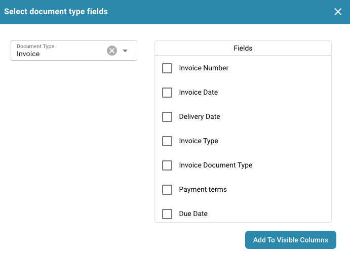

# Dokumentspalten ändern

Vom Dashboard aus klicken Sie auf das Symbol für erweiterte Einstellungen, wie unten dargestellt:

<figure><figcaption></figcaption></figure>

Es wird dann das folgende Menü angezeigt:

Wählen Sie die Schaltfläche "Dashboard-Spalten für Organisation festlegen" aus, und es wird eine Liste aller Spaltennamen angezeigt.

In diesem Menü können Sie die Spaltennamen auswählen und die Pfeile verwenden, um die gewünschten Spalten hinzuzufügen oder zu entfernen.

<figure><figcaption></figcaption></figure>

Sie können die Reihenfolge der Spalten festlegen, indem Sie auf die Punkte neben dem Spaltennamen klicken und sie an die entsprechende Position ziehen.

Eine weitere Option ermöglicht es Ihnen auch, Felder eines Dokumententyps hinzuzufügen:

<figure><figcaption></figcaption></figure>

<figure><figcaption></figcaption></figure>

Hier können Sie aus den verschiedenen Dokumententypen wählen:

<figure><figcaption></figcaption></figure>

Für jeden Dokumententyp gibt es verschiedene Felder, die Sie hinzufügen können:

<figure><figcaption></figcaption></figure>

Wählen Sie die benötigten Felder aus und klicken Sie auf „Zu sichtbaren Spalten hinzufügen“, sie werden dann in den Spalteneinstellungen angezeigt.

<figure><figcaption></figcaption></figure>
