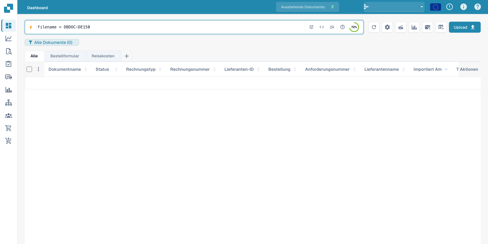
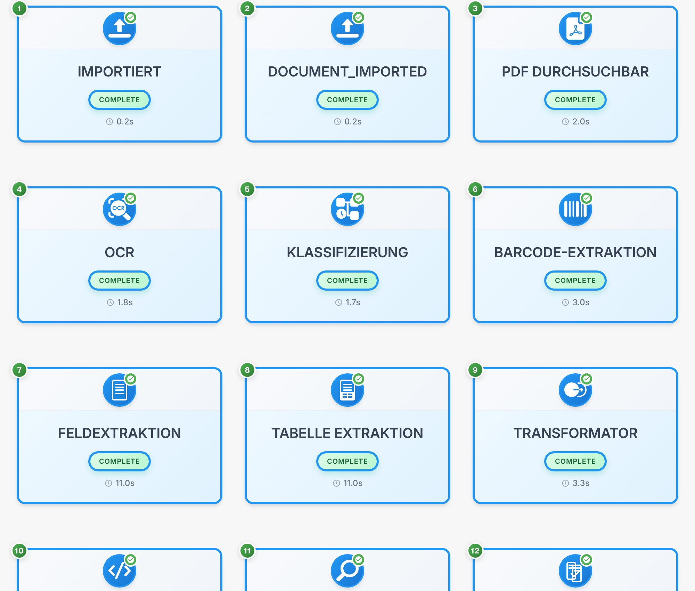

# Dokumentenfluss

Der **Dokumentenfluss** zeigt die Verarbeitungsschritte eines Dokuments. Die nummerierten Karten machen Reihenfolge, Zustand und Laufzeit sichtbar. Das Beispiel verwendet eine fiktive Rechnung.

## Dokument finden und Dokumentenfluss öffnen

Suchen Sie das Dokument zunächst im Dashboard. Die folgende Aufnahme zeigt die Suche nach dem Beispieldokument; Dokumentwerte in der Tabelle sind ausgeblendet.

<figure><figcaption>
Synthetisches Beispieldokument im deutschen Dashboard finden; Dokumentwerte sind ausgeblendet.
</figcaption></figure>

Öffnen Sie das Dokument und wählen Sie in der **Feldvalidierung** das Drei-Punkte-Menü der rechten Aktionsleiste. Klicken Sie auf **Dokumentenfluss**.

<figure><figcaption>
Menü Weitere Optionen in der deutschen Feldvalidierung mit dem Eintrag Dokumentenfluss.
</figcaption></figure>

## Prozesskarten lesen

Jede Karte steht für einen Verarbeitungsschritt, etwa **Importiert**, **OCR**, **Klassifizierung** oder **Feldextraktion**. Folgen Sie den Nummern und scrollen Sie zu den späteren Schritten.

<figure><figcaption>
Prozesskarten im Dokumentenfluss einer fiktiven Rechnung; technische Statuscodes bleiben unverändert.
</figcaption></figure>

Technische Bezeichnungen und Statuscodes wie `DOCUMENT_IMPORTED` oder `COMPLETE` werden unverändert angezeigt. `COMPLETE` kennzeichnet einen abgeschlossenen Schritt.

## Details eines Schritts

Wählen Sie eine Prozesskarte, um die zugehörigen Details und gegebenenfalls Protokolle anzuzeigen. Einzelne Detailbereiche sind im Produkt derzeit noch englisch beschriftet. Die folgende Übersicht erklärt ihre Inhalte:

| Angabe | Bedeutung |
| --- | --- |
| Modul | Verarbeitungskomponente des ausgewählten Schritts |
| Status | Aktueller Zustand dieses Schritts |
| Dauer | Für den Schritt erfasste Laufzeit |
| Protokolle | Verfügbare technische Meldungen zur Aufgabe |

Prüfen Sie bei einem wartenden oder fehlgeschlagenen Schritt die zugehörigen Meldungen, bevor Sie eine Verarbeitung erneut starten.
