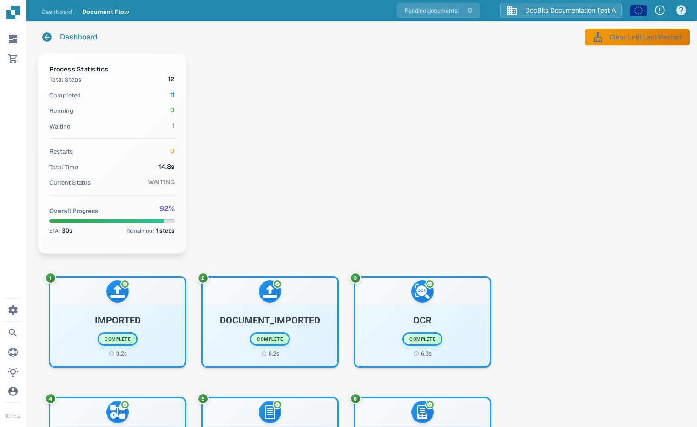

# Document Flow

Der **Document Flow** zeigt die Verarbeitungsschritte eines Dokuments. Damit sehen Sie, welche Schritte abgeschlossen sind, welcher Schritt wartet und wie lange die Verarbeitung gedauert hat. Das folgende Beispiel verwendet eine synthetische Rechnung in der englischen Sandbox.

## Über das Dashboard öffnen

Suchen Sie auf dem **Dashboard** das Dokument. Wählen Sie in der Spalte **Actions** die drei Punkte und dann **Document flow**. Die Option öffnet den Flow für dieses Dokument; das Dokument selbst wird nicht verändert.

<figure><figcaption>Wählen Sie Document flow im Actions-Menü des Dokuments.</figcaption></figure>

## Über die Field Validation öffnen

Öffnen Sie das Dokument. Wählen Sie in der **Field Validation** in der rechten Aktionsleiste die drei Punkte und dann unter **More options** den Eintrag **Document Flow**.

<figure><figcaption>Derselbe Flow ist auch in der Dokumentansicht verfügbar.</figcaption></figure>

## Den Flow lesen

Die **Process Statistics** links fassen die Anzahl der Schritte, abgeschlossene und wartende Schritte, Neustarts, die Gesamtzeit, den aktuellen Status und den Gesamtfortschritt zusammen. Jede nummerierte Karte zeigt einen Verarbeitungsschritt und seinen aktuellen Zustand. Scrollen Sie nach unten, um spätere Schritte zu sehen.

<figure><figcaption>Die ersten Schritte des Flows einer synthetischen Rechnung.</figcaption></figure>

<figure><figcaption>Scrollen Sie, um der Abfolge durch die späteren Schritte zu folgen.</figcaption></figure>

Wählen Sie eine Schrittkarte aus, um links die **Step Details** zu öffnen. Sie zeigen das Modul und seinen Status. Rechts kann sich zusätzlich ein Bereich **Task Logs** öffnen; die Protokolldetails hängen davon ab, was für diese Aufgabe verfügbar ist. Wählen Sie **×** in den Step Details, um den Bereich zu schließen.

<figure><figcaption>Die Step Details erklären den Status des ausgewählten Moduls.</figcaption></figure>
