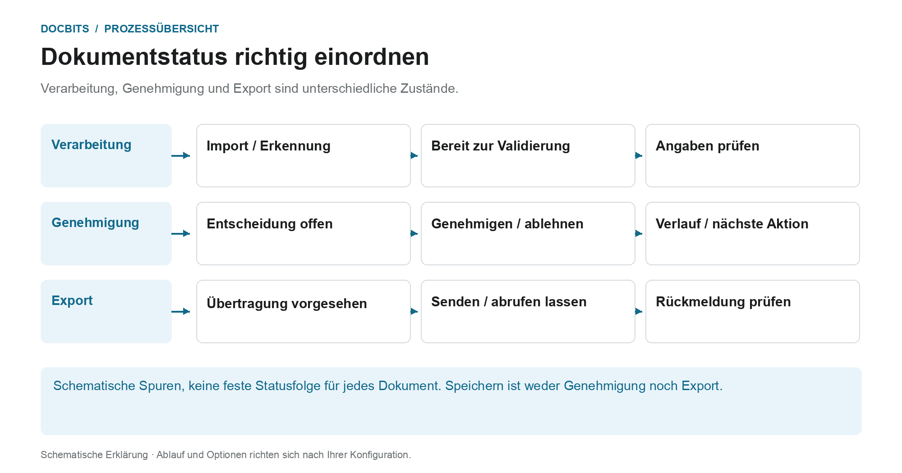
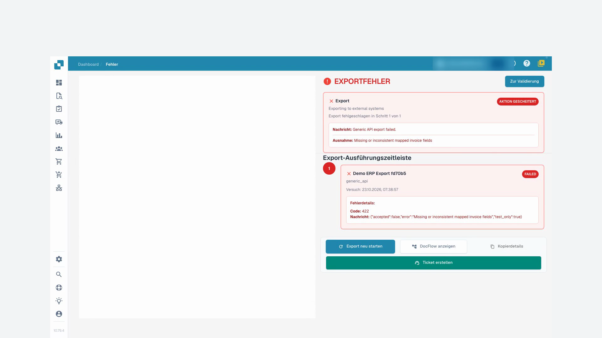
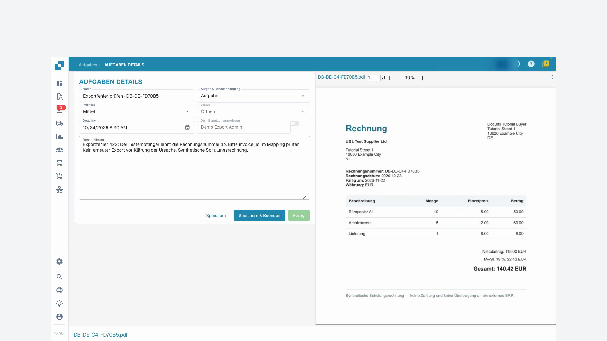

# Dokumentstatus

## Drei Statusfragen statt einer einzigen Statuskette

<figure><figcaption>
Verarbeitung, Genehmigung und Export sind unterschiedliche Zustände. Die Grafik ist schematisch; maßgeblich sind die aktiven Einstellungen Ihrer Organisation.
</figcaption></figure>

Ein Dokument kann fachlich noch auf eine Entscheidung warten, obwohl seine Erkennung bereits abgeschlossen ist. Lesen Sie den angezeigten Status deshalb im Zusammenhang mit dem Verarbeitungsschritt und Ihrem Freigabeprozess.

| Frage | Bedeutung | Nächster Schritt |
| --- | --- | --- |
| **Ist die Verarbeitung abgeschlossen?** | OCR, Klassifizierung und Extraktion bereiten das Dokument zur Prüfung vor. „Bereit zur Validierung“ ist keine fachliche Genehmigung. | Dokument öffnen, Angaben mit dem Original vergleichen und Pflichtfeldfehler bearbeiten. |
| **Ist die fachliche Entscheidung abgeschlossen?** | Eine Genehmigung kann mehrere Stufen haben. Eine erste Zustimmung schließt nicht automatisch alle Stufen ab. | Aktuelle Stufe, zuständigen Prüfer und Genehmigungsverlauf kontrollieren. |
| **Wurde das Dokument übertragen?** | Exportstatus und Rückmeldung beschreiben die technische Übergabe. Ein gespeicherter Wert oder ein Genehmigungseintrag beweist keine ERP-Verarbeitung. | Exportdetails lesen und bei Bedarf den Vorgang im Zielsystem nachvollziehen. |

Die Grafik ordnet diese Fragen in drei Spuren. Sie ist keine vollständige Liste technischer Statuscodes und legt keine universelle Reihenfolge fest. Die tatsächlichen Übergänge hängen von Dokumenttyp, Workflow und Exportweg ab.

### Bei Fehlern am betroffenen Schritt beginnen

Öffnen Sie den Fehlerstatus und lesen Sie die Meldung. Fehlt ein Pflichtwert, prüfen und korrigieren Sie ihn am Original. Meldet der Empfänger einen Exportfehler, klären Sie dessen Ursache, bevor Sie einen erneuten Export starten. Nutzen Sie den [Dokument-Flow](document-flow.md) für die Verarbeitungsschritte und die Anleitung zur [Genehmigung](../approve-or-reject-invoices.md) für fachliche Entscheidungen.

Verarbeitungsstatus zeigen Schritte wie OCR, Klassifizierung oder Export an. **Bereit zur Validierung** bedeutet, dass Sie das Dokument prüfen können. Freigabestatus zeigen einen ausstehenden Genehmigungsschritt an. **Exportiert** kennzeichnet den abgeschlossenen Dokumentexport. Klicken Sie bei **Fehler** auf den Fehlerstatus, um verfügbare Fehlerdetails zu öffnen.

Wenn Verarbeitungszeiten vorliegen, bewegen Sie den Mauszeiger über den Status, um Phasen und Dauer zu sehen. Bei möglichen Duplikaten erscheint ein Duplikatsymbol; öffnen Sie es, um die zugehörigen Dokumente zu vergleichen.

Öffnen Sie eine Dokumentzeile, um in der Validierungsansicht zu arbeiten. Im Aktionsmenü der Zeile finden Sie die für das Dokument erlaubten Vorgänge, etwa Zuweisen, Herunterladen, Verlauf oder Neustart der Verarbeitung. Verfügbare Downloadvarianten hängen vom Dokument ab und können Anmerkungen oder elektronische Rechnungsformate enthalten.

Wählen Sie mehrere Dokumente über ihre Kontrollkästchen aus und öffnen Sie das Menü im Tabellenkopf für erlaubte Sammelaktionen, etwa Zuweisen, Zusammenführen, Neustart, Exportneustart oder Löschen. Prüfen Sie Auswahl und Bestätigung sorgfältig. Diese Aktionen können Dokumente verändern; das Speichern einer Ansicht ändert nur die Darstellung der Arbeitsliste.

Suche, Dokumentaktionen und gespeicherte Ansichten erklärt die [Dashboard-Anleitung](README.md).

## Videoanleitung: Blockierte Rechnungen gezielt weiterbearbeiten


Blockierte Rechnungen gezielt weiterbearbeiten


[Mit Untertiteln und Kapiteln ansehen](https://docbits-videos.fra1.cdn.digitaloceanspaces.com/settings-assistant/blocked-invoices-customer/v1/de.html)

Einzelne native Produktbeschriftungen können abweichend übersetzt sein. Technische Feld-IDs bleiben erhalten.

Ich öffne die Rechnung in der Feldvalidierung. In diesem Beispiel fehlt die Rechnungsnummer. Die übrigen Werte sind bereits ausgefüllt. Ich vergleiche sie mit dem Original, bevor ich etwas ändere.

Jetzt trage ich die Rechnungsnummer ein und verlasse das Feld. Danach speichere ich die Rechnung. Ich warte auf die Rückmeldung und lade den Beleg erneut. So sehe ich, ob die Korrektur wirklich erhalten bleibt.

Die Nummer ist nach dem erneuten Öffnen weiterhin eingetragen. Der Pflichtfeldfehler ist behoben. Das Speichern bedeutet allerdings noch nicht, dass die Rechnung freigegeben oder an das ERP übertragen wurde.

Bei einer zweiten Rechnung zeigt die Liste einen Exportfehler. Ich öffne den Status und lese die Details: Der Testempfänger hat die übermittelten Angaben mit Fehlercode vierhundertzweiundzwanzig abgelehnt. Hier muss die technische Zuordnung geprüft werden. Ich starte den Export nicht einfach mehrfach neu.

<figure><figcaption>
Exportfehler und Rückmeldung des Empfängers
</figcaption></figure>

Über die Aufgaben am Dokument erstelle ich eine konkrete Übergabe an unseren Testadministrator. Ich nenne den Fehlercode und bitte darum, die Rechnungsnummer im Mapping zu prüfen. Für diese Schulung bleibt der E-Mail-Versand ausgeschaltet.

Nach dem erneuten Laden kontrolliere ich, dass die Aufgabe gespeichert und der richtigen Person zugewiesen ist. Die Aufgabe bleibt offen, bis die Ursache geklärt wurde. Eine angelegte Aufgabe ist noch kein erfolgreicher Export.

<figure><figcaption>
Gespeicherte Übergabe an den Administrator
</figcaption></figure>
