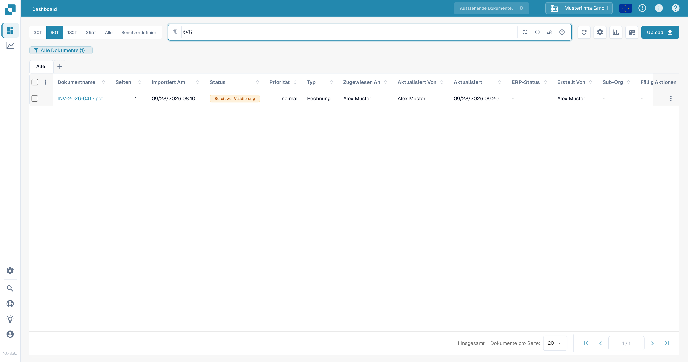
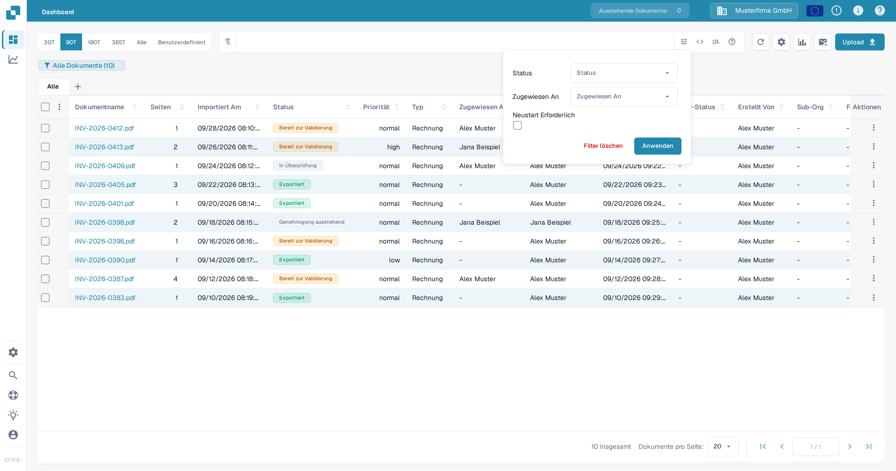
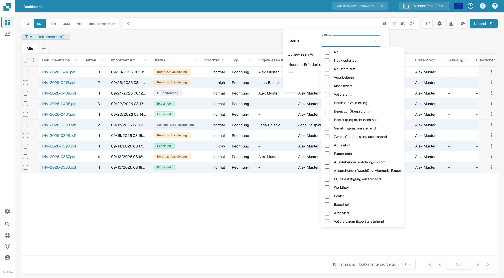
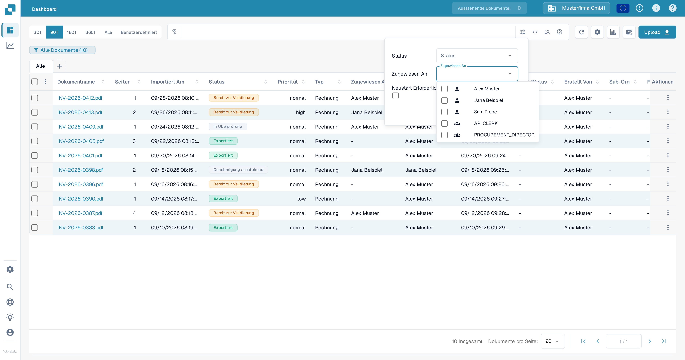
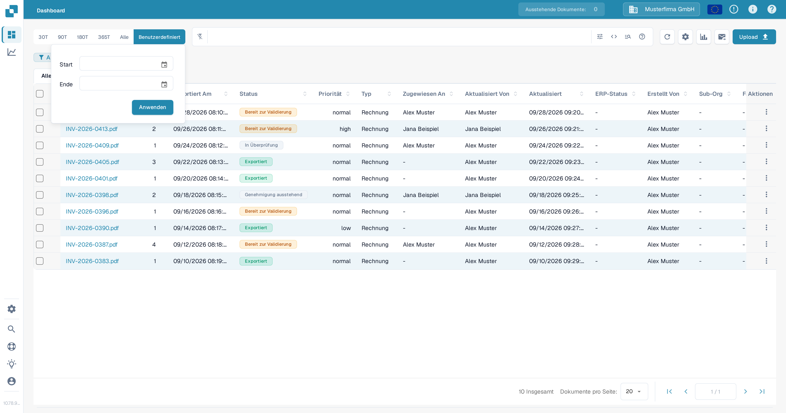
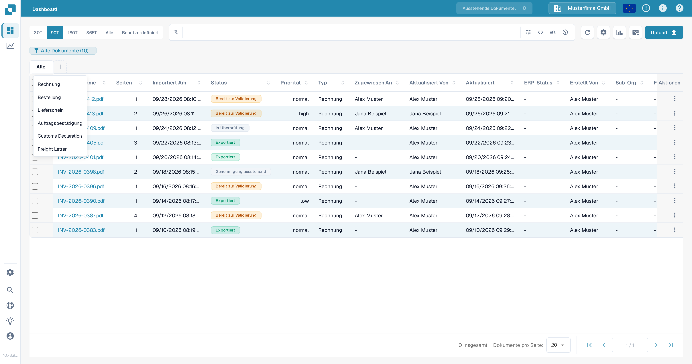
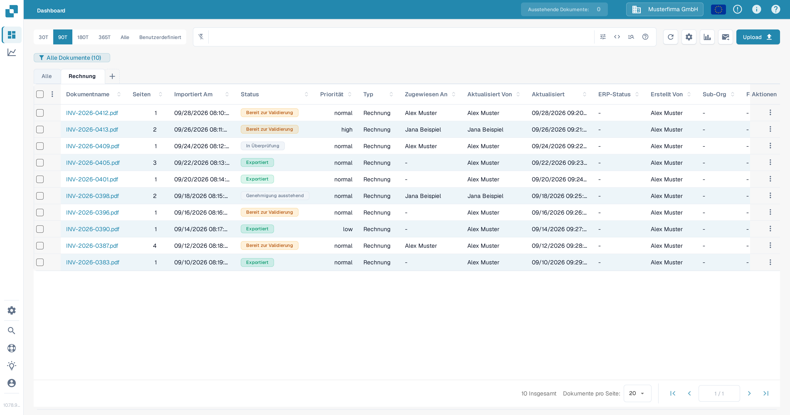

# Dokumente filtern

Nutzen Sie die Suchleiste des Dashboards, den Filterbereich, den Datumsbereich und die Dokumenttyp-Tabs, um die Dokumentliste einzugrenzen. Die Steuerungen greifen zusammen: Ein Dokument muss sowohl der aktiven Suche als auch den aktiven Filtern entsprechen, um in der Tabelle zu bleiben.

## Ein Dokument anhand des Namens suchen

1. Öffnen Sie das **Dashboard**.
2. Geben Sie einen Teil eines Dokumentnamens in die Suchleiste über der Tabelle ein und drücken Sie **Enter**. Die Zahl im Dashboard-Abzeichen und die Tabelle aktualisieren sich und zeigen die passenden Dokumente an.
3. Ersetzen Sie den Suchbegriff, wenn Sie ein anderes Dokument suchen möchten. Für Feldsuchen und Suchsyntax siehe [Schnellsuche](quick-search.md).

<figure><figcaption>Die Suche nach einem Dokumentnamen grenzt die Liste der Testdokumente ein.</figcaption></figure>

## Nach Status, Zuständigkeit oder Neustart-Anforderung filtern

1. Wählen Sie das **Filtersymbol** (Schieberegler) am rechten Ende der Suchleiste.
2. Wählen Sie einen oder mehrere **Status**-Werte aus. Sie können mehrere Status gleichzeitig auswählen.
3. Wählen Sie unter **Zugewiesen An** die Benutzer aus, deren Dokumente Sie sehen möchten. Wenn in Ihrer Organisation Gruppenberechtigungen aktiviert sind, können Gruppen in derselben Liste erscheinen. Ein separates Feld **Der Gruppe zugewiesen** gibt es in diesem Bereich nicht.
4. Wählen Sie **Neustart Erforderlich** aus, um Dokumente anzuzeigen, die einen Neustart benötigen.
5. Wählen Sie **Anwenden**. Wählen Sie in diesem Bereich **Filter löschen**, um diese Auswahlen zu entfernen; Suchtext und Datumsbereich sind davon unabhängige Steuerungen.

<figure><figcaption>Der aktuelle Filterbereich hat drei Kriterien und zwei Aktionen.</figcaption></figure>

<figure><figcaption>Wählen Sie die benötigten Verarbeitungsstatus aus.</figcaption></figure>

<figure><figcaption>Wählen Sie unter Zugewiesen An einen Benutzer aus.</figcaption></figure>

Eine Erklärung, was die einzelnen Verarbeitungsstatus bedeuten, finden Sie unter [Dokumentstatus](document-status.md).

## Importzeitraum wählen

Wählen Sie oberhalb der Suchleiste **30T**, **90T**, **180T**, **365T** oder **Alle**, um den Importzeitraum zu ändern. Wählen Sie **Benutzerdefiniert**, legen Sie **Start** und **Ende** fest und wählen Sie dann **Anwenden**, um einen bestimmten Zeitraum einzustellen. Die aktuelle Auswahl ist hervorgehoben.

<figure><figcaption>Benutzen Sie Benutzerdefiniert, wenn die voreingestellten Zeiträume nicht passen.</figcaption></figure>

## Dokumenttyp-Tabs verwenden

1. Wählen Sie **+** neben **Alle**. Das Menü listet die Dokumenttypen auf, die Ihrer Organisation zur Verfügung stehen.
2. Wählen Sie einen Typ, z. B. **Rechnung**, um dessen Tab hinzuzufügen. Wählen Sie dann den neuen Tab an, um die Tabelle auf diesen Typ zu filtern. **Alle** entfernt die Typ-Beschränkung, ohne den Tab zu löschen.
3. Um einen Typ-Tab zu entfernen, wählen Sie sein **×** an. Der Tab **Alle** kann nicht entfernt werden.

<figure><figcaption>Fügen Sie über das Plus-Menü einen Dokumenttyp-Tab hinzu.</figcaption></figure>

<figure><figcaption>Wählen Sie den Tab an, um den Typfilter anzuwenden; mit × entfernen Sie den Tab.</figcaption></figure>

Wenn das **+**-Menü keine Typen enthält, bitten Sie einen Administrator zu prüfen, welche Dokumenttypen für Ihre Organisation aktiv sind. Siehe [Dokumenttypen](../../../administration-and-setup/settings/global-settings/document-types/README.md). Um eine Kombination von Filtern für später zu speichern, siehe [Persönliche Dashboards](personal-dashboards.md).
