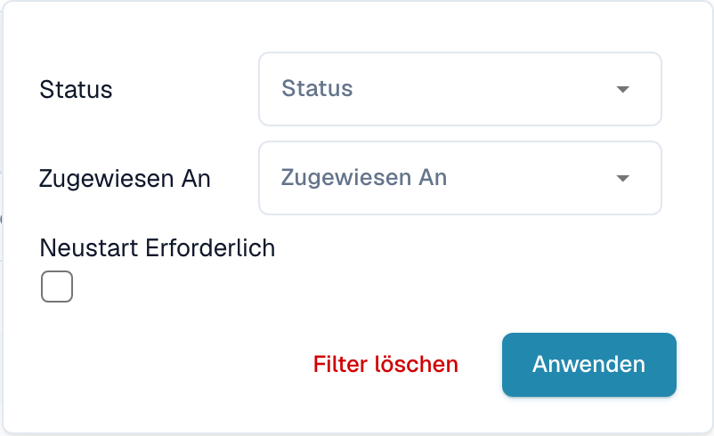

# Dokumente filtern

## Standard-Filteroptionen

Über die Suchleiste im Dashboard suchen Sie nach Dokumenten. Weitere Möglichkeiten und Suchausdrücke erklärt die [Schnellsuche](quick-search.md).

Wählen Sie das Symbol **Filter** (drei Schieberegler) am rechten Ende der Suchleiste. Im aktuellen Filterdialog stehen **Status**, **Zugewiesen An** und **Neustart Erforderlich** zur Verfügung.

<figure><figcaption>
Der Filterdialog der deutschen DocBits-Oberfläche. Die Auswahllisten sind geschlossen; Personen- und Dokumentdaten werden nicht gezeigt.
</figcaption></figure>

* **Status**: Beschränken Sie die Liste auf einen Verarbeitungsstatus, zum Beispiel „Bereit zur Validierung“.
* **Zugewiesen An**: Filtern Sie nach der zuständigen Person. Abhängig von der Organisationskonfiguration kann die Auswahl auch Gruppen enthalten.
* **Neustart Erforderlich**: Zeigen Sie Dokumente an, die einen Neustart erfordern.

Wählen Sie **Anwenden**, um die Filter zu übernehmen. Mit **Filter löschen** setzen Sie die Filter zurück.

## Zeitbasierte Filterung

Je nach Suchkonfiguration zeigt das Dashboard zusätzlich Schaltflächen für voreingestellte Zeiträume und einen benutzerdefinierten Zeitraum. Bei aktivierter Volltextsuche können diese Schaltflächen ausgeblendet sein.

Wenn die Zeitauswahl sichtbar ist, können Sie den Importzeitraum auf 30, 90, 180 oder 365 Tage begrenzen oder alle Dokumente anzeigen. Für einen eigenen Zeitraum öffnen Sie **Benutzerdefiniert**, geben Start- und Enddatum an und wählen **Anwenden**.

> **Hinweis:** Größere Zeiträume können die Ladezeit erhöhen.

## Nach Dokumenttyp filtern

1. Öffnen Sie das Plus-Symbol neben den Dokumenttyp-Registerkarten im Dashboard.
2. Wählen Sie den gewünschten Dokumenttyp aus der Liste.
3. Wechseln Sie über die Registerkarten zwischen den Dokumenttypen.

Um eine Dokumenttyp-Registerkarte zu entfernen, bewegen Sie den Mauszeiger darüber und wählen das eingeblendete rote X.
