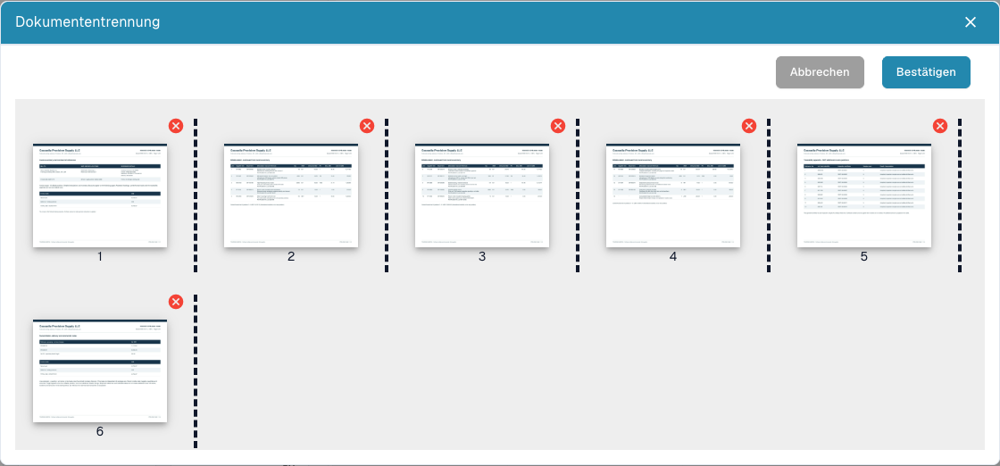

# PDF aufteilen und Seiten ordnen

<figure><figcaption>
Seitenvorschau, Trennstellen und Entfernen-Schaltflächen vor dem Ausführen einer Aufteilung.
</figcaption></figure>

Teilen Sie eine hochgeladene PDF manuell auf, wenn sie mehrere eigenständige Belege enthält. Beispiel: Rechnung A umfasst Seiten 1–3, Rechnung B Seiten 4–7 und ein Lieferschein Seiten 8–10. Jeder Beleg soll getrennt weiterverarbeitet werden.

## Vorbereiten

Sie benötigen Bearbeitungsrechte und ein Dokument mit mehreren Seiten. Halten Sie das Original bereit. Klären Sie eine Belegsperre mit der zuständigen Person, bevor Sie Änderungen vornehmen.

## Schritt für Schritt

1. Öffnen Sie den Beleg im Dashboard und prüfen Sie alle Originalseiten.
2. Öffnen Sie im Dokumentbetrachter das Menü mit weiteren Optionen und wählen Sie **Dokumententrennung**.
3. Prüfen Sie die nummerierten Vorschaubilder. Setzen Sie die Trennstellen jeweils hinter die letzte Seite eines Belegs, im Beispiel hinter Seite **3** und **7**.
4. Ziehen Sie falsch angeordnete Seiten an die richtige Position. Prüfen Sie anschließend Reihenfolge und Trennstellen erneut.
5. Entfernen Sie eine Seite über das **rote Kreuz** nur, wenn sie ausgeschlossen werden soll. Eine leere Trennseite kann entfallen; Steueraufstellungen und Anlagen können erforderlich sein.
6. Wählen Sie **Bestätigen**, lesen Sie die Rückfrage und fahren Sie erst bei korrekter Zuordnung fort. Mit **Abbrechen** verlassen Sie den Dialog ohne Übermittlung der Aufteilung.
7. Öffnen Sie danach jeden entstandenen Beleg im Dashboard. Prüfen Sie Anfang, Ende, Seitenzahl, Dokumenttyp und extrahierte Werte.

## Ergebnis prüfen und Fehler eingrenzen

Jede Originalseite muss einem vorgesehenen Beleg zugeordnet oder bewusst ausgeschlossen sein. Eine Aufteilung belegt weder erfolgreiche Extraktion noch Freigabe oder ERP-Export.

Fehlt die Funktion, prüfen Sie Seitenzahl, Rechte, Sperre und Status. Ohne Trennstelle, Umordnung oder Entfernung kann der Dialog melden, dass keine Änderung ausgewählt wurde. Prüfen Sie nach einem Fehler zuerst das Dashboard, bevor Sie einen Vorgang mit unklarem Ergebnis wiederholen.

Siehe [Dokumente zusammenführen](document-merging.md) und [Klassifizierung und Extraktion](../../../administration-and-setup/settings/document-processing/classification-and-extraction/README.md) für die automatische Barcode-Aufteilung.
