# Schnellsuche

Die **Schnellsuche** ist der schnellste Weg, um Dokumente im Dashboard zu finden. Sie
geben ein, wonach Sie suchen — einen Namen, einen Status, einen Betrag, ein Datum — und die
Dokumentliste wird sofort gefiltert.

Dieser Leitfaden ist so aufgebaut, wie die Suche schrittweise zusammengesetzt wird:

1. **Standardfelder** — die Spalten, die jedes Dokument besitzt (Dokumentname, Status,
   Daten). Immer verfügbar.
2. **Volltextfelder** — extrahierte Inhalte (Lieferant, Bestellung, Rechnungs-
   nummer, Beträge, Positionen). Verfügbar, wenn die Volltextsuche aktiviert ist.
3. **Operatoren, Kurzformen & Rezepte** — die vollständige Referenz, sobald Sie
   sich sicher fühlen.

> Sie müssen sich nichts merken: Klicken Sie in die Suchleiste und wählen Sie ein Feld und
> einen Wert aus der Liste aus — die Schnellsuche erstellt die Abfrage für Sie. Die Beispiele unten
> zeigen außerdem die getippte Form, sodass Sie sie direkt kopieren können.

<figure><figcaption><p>Schnellsuche im deutschen Dashboard.</p></figcaption></figure>

---

## So funktioniert die Suchleiste — Chips, Symbolleiste & Rohansicht

Bevor wir uns den Feldern selbst zuwenden, ist es hilfreich zu wissen, wie die Leiste aufgebaut ist.

### Bedingungen werden zu Chips

Sobald Sie eine Bedingung vervollständigt haben (ein Feld, einen Operator und einen Wert), verwandelt die Schnellsuche
sie in einen **Chip** — eine farbige Pille innerhalb der Leiste — und beginnt mit einem neuen. Ein
Chip zeigt das **Feld**, den **Operator** und den **Wert** sowie ein **×** zum
Entfernen an. Chips sind je nach Speicherort der Daten farblich gekennzeichnet:

| Chip-Farbe | Feldtyp |
|-------------|------------|
| **Blau** | Standardspalte (Dokumentname, Status, Daten) |
| **Orange** | Volltext-/extrahiertes Feld (Lieferant, Betrag, Rechnungsnummer) |
| **Lila** | Vektorsuche (semantisch) |
| **Grün** | OCR-Textsuche |

Klicken Sie auf einen Chip, um ihn zu bearbeiten (er klappt wieder zu Text auf); klicken Sie auf **×**, um ihn zu löschen.
Mehrere kombinierte Chips werden standardmäßig als **UND** gelesen.

### Die Symbolleiste

Am rechten Ende der Leiste:

- **ⓘ Hilfe** — öffnet die in der App integrierte Referenz **Dashboard-Suche — Felder & Syntax**,
  die jedes Feld, jeden Operator und jede Kurzform auflistet, die in Ihrem Workspace verfügbar sind.
- **Filter** (drei Schieberegler) — ein Schnellbereich für die gängigen Filter **Status**,
  **Zugewiesen an** und **Neustart erforderlich**, mit **Filter löschen** und **Anwenden**.
- **Index-Ring** — ein kleiner Fortschrittsring, der anzeigt, wie viel Ihres Volltext-Index
  bereits aufgebaut ist (wird nur angezeigt, wenn die Volltextsuche aktiviert ist).

### Standard- vs. Rohansicht

Die Leiste zeigt Ihre Abfrage normalerweise als Chips an (**Standardansicht**). Wechseln Sie zur **Roh-
ansicht**, um die Abfrage als reinen Text anzuzeigen und zu bearbeiten (z. B.
`status=ready_for_validation AND supplier_name=Test`) — nützlich zum Kopieren,
Teilen oder direkten Eingeben einer langen Abfrage. Ihre Abfrage bleibt beim Wechsel erhalten und wird
gespeichert, wenn Sie das Dashboard neu laden.

---

## Teil 1 — Standardfelder

Standardfelder sind die eigenen Spalten des Dokuments. Sie sind **immer verfügbar**,
unabhängig davon, ob die Volltextsuche aktiviert ist oder nicht.

### Dokumente anhand des Namens finden

Die Suche nach dem Dokumentnamen ist die häufigste. Es gibt drei Möglichkeiten, ihn abzugleichen —
alle **ohne Berücksichtigung der Groß-/Kleinschreibung**:

#### `=` → beginnt mit

```
filename=invoice
```

Findet Dokumente, deren Name **mit** „invoice“ **beginnt**. Beim Abgleich wird die Groß-/Kleinschreibung ignoriert, sodass
all diese mit `filename=invoice` übereinstimmen:

```
Invoice.pdf   iNVoice.pdf   iNvoiCE.pdf   INVOICE.pdf
Invoice.xml   iNVoice.xml   iNvoiCE.edi   …
```

Es stimmt **nicht** mit `XYZ_Invoice.pdf` überein (dort steht „invoice“ in der Mitte — verwenden Sie
dafür `:`).

<figure>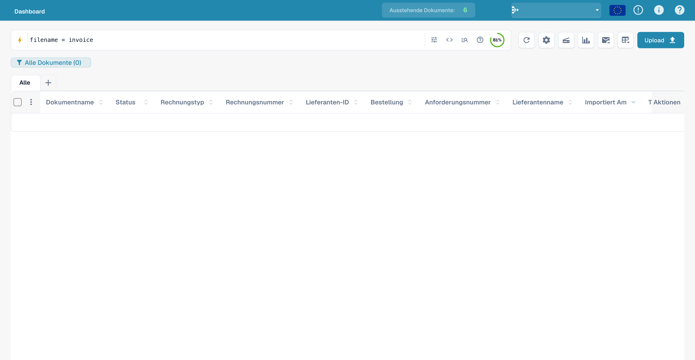<figcaption><p>Suche filename = invoice mit deutschen Tabellenüberschriften. Dieses Beispiel hat keine Treffer.</p></figcaption></figure>

#### `:` → enthält (an beliebiger Stelle)

```
filename:invoice
```

Verwenden Sie `:`, um das Wort **an beliebiger Stelle** im Namen abzugleichen — `2026_Invoice.pdf`,
`vietnam_einvoice_sample.xml`, `scan_invoice_copy.pdf`.

<figure><figcaption><p>Schnellsuche nach einem Teil des Dateinamens: filename:invoice.</p></figcaption></figure>

#### `="…"` → beginnt *oder* endet mit

```
filename="invoice"
```

Anführungszeichen sorgen dafür, dass `=` Namen abgleicht, die mit dem Wert **beginnen oder enden** — praktisch für einen
vorangestellten Code oder eine Dateiendung.

> **Die drei in einer Zeile:** `=` → beginnt mit · `:` → enthält · `="…"` →
> beginnt oder endet mit. Alle ignorieren Groß-/Kleinschreibung. Sie können dies jederzeit über das
> **Hilfesymbol** in der Suchleiste zusammengefasst sehen (nächster Abschnitt).

### Dokumente anhand des Status finden

```
status=ready_for_validation
```

Der Status ist eine feste Liste, daher ist `=` ein **exakter** Abgleich, und die Leiste bietet eine Wert-
auswahl an, wenn Sie `status=` eingeben.

<figure><figcaption><p>Nach dem technischen Status ready_for_validation filtern.</p></figcaption></figure>

### Dokumente anhand des Datums finden

```
created_on>2026-05-25
```

Verwenden Sie `>`, `<`, `>=`, `<=` für Datumsbereiche. Sie können auch **relative** Daten verwenden:
`today()`, `today()-7` (letzte 7 Tage), `today()+30` (nächste 30 Tage).

<figure><figcaption><p>Dokumente mit created_on nach dem 25. Mai 2026 suchen.</p></figcaption></figure>

### Dokumente anhand des Rechnungs-Untertyps finden

```
invoice_sub_type="Cost Invoice"
```

Der Rechnungs-Untertyp ist eine feste Liste (zum Beispiel **Kostenrechnung** oder **Purchase
Invoice**), daher ist `=` ein **exakter** Abgleich, und die Leiste bietet eine Wertauswahl an, wenn
Sie `invoice_sub_type=` eingeben. Verwenden Sie `invoice_sub_type!="Cost Invoice"` für
alles außer diesem Untertyp.

---

## Teil 2 — Volltextfelder

Volltextfelder durchsuchen den **extrahierten Inhalt** Ihrer Dokumente — Lieferant,
Bestellung, Rechnungsnummer, Beträge, Positionen. Sie erscheinen in **Orange**
und sind verfügbar, wenn die **Volltextsuche** für Ihre Organisation aktiviert ist. Die
Abgleichsregeln sind genau dieselben wie für Standardtextfelder
(`=` beginnt mit, `:` enthält, `="…"` beginnt oder endet mit).

### Dokumente eines Lieferanten finden

```
supplier_name=Test
```

Beginnt-mit auf dem extrahierten Lieferantennamen. Verwenden Sie `supplier_name:Beispiel`, um an beliebiger Stelle
abzugleichen, oder `supplier_name:"Beispiel Lieferant"`, um einen Wert mit Leerzeichen in Anführungszeichen zu setzen.

<figure><figcaption><p>Beispiel einer Lieferantenabfrage: supplier_name=Test.</p></figcaption></figure>

### Dokumente anhand der Bestellung finden

```
purchase_order=PO
```

Beginnt-mit auf der extrahierten Bestellnummer — ideal für ein Bestell-Präfix.

<figure><figcaption><p>Beispiel einer Bestellabfrage: purchase_order=PO.</p></figcaption></figure>

### Dokumente anhand des Betrags finden

```
total_amount>5000
```

Verwenden Sie `>`, `<`, `>=`, `<=` oder `between 100 and 500` für eine Spanne.

<figure>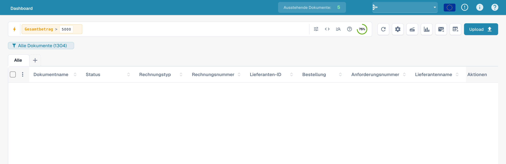<figcaption><p>Dokumente mit einem Gesamtbetrag über 5000 suchen.</p></figcaption></figure>

Für ein Fenster verwenden Sie `between`:

```
total_amount between 1000 and 5000
```

Dies ist die Kurzform für `total_amount>=1000 AND total_amount<=5000`.

<figure><figcaption><p>Gesamtbetrag zwischen 1000 und 5000 eingrenzen.</p></figcaption></figure>

### Finden, was fehlt

```
supplier_name=""
```

`=""` bedeutet „dieses Feld ist **nicht gesetzt**“; `supplier_name!=""` bedeutet „hat einen beliebigen
Lieferanten“.

<figure><figcaption><p>Dokumente mit leerem Lieferantennamen suchen.</p></figcaption></figure>

Dieselbe Prüfung auf Vorhandensein funktioniert bei jedem Feld — zum Beispiel bei Dokumenten, denen noch
ein AP-Zuordnungscode fehlt:

```
ap_assignment_code=""
```

<figure>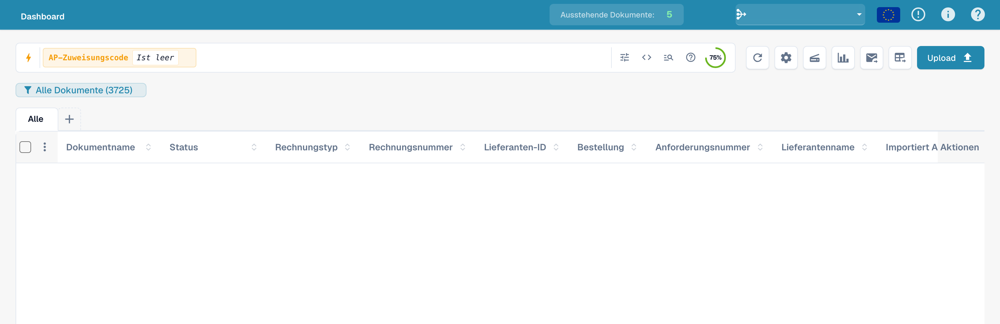<figcaption><p>Dokumente ohne AP-Zuordnung suchen.</p></figcaption></figure>

---

## Schnellfilter — ein Klick

Das **Blitz**-Symbol am Anfang des Suchfelds öffnet die Feldauswahl. Oben in dieser
Auswahl stehen die **Schnellfilter**: fertige Suchen, die Sie mit einem einzigen Klick
anwenden. Jeder davon ist lediglich eine Kurzform für eine Abfrage, die Sie auch selbst
eingeben könnten:

| Schnellfilter | Findet | Entspricht der Eingabe |
|--------------|-------|----------------|
| ⚠️ **Überfällig** | Über das Fälligkeitsdatum hinaus | `invoice_due_date<today()` |
| 🕐 **Bald fällig** | Innerhalb der nächsten 7 Tage | `invoice_due_date<=today()+7` |
| 👤 **Mir zugewiesen** | Elemente, die auf Ihre Aktion warten | `assigned_to=<you>` |
| 📅 **Heute eingegangen** | Heute importiert | `imported_on>=today()` |
| 📋 **Wartet auf Validierung** | Bereit zur Validierung | `status=ready_for_validation` |
| 🧾 **Elektronische Dokumente** | E-Rechnungen (XML, ZUGFeRD, EDI) | `is_edoc=true` |
| ✅ **Voller PO-Abgleich** | Vollständig mit einer Bestellung abgeglichen | `po_match_status=full_matched` |
| ➗ **Teilweiser PO-Abgleich** | Teilweise mit einer Bestellung abgeglichen | `po_match_status=partial_matched` |
| 📉 **PO-Unterabgleich** | Menge oder Stückpreis unter der Bestellung | `po_match_status=under_matched` |

Die drei **PO-Abgleich**-Filter und die Volltextfelder erfordern, dass die Volltextsuche
für Ihre Organisation aktiviert ist.

<figure>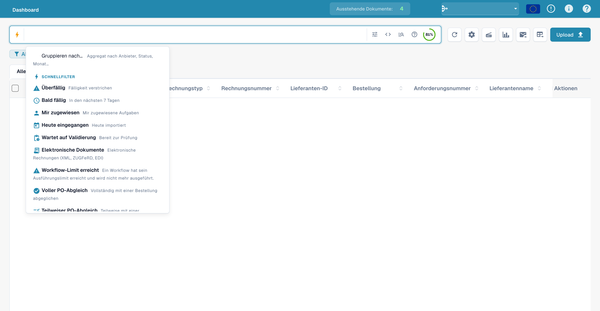<figcaption><p>Deutsche Schnellfilter in der Feldauswahl der Schnellsuche, darunter Überfällig, Bald fällig und Mir zugewiesen.</p></figcaption></figure>

---

## Ergebnisse gruppieren

Anstatt einer flachen Liste können Sie die Ergebnisse nach einem beliebigen Feld **gruppieren** — Lieferant,
Status, Dokumenttyp, Unterorganisation oder einem Datumsbereich. Fügen Sie eine Gruppierung über
die Suchleiste hinzu:

```
group by supplier_name
```

Die Liste zeigt dann einklappbare **Gruppenüberschriften**, jede mit dem Namen der Gruppe und
einer **Anzahl** (z. B. *Beispiel-Lieferant (12)*). Klicken Sie auf eine Überschrift, um diese Gruppe ein- oder
auszuklappen. Bei Datumsfeldern können Sie nach **Tag, Woche oder Monat** gruppieren.

<figure>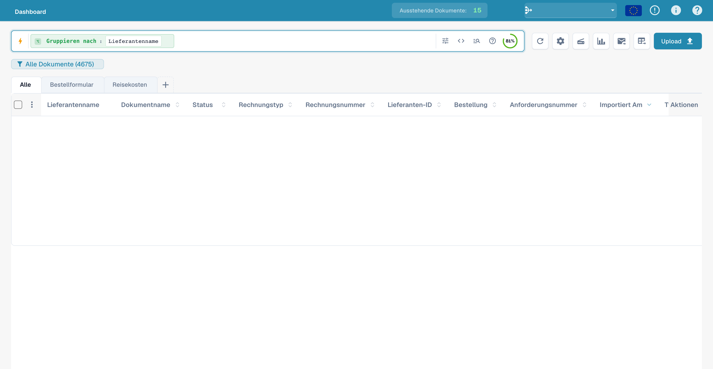<figcaption><p>Gruppieren nach Lieferantenname in der deutschen Oberfläche. Lieferantendaten und Tabellenwerte sind ausgeblendet.</p></figcaption></figure>

Die Gruppierung lässt sich mit jedem Filter kombinieren — `status=ready_for_validation group by
supplier_name` gruppiert nur die übereinstimmenden Dokumente. Das Klicken in eine Gruppe
**zoomt hinein**: Es wendet den Wert dieser Gruppe als Filter an und führt Sie zurück zur
flachen Liste für diese Auswahl.

---

## Teil 3 — Operatoren, Verknüpfungen, Kurzformen

### Die integrierte Hilfe

Das **Hilfesymbol** in der Suchleiste öffnet eine vollständige Referenz aller Felder,
Operatoren und Kurzformen, die in Ihrem Workspace verfügbar sind — einschließlich der Angabe, welche Felder
Standard- bzw. Volltextfelder sind.

<figure><figcaption><p>Die integrierte Hilfe <strong>Dashboard-Suche — Felder &#38; Syntax</strong>, die jeden Operator und die Art des Wertabgleichs auflistet.</p></figcaption></figure>

### Wie `=` je nach Feldtyp abgleicht

Bei jedem Textabgleich wird die Groß-/Kleinschreibung ignoriert.

| Feldtyp | Beispiel | `=` bedeutet |
|------------|---------|-----------|
| Text (Name, Lieferant, Bestellung) | `filename=invoice` | **beginnt mit** |
| Text, an beliebiger Stelle | `filename:invoice` | **enthält** |
| Text, Beginn *oder* Ende | `filename="invoice"` | **beginnt oder endet mit** |
| Status / Typ / Bestellabgleich (feste Listen) | `status=finished` | **exakt** |
| Bezeichner (Rechnungsnummer, Lieferanten-ID) | `invoice_number=INV-100` | **exakt** |
| Zahl | `total_amount>5000` | Bereich (`> < >= <= between`) |
| Datum | `created_on>2026-01-01` | Bereich + `today()±N` |

### Operatoren

| Operator | Bedeutung |
|----------|---------|
| `=` | beginnt-mit (Text) / exakt (Liste, Zahl, Datum) |
| `:` | enthält (Text, an beliebiger Stelle) |
| `="…"` | beginnt-mit oder endet-mit (Text) |
| `!=` | das Gegenteil von `=` |
| `>` `<` `>=` `<=` | größer / kleiner als |
| `between … and …` | inklusiver Bereich |
| `field=""` / `field!=""` | ist leer / ist gesetzt |
| `today()`, `today()-7`, `today()+30` | relative Daten |

### Verknüpfungen

Kombinieren Sie Bedingungen mit **AND** (beide wahr), **OR** (eine von beiden), **NOT** und
Klammern `( … )` zur Gruppierung:

```
status=ready_for_validation AND supplier_name=Test
(status=error OR status=failed) AND created_on>today()-1
```

<figure>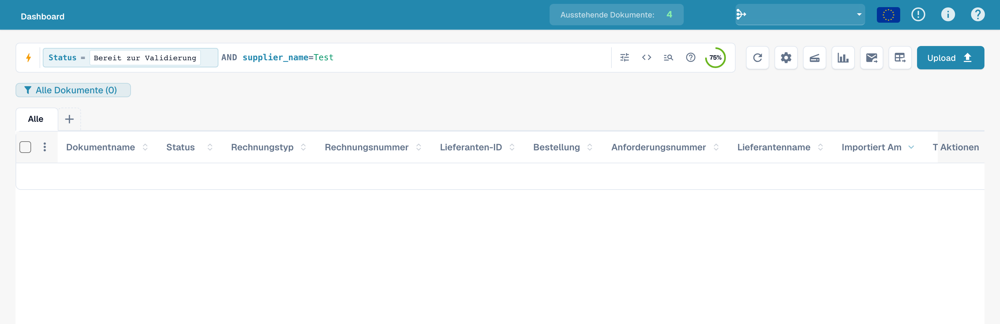<figcaption><p>Status- und Lieferantenfilter mit AND kombinieren.</p></figcaption></figure>

### Kurzformen

Kürzere Formulierungen für dieselben Abfragen — verwenden Sie, was sich besser liest:

| Kurzform | Entspricht | Beschreibung |
|----------|---------|-------------|
| `total_amount gt 5000` | `total_amount>5000` | Wort-Aliase für Vergleichsoperatoren (`gt`/`gte`/`lt`/`lte`/`eq`/`ne`) |
| `due_date > today` | `due_date>today()` | Bloßes `today` / `yesterday` / `tomorrow` |
| `imported_on this_week` | `imported_on>=today()-7 AND imported_on<=today()` | Relative Zeiträume (`this_week`, `last_week`, `this_month`, …) |
| `ap_assignment_code is empty` | `ap_assignment_code=""` | Ob ein Feld einen beliebigen Wert hat |
| `status:open` | `status=ready_for_validation` | Benutzerfreundliche Statusbezeichnung (`open`/`closed`/`failed`/`done`) |
| `total_amount not between 100, 200` | `total_amount<100 OR total_amount>200` | Wert außerhalb eines Fensters |
| `status in (finished, error)` | `status=finished OR status=error` | Beliebigen Wert aus einer Liste abgleichen |
| `not status=finished` | `status!=finished` | Beliebiges Prädikat negieren |
| `filename contains rechnung` | `filename:rechnung` | Zeichenketten-Abgleich (`contains`/`starts_with`/`ends_with`) |
| `total_amount > 5k` | `total_amount>5000` | Währungssuffix `k` (×1.000), `M` (×1.000.000) |
| `overdue` | `invoice_due_date<today() AND status!=finished` | Unbezahlte überfällige Rechnungen |
| `#INV-1234` | `invoice_id:INV-1234` | Präfix im Twitter-Stil für die Rechnungs-ID |
| `@User` | `assigned_to:User` | Präfix im Twitter-Stil für den Zugewiesenen |
| `$5000+` | `total_amount>=5000` | `$`-Präfix für Betragsschwellen |

### Galerie: Abfragebeispiele

Die Bilder zeigen die jeweils eingegebene Abfrage in der deutschen Oberfläche. Dokumentdaten sind ausgeblendet. Ein Bild der Filterleiste belegt keine bestimmte Trefferzahl.

#### Vergleich mit Wortoperator

```
created_on gt 2026-05-25
```

<figure><figcaption><p>Vergleichsoperator gt in einer Datumsabfrage verwenden.</p></figcaption></figure>

#### Datum vor heute

```
created_on < today()
```

<figure><figcaption><p>created_on mit today() vergleichen.</p></figcaption></figure>

#### Erstellungsdatum ab einem Stichtag

```
created_on >= 2026-06-01
```

<figure><figcaption><p>Erstellungsdatum ab dem 1. Juni 2026 filtern.</p></figcaption></figure>

#### Ohne Bearbeiter

```
assigned_to is empty
```

<figure><figcaption><p>Dokumente ohne zugewiesenen Bearbeiter suchen.</p></figcaption></figure>

#### Status filtern

```
status=ready_for_validation
```

<figure><figcaption><p>Beispiel einer Statusabfrage in der deutschen Schnellsuche.</p></figcaption></figure>

#### Außerhalb eines Zeitraums

```
created_on not between 2026-06-01 and 2026-06-15
```

<figure>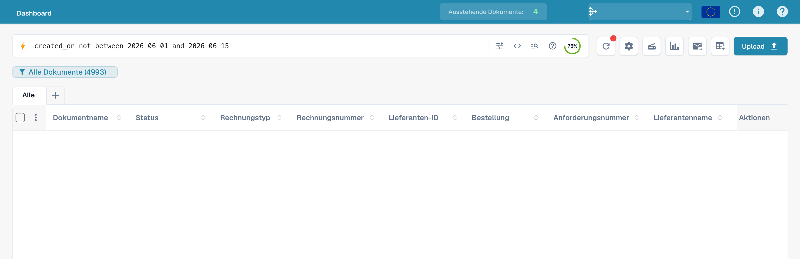<figcaption><p>Erstellungsdatum außerhalb eines angegebenen Zeitraums suchen.</p></figcaption></figure>

#### Mehrere Statuswerte

```
status=ready_for_validation OR status=exported
```

<figure>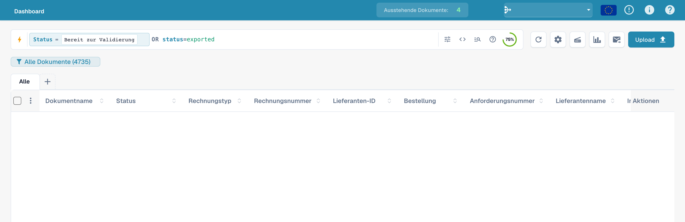<figcaption><p>Zwei technische Dokumentstatus mit OR kombinieren.</p></figcaption></figure>

#### Lieferantenfilter ausschließen

```
NOT supplier_name=Test
```

<figure><figcaption><p>Einen Lieferantenfilter mit NOT ausschließen.</p></figcaption></figure>

#### Teil eines Dateinamens

```
filename:invoice
```

<figure><figcaption><p>Dateinamen mit einem enthaltenen Suchbegriff finden.</p></figcaption></figure>

#### Rechnungsnummer abfragen

```
invoice_number=INV
```

<figure><figcaption><p>Beispiel einer Abfrage nach invoice_number.</p></figcaption></figure>

#### Leere Bearbeiterzuordnung

```
assigned_to=""
```

<figure><figcaption><p>Nach leerer Bearbeiterzuordnung filtern: assigned_to=&quot;&quot;.</p></figcaption></figure>

#### Währung abfragen

```
currency=EUR
```

<figure><figcaption><p>Dokumente in Euro suchen: currency=EUR.</p></figcaption></figure>

#### Fälligkeitsdatum vor heute

```
invoice_due_date<today()
```

<figure><figcaption><p>Nach einem Fälligkeitsdatum vor today() suchen.</p></figcaption></figure>

#### Betragsschwelle

```
total_amount>=1000
```

<figure><figcaption><p>Gesamtbetrag ab 1000 filtern.</p></figcaption></figure>

## Dokumentinhalt einbeziehen

Über das Menü **Suche im Dokumentinhalt** bestimmen Sie, ob die Schnellsuche zusätzlich den Dokumentinhalt berücksichtigt. Diese Auswahl ist von technischen Abfragepräfixen wie `vector:`, `ocr:` oder `ai:` zu unterscheiden.

### Automatisch

Wählen Sie **Automatisch**, damit die Suche den Dokumentinhalt nach dem verfügbaren Suchmodus einbezieht.

<figure>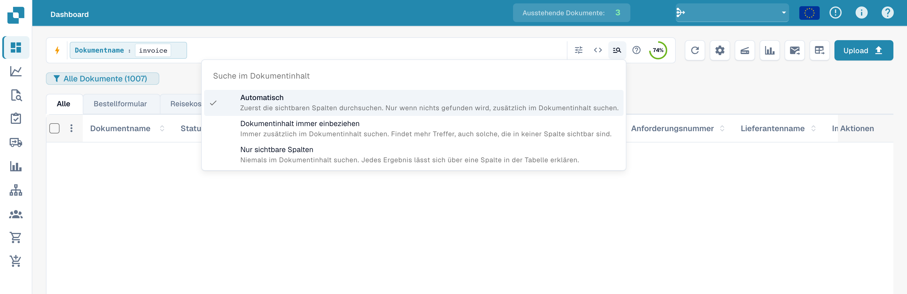<figcaption><p>Dokumentinhalt bei der Schnellsuche automatisch einbeziehen.</p></figcaption></figure>

### Dokumentinhalt immer einbeziehen

Diese Auswahl bezieht den Dokumentinhalt ausdrücklich in die Suche ein. Die dafür benötigten Suchfunktionen müssen für Ihre Organisation verfügbar sein.

<figure>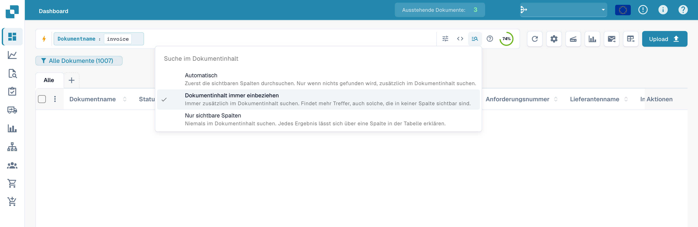<figcaption><p>Dokumentinhalt bei der Schnellsuche immer einbeziehen.</p></figcaption></figure>

### Nur sichtbare Spalten

Mit **Nur sichtbare Spalten** begrenzen Sie die Suche auf die im Dashboard sichtbaren Spalten.

<figure>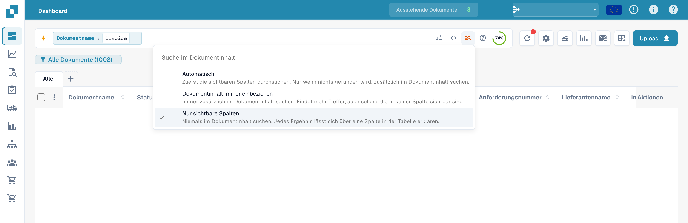<figcaption><p>Schnellsuche auf sichtbare Spalten begrenzen.</p></figcaption></figure>

---

### Rezepte

| Sie möchten … | Geben Sie dies ein |
|-----------|-----------|
| Bereit zur Validierung, vollständig abgeglichen | `status=ready_for_validation AND po_match_status=full_matched` |
| Dieser Lieferant, diese Woche | `supplier_name=Test AND created_on>today()-7` |
| Überfällige Rechnungen mit hohem Wert | `total_amount>5000 AND invoice_due_date<today()` |
| Zwei Lieferanten gleichzeitig | `supplier_name=BeispielA OR supplier_name=BeispielB` |
| Fehlerhafte Dokumente von heute | `(status=error OR status=failed) AND created_on>today()-1` |
| Elektronische Gutschriften | `is_edoc=true AND sub_doc_type=CREDIT_NOTE` |
| Nach Bestell-Präfix | `purchase_order=PO-2026` |

> Orangefarbene (Volltext-)Felder erfordern, dass die **Volltextsuche** für Ihre
> Organisation aktiviert ist. Ein wörtliches `%` oder `_` in einem Wert wird als normales Zeichen behandelt.
