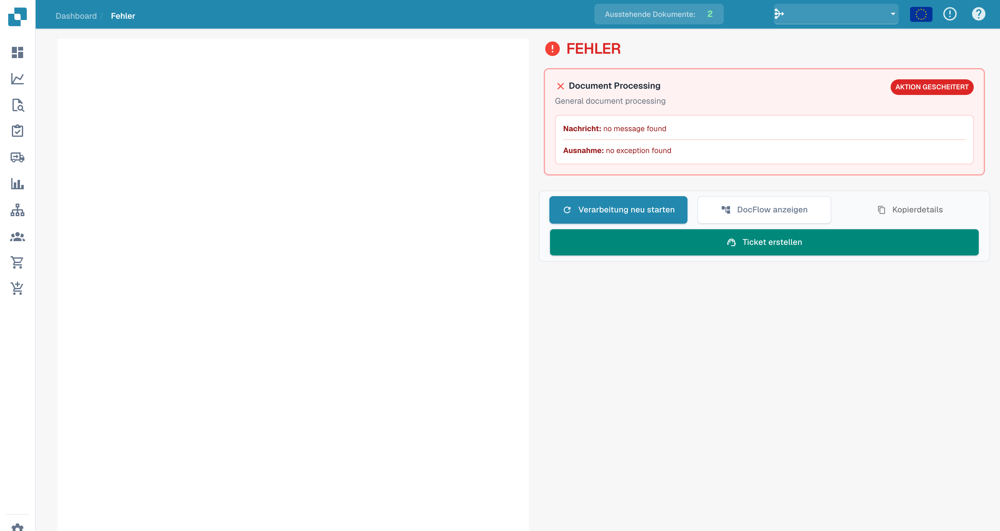
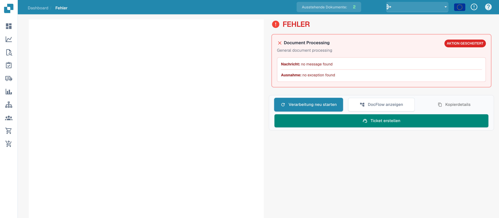

# Fehleransicht

Wenn die Dokumentverarbeitung fehlschlägt, hilft die **Fehleransicht** bei der Diagnose. Sie zeigt die betroffene Verarbeitung, eine **Nachricht** und eine **Ausnahme**, soweit solche Details vorliegen.

## Fehlerdetails lesen

<figure><figcaption>
Bereich für Nachricht und Ausnahme in der Fehleransicht; das Beispiel enthält keine Detailmeldung.
</figcaption></figure>

Diese Aufnahme erläutert die Oberfläche ohne hinterlegte Fehlerdetails. Die technischen Platzhalter `no message found` und `no exception found` sind keine konkrete Fehlerdiagnose. Bei einem tatsächlichen Vorfall prüfen Sie die dort angezeigten Meldungen und den [Dokumentenfluss](dashboard/document-flow.md).

## Verfügbare Aktionen

<figure><figcaption>
Fehleransicht mit Aktionen; im Beispiel sind keine Fehlerdetails hinterlegt.
</figcaption></figure>

| Aktion | Verwendung |
| --- | --- |
| **Verarbeitung neu starten** | Die Dokumentverarbeitung nach Prüfung beziehungsweise Behebung der Ursache erneut anstoßen. |
| **DocFlow anzeigen** | Die Verarbeitungsschritte und deren Zustand untersuchen. |
| **Kopierdetails** | Verfügbare technische Details für die weitere Diagnose kopieren. |
| **Ticket erstellen** | Eine Supportanfrage zum betroffenen Dokument vorbereiten. |

Die verfügbaren Dokument- und Vorschaufunktionen hängen davon ab, ob das Dokument erfolgreich geladen werden kann. Kann es nicht geladen werden, bleibt der Vorschaubereich möglicherweise leer.

## Support kontaktieren

Tritt der Fehler erneut auf, nennen Sie dem Support die Dokument-ID, die genaue Meldung, den Zeitpunkt sowie bereits durchgeführte Schritte. Prüfen Sie technische Details auf vertrauliche Inhalte, bevor Sie diese weitergeben. Weitere Hinweise finden Sie unter [Benutzerunterstützung](ressources-and-support/user-support.md).
