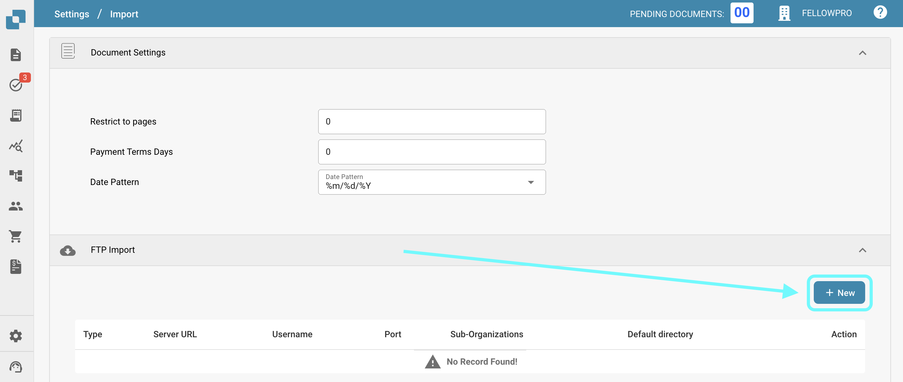

# FTP

Wenn Sie Ihr SFTP mit DocBits integrieren möchten, um Dokumente zu importieren.

Anforderungen

* Korrekt konfigurierter, Linux-kompatibler SFTP-Server
* SFTP-Hostname, Benutzername und Passwort
* Dedizierter Importordner

**Importkonfiguration**

Öffnen Sie vom Dashboard aus die Einstellungen und navigieren Sie zu Importieren. Wählen Sie unter FTP-Import aus, um eine neue Konfiguration hinzuzufügen.

<figure><figcaption></figcaption></figure>

Geben Sie die SFTP-Anmeldeinformationen in die dafür vorgesehenen Felder ein und wählen Sie Speichern (Das API-Schlüsselfeld wird automatisch mit dem API-Schlüssel der Umgebung, in der Sie arbeiten, ausgefüllt).

Sobald Sie alle erforderlichen Details Ihres SFTP eingegeben haben, klicken Sie auf SPEICHERN.
