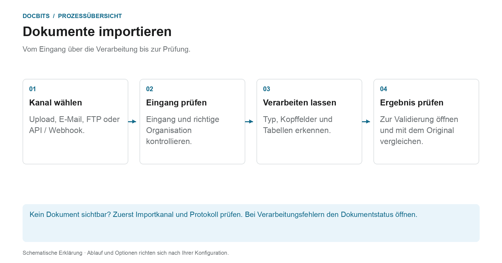

# So importieren Sie Dokumente

## Vom Eingang zum prüfbaren Dokument

<figure><figcaption>
Vom Eingang über die Verarbeitung bis zur Prüfung. Die Grafik ist schematisch; maßgeblich sind die aktiven Einstellungen Ihrer Organisation.
</figcaption></figure>

Wählen Sie zunächst den Importweg. Der erfolgreiche Versand einer E-Mail oder das Absenden einer API-Anfrage belegt noch nicht, dass das Dokument vollständig verarbeitet ist. Prüfen Sie den Eingang in DocBits und anschließend den Dokumentstatus.

1. **Importkanal wählen:** Nutzen Sie den manuellen Upload für einzelne Dateien oder einen eingerichteten automatischen Kanal für regelmäßige Eingänge.
2. **Eingang kontrollieren:** Suchen Sie das Dokument in der richtigen Organisation. Bei E-Mail-Eingängen prüfen Sie bei Bedarf die Importprotokolle; unterstützen Format und Absenderregeln den Anhang?
3. **Verarbeitung abwarten:** DocBits verarbeitet das Dokument entsprechend dem Dokumenttyp und den aktiven Einstellungen. Bei PDFs kann OCR oder vorhandener PDF-Text verwendet werden; elektronische Dokumente können strukturierte Daten liefern. Nicht jeder Import durchläuft denselben Extraktionspfad.
4. **Ergebnis öffnen:** Sobald das Dokument zur Validierung bereitsteht, vergleichen Sie erkannte Angaben mit dem Original. Ein Import ist noch keine Genehmigung und kein ERP-Export.

### Den passenden Importweg finden

| Eingang | Anleitung |
| --- | --- |
| Einzelne Dokumente hochladen | [Manueller Import](manual-import.md) |
| Postfach verbinden oder E-Mails weiterleiten | [E-Mail-Import](email/README.md) |
| Dateien über einen eingerichteten FTP-Kanal abholen | [FTP](ftp.md) |
| Dokumente aus einer Anwendung übertragen | [Webhook / API](webhook.md) |

**Wenn etwas fehlt:** Prüfen Sie zuerst den Eingangskanal. Ist das Dokument bereits in DocBits vorhanden, helfen [Dokumentstatus](../dashboard/document-status.md) und [Dokument-Flow](../dashboard/document-flow.md), den betroffenen Verarbeitungsschritt zu finden.


DocBits Import-Tutorial: Dokumente hochladen, Drag & Drop + manuelle vs. automatische Klassifizierung

