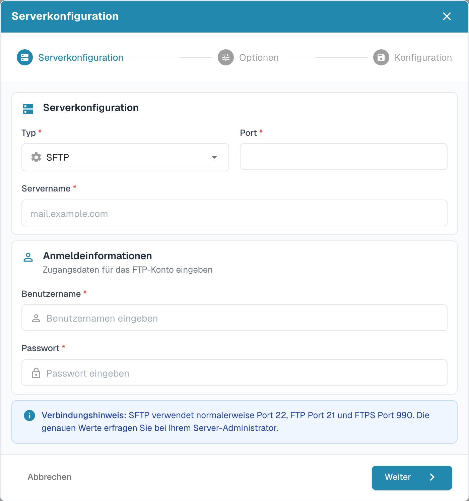

# FTP- und SFTP-Import

Für einen automatischen Import benötigen Sie die freigegebenen Serverdaten sowie einen Importordner, auf den das verwendete Konto zugreifen darf.

## Verbindung anlegen

Öffnen Sie **Einstellungen → Import** und wählen Sie im Bereich **FTP-Import** eine neue Verbindung.

<figure><figcaption>
Deutsche Übersicht der Importverbindungen; Verbindungsdaten sind ausgeblendet.
</figcaption></figure>

Der Assistent beginnt mit **Serverkonfiguration**. Wählen Sie den Verbindungstyp und tragen Sie Servername, Port sowie die vorgesehenen Anmeldedaten ein. Der Hinweis im Dialog nennt die üblichen Ports; maßgeblich sind die Angaben Ihrer Serveradministration.

<figure><figcaption>
Erster Schritt des FTP-Importassistenten: Serverkonfiguration.
</figcaption></figure>

Gehen Sie mit **Weiter** zu den folgenden Schritten **Optionen** und **Konfiguration**. Prüfen Sie die vollständige Verbindung, bevor Sie sie speichern.

## Dateiarchivierung

Wenn Ihre Verbindung eine Dateiarchivierung anbietet, konfigurieren Sie diese in den Importoptionen. Legen Sie das gewünschte Archivverzeichnis fest und prüfen Sie, dass das Importkonto dort schreiben darf. Testen Sie mit einer Beispieldatei, ob nach erfolgreichem Import die vorgesehene Archivierung erfolgt. Die verfügbaren Optionen hängen vom Verbindungstyp und Ihrer Version ab.
