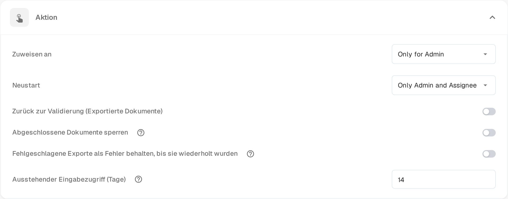

# Pending Input

**Pending Input** hält ein Dokument an, während Sie auf die Antwort einer Kollegin oder eines Kollegen warten. Sie stellen die Frage im Aktivitätsprotokoll des Dokuments und markieren die Personen, die antworten sollen. Das Dokument verlässt die aktive Warteschlange, bis geantwortet wird; die markierten Personen können es über einen Link in ihrer E-Mail schreibgeschützt öffnen.

Der Status erscheint im [Dashboard](dashboard/README.md) als **Pending Input**, und Sie können die Arbeitsliste danach filtern.

## Eingabe anfordern

1. Öffnen Sie das Dokument in einer Ansicht, die das Aktivitätsprotokoll anbietet – die Genehmigungs- und Prüfansichten tun das –, und wählen Sie das Sprechblasen-Symbol in der Werkzeugleiste.
2. Schreiben Sie Ihre Frage und tippen Sie **@**, gefolgt vom Namen der gewünschten Person. Wählen Sie die Person aus der angezeigten Liste. Erst die Markierung gewährt den Zugriff: Nur markierte Personen erhalten den Link zum Dokument.
3. Sobald eine Person markiert ist, erscheint unter dem Eingabefeld ein Kasten mit zwei Möglichkeiten:

* **Comment only** (nur Kommentar) – die Frage wird im Aktivitätsprotokoll veröffentlicht, der Status bleibt unverändert. Verwenden Sie diese Möglichkeit, wenn Sie nur eine Antwort benötigen und das Dokument nicht anhalten möchten.
* **Send & set to Pending Input** (senden und auf Pending Input setzen) – die Frage wird veröffentlicht und das Dokument wartet. Es verlässt die aktive Warteschlange und bleibt angehalten, bis die markierte Person antwortet.

Die markierten Personen erhalten eine E-Mail mit einem Link zum Dokument. **Enter** oder das Senden-Symbol veröffentlichen weiterhin einen normalen Kommentar ohne Zugriff; **Shift+Enter** beginnt eine neue Zeile. Bei einem bereits angehaltenen Dokument oder bei einem Dokument, das noch nicht angehalten werden kann, bietet der Kasten die Frage ohne die Pause-Option an.

## Eine Anfrage beantworten

Sie werden um eine Eingabe gebeten, wenn eine Kollegin oder ein Kollege Sie im Aktivitätsprotokoll markiert.

* Öffnen Sie den Link aus der E-Mail. Die Seite **Pending Input** zeigt links die Seiten des Dokuments und rechts das Aktivitätsprotokoll, mit der Markierung **Pending Input**.
* Ihr Zugriff ist schreibgeschützt: Sie können das Dokument lesen und im Aktivitätsprotokoll antworten, aber keine Felder ändern und nicht exportieren.
* Schreiben Sie Ihre Antwort im Aktivitätsprotokoll und senden Sie sie. Die fragende Person wird benachrichtigt, und der Verlauf bleibt im Dokument erhalten.
* Der Kopf der Seite zeigt, wie lange Ihr Zugriff gilt, zum Beispiel **Read-only access until 09.11.2026**. Der Zugriff endet auch, sobald das Dokument weitergeht.

Wenn Sie den Link öffnen, nachdem die Anfrage beantwortet wurde oder Ihr Zugriff geendet hat, teilt Ihnen die Seite mit, dass die Anfrage erledigt oder abgelaufen ist und keine Aktion nötig ist.

## Die Anfrage abschließen

Das Dokument bleibt angehalten, bis die zugewiesene Person die Antwort aufgreift.

1. Öffnen Sie das Dokument im Dashboard. Ein angehaltenes Dokument öffnet direkt seine **Pending Input**-Seite.
2. Lesen Sie die Antwort im Aktivitätsprotokoll.
3. Wählen Sie **Resolve & Proceed** (abschließen und fortfahren). Das Dokument läuft im folgenden Status seines Workflows weiter, sodass Sie direkt auf der Ansicht landen, in der Sie weiterarbeiten.

Nur die dem Dokument zugewiesene Person oder ein Mitglied der Gruppe, der es zugewiesen ist, kann die Anfrage abschließen. Administratoren und Genehmiger können ein angehaltenes Dokument schreibgeschützt öffnen, um zu sehen, warum es wartet.

## Die Zugriffsdauer festlegen

Die Funktion ist in jeder Organisation verfügbar. Einstellen lässt sich, wie lange eine angefragte Person Zugriff auf das Dokument behält:

1. Öffnen Sie **Einstellungen → Dashboard**.
2. Klappen Sie **Aktion** auf.
3. Tragen Sie in **Ausstehender Eingabezugriff (Tage)** eine ganze Zahl an Tagen ein. Standard sind **14**, mindestens ein Tag ist erforderlich.
4. Speichern Sie Ihre Änderungen.

Die Frist beginnt mit dem Versand der Anfrage. Sie endet früher, wenn das Dokument abgeschlossen ist oder in einen anderen Status wechselt.

<figure><figcaption>
Ausstehender Eingabezugriff (Tage) im Abschnitt Aktion der Dashboard-Einstellungen. Die Auswahlwerte der Berechtigungen darüber zeigt das Produkt derzeit auf Englisch.
</figcaption></figure>
