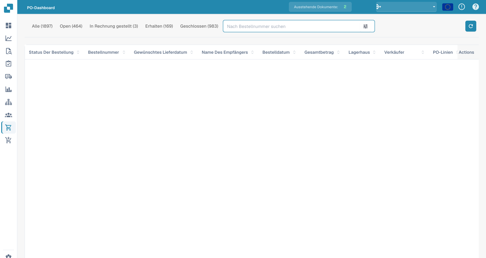

# Bestellung

Dieser Abschnitt bietet einen detaillierten Überblick über alle Bestellungen. Er enthält eine Suchleiste mit verschiedenen Filtern, die Sie auswählen können, um Ihre Ergebnisse schnell einzugrenzen. Darüber hinaus können Sie die Anordnung der Spaltenüberschriften anpassen, indem Sie die Drag-and-Drop-Funktionalität für ein maßgeschneidertes Seherlebnis verwenden.

<figure><figcaption>
Bestellübersicht mit deutschen Spaltenüberschriften und ausgeblendeten Bestelldaten.
</figcaption></figure>
