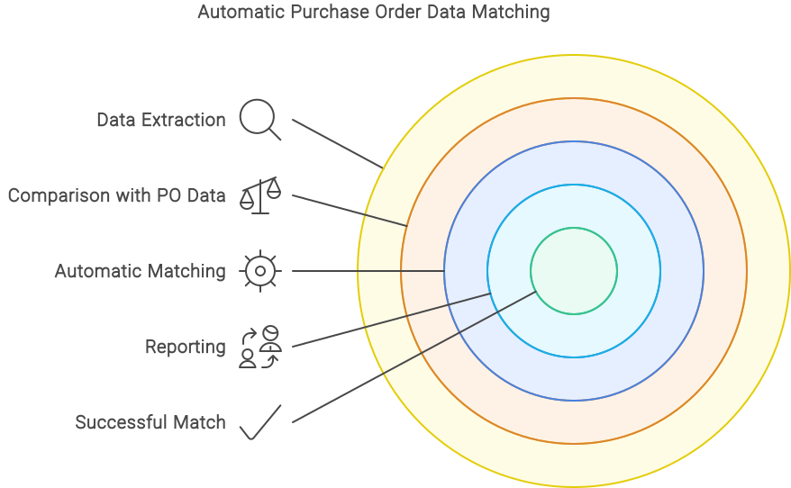

# Automatischer Bestelldatenabgleich

Docbits ist ein fortschrittliches System, das darauf ausgelegt ist, den Abgleich von Bestelldaten (POs) mit eingehenden Rechnungsdokumenten zu automatisieren. Dieses Tool ist speziell für die effiziente Verwaltung und Verarbeitung von Rechnungsdaten innerhalb von ERP-Systemen konzipiert. Diese Dokumentation erläutert die Grundlagen des automatischen Abgleichs durch Docbits und definiert die spezifischen Regeln, die für einen erfolgreichen Abgleich erforderlich sind.

<figure><figcaption></figcaption></figure>

## **Grundprinzipien der automatischen Abgleichung in Docbits**

**Datenextraktion:** Docbits startet den Prozess, indem relevante Daten aus digitalisierten Rechnungsdokumenten extrahiert werden. Typischerweise umfasst diese Daten die Artikelnummern, Mengen und Stückpreise jeder Rechnungsposition. Die Präzision dieser Extraktion ist entscheidend, da sie die Grundlage für den nachfolgenden Abgleichprozess bildet.

**Vergleich mit PO-Daten:** Die extrahierten Daten werden mit den entsprechenden Informationen in den gespeicherten Bestellungen verglichen. Docbits überprüft, ob die Artikelnummern, Mengen und Preise mit denen in den POs übereinstimmen. Für einen erfolgreichen Abgleich müssen die Daten in den Rechnungen den Daten in den Bestellungen entsprechen, unter Berücksichtigung definierter Toleranzgrenzen.

**Automatischer Abgleich:** Basierend auf den Vergleichsergebnissen führt Docbits den Abgleich durch. Das System überprüft, ob die Abgleichkriterien innerhalb der festgelegten Toleranzgrenzen liegen. Wenn diese Kriterien erfüllt sind, wird der Abgleich als erfolgreich betrachtet.

**Berichterstattung:** Nach Abschluss des Abgleichprozesses generiert Docbits Berichte, die den Status der Abgleiche anzeigen. Diese Berichte informieren über erfolgreich abgeglichene Rechnungen und identifizieren Abweichungen.

## **Definition der Abgleichregeln**

**Artikelnummer:** Die Artikelnummer auf der Rechnung muss genau mit der Artikelnummer in der Bestellung übereinstimmen. Es gibt keine Toleranz für Abweichungen bei den Artikelnummern.

**Mengen:** Die Menge der gelieferten Waren auf der Rechnung kann innerhalb eines vordefinierten Toleranzbereichs variieren. Typischerweise könnte eine Toleranz von ±5% akzeptabel sein, um geringfügige Unterschiede in den Liefermengen zu berücksichtigen.

**Preise:** Preisabweichungen sind bis zu einer festgelegten Schwelle tolerierbar. Eine übliche Toleranz könnte ±2% des Preises betragen, um geringfügige Unterschiede in Preisangaben zu akzeptieren, die aus Rundungsunterschieden oder Währungsschwankungen resultieren.

## **Abgleichstatus:**

* **Vollständiger Abgleich:** Alle Datenpunkte (Artikelnummer, Menge und Preis) liegen innerhalb der festgelegten Toleranzgrenzen.
* **Teilabgleich:** Ein oder mehrere Datenpunkte weichen außerhalb der Toleranzgrenzen ab, aber die Abweichungen sind minimal und erfordern eine manuelle Überprüfung.
* **Kein Abgleich:** Signifikante Abweichungen in einem oder mehreren Datenpunkten, die sofortige Korrektur oder weitere Untersuchungen erfordern.

Die präzise Definition dieser Regeln und die Festlegung von Toleranzgrenzen sind entscheidend für die Effizienz des automatischen Abgleichs und die Reduzierung manueller Eingriffe. Docbits ermöglicht eine flexible Konfiguration dieser Parameter, um den Anforderungen verschiedener Unternehmen und Branchen gerecht zu werden.
