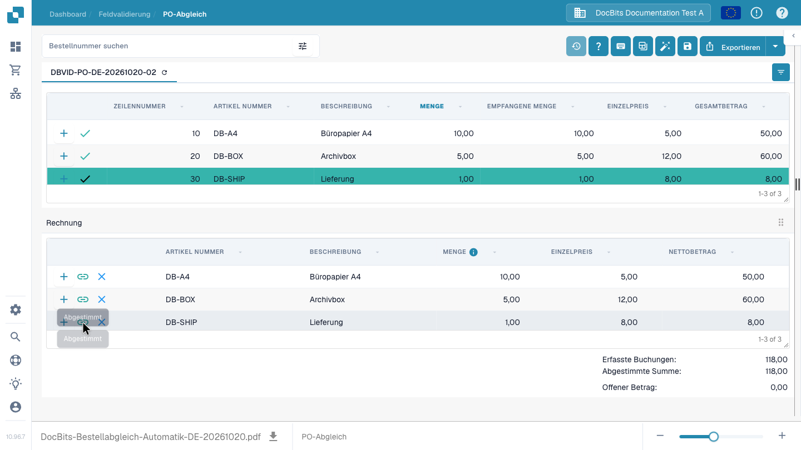
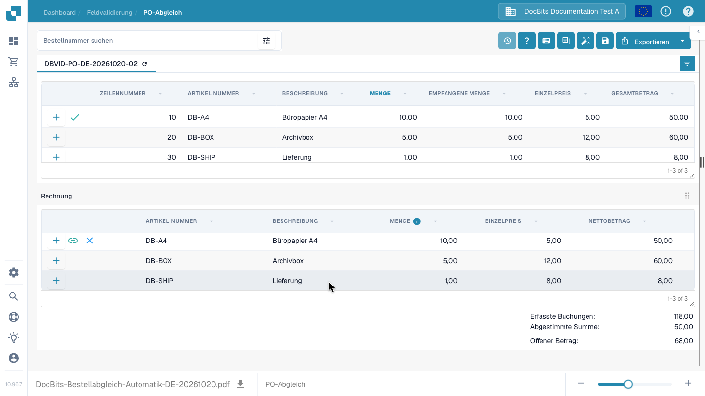
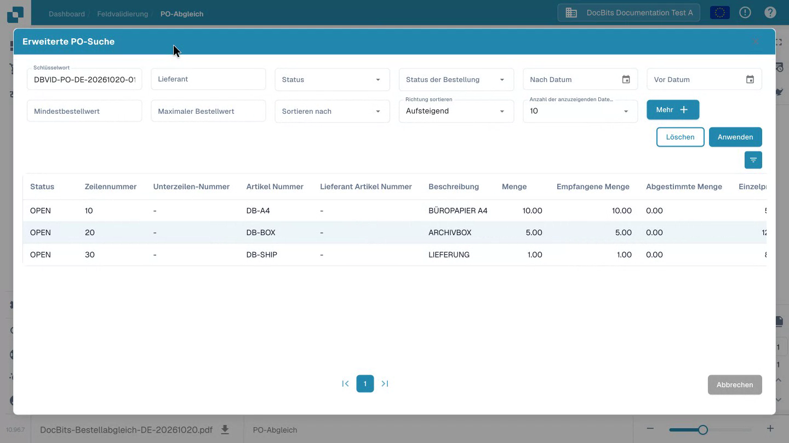
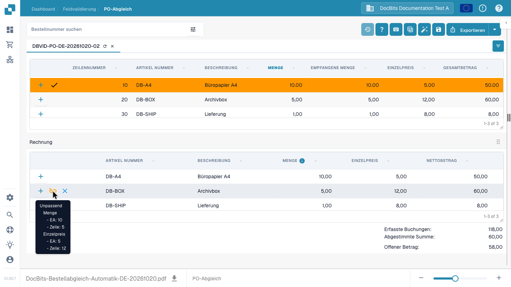

# Bildschirm „Purchase Order Matching“

DocBits übernimmt eine auf der Rechnung erkannte **Bestellnummer** automatisch und lädt die zugehörige Bestellung für den **PO-Abgleich**. Sie müssen die Nummer dann nicht erneut eingeben oder die Bestellung manuell suchen. Eingerichtete Abgleichregeln können auch die Rechnungspositionen automatisch mit den Bestellpositionen verbinden. Ihre Aufgabe ist es, das Ergebnis zu prüfen und ungeklärte Abweichungen zu bearbeiten. Die Bestelldaten können aus einer ERP-Integration oder einem anderen konfigurierten Import stammen. Der Bildschirm zeigt das Dokument neben den beiden Tabellen an, damit Sie Nummern, Mengen, Preise und Abweichungen prüfen können, bevor Sie speichern oder exportieren.

## Rechnungspositionen prüfen und mit einer Bestellung abgleichen

Der Rundgang beginnt mit dem Normalfall: DocBits hat die Bestellnummer aus der Rechnung übernommen, lädt die passende Bestellung ohne manuelle Suche und hat die drei Positionen automatisch abgeglichen. Die Anwenderin prüft Artikel, Mengen, Preise und Summen, erklärt Full Match und Partial Match an konkreten Beispielen und speichert das Ergebnis. Erst danach zeigt sie Sonderfälle: eine nicht erkannte Bestellnummer manuell suchen sowie eine falsche Verbindung lösen und korrigieren. Diese manuellen Schritte sind keine Pflichtschritte bei jeder Rechnung.




Bestelldaten müssen in der Organisation verfügbar und der PO-Abgleich für den Dokumenttyp eingerichtet sein. Die Regeln, Toleranzen und verfügbaren Freigabe- oder Exportaktionen hängen von Ihrer Konfiguration und Ihren Berechtigungen ab.


<figure><figcaption>
Das Beispiel enthält Papier, Archivboxen und Lieferung. Alle drei Positionen sind erfolgreich zugeordnet; der offene Betrag ist null.
</figcaption></figure>

## Full Match, Partial Match und Abweichungen verstehen

| Ergebnis | Bedeutung | Ihr nächster Schritt |
| --- | --- | --- |
| **Full Match – vollständiger Abgleich** | Alle relevanten Rechnungspositionen sind nach den geltenden Regeln erfolgreich abgeglichen. Im Video sind das drei Positionen und 118 Euro netto. | Ergebnis und Beleg prüfen, speichern und den vorgesehenen Freigabe- oder Exportprozess fortsetzen. |
| **Partial Match – teilweiser Abgleich** | Ein Teil der Rechnungspositionen ist zugeordnet, weitere Positionen sind noch offen. Im Video ist Papier mit 50 Euro zugeordnet; Archivboxen und Lieferung mit zusammen 68 Euro sind offen. | Offene Positionen und die Ursache prüfen; bei Bedarf die korrekte Zuordnung ergänzen oder die Angaben klären. |
| **Abweichung / Unpassend** | Eine Verbindung besteht, aber ein geprüfter Wert wie Menge, Einzelpreis oder Artikelkennung passt nicht. | Abweichungsdetails lesen. Eine falsche Verbindung lösen; eine tatsächliche Differenz nach Ihrem Prüfprozess klären. |

<figure><figcaption>
Partial Match: Eine von drei Rechnungspositionen ist erfolgreich zugeordnet. Das ist keine feste 50-Prozent-Grenze.
</figcaption></figure>

„Half Match“ ist keine feste 50-Prozent-Grenze. Verwenden Sie für einen unvollständigen Abgleich den Begriff **Partial Match**. Eine passende Bestellnummer oder Gesamtsumme allein ergibt noch keinen Full Match. Umgekehrt darf die Bestellung weitere, noch nicht berechnete Positionen enthalten: Entscheidend sind die relevanten Positionen dieser Rechnung. Ein Full Match bestätigt den Abgleich; Freigabe und Export bleiben eigene Prozessschritte.

## Was die Regeln und Toleranzen bestimmen

Administratoren legen fest, welche Felder verglichen werden und welche Regeln automatisch oder bei einer manuellen Verbindung gelten. **Single Match** vergleicht eine Rechnungsposition mit einer Bestellposition. **Multi Match** ermöglicht den gemeinsamen Abgleich mehrerer Positionen nach den eingerichteten Gruppierungen und Vergleichsstrategien. **Match on Total** ist eine Regelart für summierte Werte und hat eine andere Bedeutung als der Dokumentstatus Full Match.

Mengen- und Einzelpreistoleranzen können als Prozent oder fester Wert eingerichtet werden. Bei einem Bestellpreis von 10 Euro bedeuten 5 Prozent eine erlaubte Abweichung von 0,50 Euro in beide Richtungen, also 9,50 bis 10,50 Euro. Die passende numerische Vergleichsspalte der Regel muss Toleranz zulassen. Artikelbezogene Einstellungen können die allgemeinen Werte übersteuern. Außerhalb der erlaubten Grenzen klären Sie die Ursache; ändern Sie keine Rechnungswerte allein für eine erfolgreiche Markierung.

### Adminvideo: PO-Abgleichsregeln und Toleranzen einrichten

Der Administrator zeigt die drei Regeltypen, Prioritäten innerhalb der Verarbeitungsstufen, Spaltenvergleiche, automatische und manuelle Anwendung sowie erweiterte Optionen. Er bearbeitet und speichert einen Entwurf und richtet im Testbeispiel eine Einzelpreistoleranz von fünf Prozent ein. Er erklärt außerdem feste Werte, artikelbezogene Ausnahmen und die getrennten Grenzen für Fracht, Zusatzkosten und Steuern. Die Aktivierung eines geänderten Regelwerks folgt erst nach fachlichen Tests.



Die einzelnen Einstellungen sind unter [PO-Abgleichsregeln](../../../administration-and-setup/settings/global-settings/document-types/more-settings/purchase-order/purchase-order-matching-rules.md) und [PO-Toleranzen](../../../administration-and-setup/settings/global-settings/document-types/more-settings/purchase-order/purchase-order-tolerance-settings-additional-purchase-order-tolerance.md) beschrieben.

## Automatisch übernommene Bestellung prüfen

1. Öffnen Sie die Rechnung im **PO-Abgleich**. Eine erkannte Bestellnummer wird aus dem Rechnungsfeld **Bestellung** übernommen; DocBits lädt darüber die zugehörigen Bestellpositionen automatisch. Voraussetzung ist, dass die Bestellung in Ihrer Organisation verfügbar ist.
2. Wählen Sie die Bestellnummer oberhalb der Tabelle, um die geladenen Positionen zu prüfen. Das Aktualisierungssymbol neben der Nummer lädt die Daten dieser Bestellung neu. Ein Neuladen kann von der konfigurierten Integration abhängen.
3. Vergleichen Sie die automatisch zugeordneten Rechnungs- und Bestellpositionen sowie ihre Statusmarkierungen. Das **+** auf einer Position klappt vorhandene Abgleich-Details auf; es verbindet die Position nicht selbst mit der Rechnung.

### Nur bei Bedarf: Bestellung manuell suchen

Ist keine passende Bestellnummer erkannt oder muss eine andere Bestellung geprüft werden, nutzen Sie die manuelle Suche:

1. Geben Sie die Nummer in **Bestellnummer suchen** ein. Öffnet sich eine Ergebnisliste, laden Sie die passende Bestellung mit einem Doppelklick auf einen Treffer.
2. Wählen Sie bei Bedarf das Filtersymbol neben dem Suchfeld für **Schlüsselwort**, **Lieferant**, **Status**, **Status der Bestellung**, Datums- und Betragsbereiche, Sortierung und die Anzahl der angezeigten Datensätze. Wählen Sie **Mehr** für zusätzliche Kriterien, **Anwenden** zum Suchen oder **Löschen** zum Zurücksetzen.
3. Prüfen Sie anschließend die geladenen Bestellpositionen und das Abgleichergebnis. Eine manuelle Suche ersetzt die Prüfung der Bestellnummer auf dem Originalbeleg nicht. Wird kein Treffer gefunden, prüfen Sie außerdem den Import der Bestellung in diese Organisation. Die Suche legt keine fehlende Bestellung an.

<figure><figcaption>
Die manuelle Suche und ihre Filter helfen bei Sonderfällen. Eine bereits erkannte Bestellnummer müssen Sie hier nicht nochmals eingeben.
</figcaption></figure>

## Positionen abgleichen und das Ergebnis prüfen

Der automatische Positionsabgleich verbindet geeignete Rechnungs- und Bestellpositionen nach den Regeln Ihrer Organisation. Prüfen Sie zuerst diese vorhandenen Zuordnungen. Bleiben Verbindungen offen oder ist eine Zuordnung falsch, können Sie Positionen manuell per Drag & Drop oder über das Kontextmenü verbinden. Über **Auto Match** können Sie den automatischen Abgleich bei Bedarf erneut anstoßen. Prüfen Sie das Ergebnis vor dem Speichern: Eine gleiche Artikelnummer allein belegt nicht, dass Menge, Preis oder Lieferbedingungen übereinstimmen. Siehe [Bestellnummer-Abgleich-Tools](purchase-order-matching-tools.md) für die Symbolleiste, Spaltensteuerung und manuelle Aktionen sowie [Tastenkombinationen](keyboard-shortcuts.md) für Tastaturaktionen.

### Manuell verbinden und eine falsche Zuordnung lösen

1. Öffnen Sie das Kontextmenü einer Bestellposition mit der rechten Maustaste und wählen Sie **Für Übereinstimmung auswählen**.
2. Öffnen Sie das Kontextmenü der passenden Rechnungsposition und wählen Sie **Verbinden Sie**.
3. Prüfen Sie die Statusmarkierung. Bewegen Sie den Mauszeiger über das Verbindungssymbol der Rechnungsposition, um Abweichungen wie Menge und Einzelpreis zu lesen.
4. Ist die Zuordnung falsch, lösen Sie sie über das **Kreuz** an der Rechnungsposition. Die Werte der Rechnung bleiben dabei erhalten. Verbinden Sie danach die richtigen Positionen.
5. Der **Zauberstab** in der oberen Symbolleiste startet den automatischen Abgleich. Kontrollieren Sie anschließend jede Zuordnung und die Summen.

<figure><figcaption>
Eine Verbindung kann bestehen und trotzdem unpassend sein. Hier zeigen die Details eine abweichende Menge und einen abweichenden Einzelpreis.
</figcaption></figure>

Klären Sie eine tatsächliche Preis- oder Mengenabweichung nach Ihrem Prüfprozess. Ändern Sie Rechnungswerte nicht allein, um eine erfolgreiche Statusmarkierung zu erhalten.

Wenn ein Dokument nicht abgeglichen wird, lesen Sie den Grund oberhalb des Bestellbereichs. Er kann melden, dass die Bestellnummer fehlt, die Bestellung nicht gefunden wurde, ihre Positionen nicht verfügbar sind oder die Rechnung keine extrahierten Positionen hat. Korrigieren Sie das Dokument oder die Konfiguration, die dieser Grund angibt. Administratoren können die [Abgleichregeln](../../../administration-and-setup/settings/global-settings/document-types/more-settings/purchase-order/purchase-order-matching-rules.md) und die [Tabellenerkennung](../../../administration-and-setup/settings/document-processing/classification-and-extraction/README.md) prüfen, wenn keine Rechnungspositionen erscheinen.

Häufige Meldungen und nächste Schritte:

| Was Sie sehen | Was Sie prüfen sollten |
| --- | --- |
| Keine Bestellnummer | Prüfen Sie die Bestellnummer im Dokument. Wählen Sie das Zielfeld und übernehmen Sie den Wert durch Auswählen beziehungsweise Doppelklicken auf dem Originalbeleg; speichern Sie anschließend. Eine manuelle Tastatureingabe trainiert die Erkennung nicht. |
| Keine Bestellung gefunden | Prüfen Sie die Nummer und ob die Bestellung in diese Organisation importiert wurde. |
| Die Bestellung wurde gefunden, aber nicht verbunden | Versuchen Sie **Auto Match**, oder verbinden Sie die Positionen manuell, nachdem Sie beide Tabellen geprüft haben. |
| Keine Bestellposition passt | Vergleichen Sie die Rechnungswerte mit der Bestellung und prüfen Sie die Abgleich-Historie. |
| Keine Rechnungspositionen | Prüfen Sie die [Tabellenerkennung](../../../administration-and-setup/settings/document-processing/classification-and-extraction/README.md), bevor Sie abzugleichen versuchen. |
| Keine offenen Bestellpositionen | Prüfen Sie die [Status verbrauchter Bestellpositionen](../../../administration-and-setup/settings/global-settings/document-types/more-settings/purchase-order/consumed-po-line-status.md) und die ausgeschlossenen Status. |


Speichern kann den Abgleich nach einer geänderten oder neu erkannten Bestellnummer erneut auslösen. Prüfen Sie das angezeigte Ergebnis nach dem Speichern. Wenn ein Abgleich nicht gespeichert werden kann, lesen Sie den angezeigten Fehler auf dem Bildschirm und bitten Sie einen Administrator, die [Transformation](../../../administration-and-setup/settings/global-settings/document-types/transformation-rules.md) und die [Abgleichregeln](../../../administration-and-setup/settings/global-settings/document-types/more-settings/purchase-order/purchase-order-matching-rules.md) zu prüfen.


Nutzen Sie die **Abgleich-Historie** (Uhr-Symbol, soweit Ihre Berechtigungen es erlauben), um nachzuvollziehen, wie ein früherer Abgleich entschieden wurde. Sie ist eine schreibgeschützte Ansicht. Sie können prüfen, welche Regeln liefen und warum ein Kandidat nicht passte; das Öffnen der Historie exportiert das Dokument nicht.

### Mehr als eine Position pro Abgleich

Eine einzelne Rechnungsposition kann mehreren Bestellpositionen entsprechen – oder umgekehrt –, soweit Ihre Abgleichregeln das erlauben. Öffnen Sie die **+**-Details einer Position, um einen vorhandenen Multi-Match zu prüfen. Prüfen Sie die kombinierte Menge und den kombinierten Preis, nicht nur eine einzelne Position. Ein leeres Detailpanel bedeutet, dass kein Multi-Match zu prüfen ist. Siehe [Bestellnummer-Abgleich-Tools](purchase-order-matching-tools.md) zum Ändern von Verbindungen.

### Mengen, Abweichungen und Rabatte

Abhängig von der Konfiguration kann der Abgleich bestellte, empfangene oder verbleibende Liefermengen sowie Einzelpreis, Artikelnummer und andere zugeordnete Felder vergleichen. Eine Abweichung kann akzeptiert werden, wenn der Dokumenttyp eine konfigurierte Toleranz hat. Prüfen Sie die angezeigte Abweichung, bevor Sie sie akzeptieren. Die [Toleranzeinstellungen](../../../administration-and-setup/settings/global-settings/document-types/more-settings/purchase-order/purchase-order-tolerance-settings-additional-purchase-order-tolerance.md) und die [Rabatt-Hinweise](discounts.md) erläutern diese Fälle.

Der Summenbereich hilft, soweit verfügbar, den Nettobetrag der Rechnung mit abgeglichenen Positionen und Gebühren abzustimmen. Wenn ein **Offener Betrag** bleibt, prüfen Sie die einzelnen Positionswerte und etwaige [Kostenelemente](../../../administration-and-setup/settings/document-processing/classification-and-extraction/table-extraction-for-costing-element.md) vor dem Export.

## Summen prüfen und speichern

Prüfen Sie die Rechnungs-Vorschau rechts und vergleichen Sie die Positionssummen und etwaige Gebühren. Eine vollständige Erklärung der Aktionen in der oberen Symbolleiste finden Sie in den [Bestellnummer-Abgleich-Tools](purchase-order-matching-tools.md). Wählen Sie **Speichern** nach dem Ändern von Abgleichen. Wählen Sie **Exportieren** erst, nachdem Sie das Dokument und das Abgleichergebnis geprüft haben; der Pfeil neben „Exportieren“ zeigt zusätzliche konfigurierte Exportoptionen. Ihre Organisation kann andere Exportaktionen haben.

Die Symbolleiste der Vorschau erlaubt es, durch Dokumentseiten zu blättern, zu zoomen, das Original herunterzuladen und eine größere Ansicht zu öffnen. Nutzen Sie sie, um zu prüfen, dass Bestellnummer und Positionswerte wirklich auf der Rechnung erscheinen. Wenn Sie mit ungespeicherten Abgleich-Änderungen die Seite verlassen, können diese verloren gehen.

Die verfügbaren Vergleiche und Toleranzwerte hängen von Ihren Dokumenttyp-Einstellungen ab. Lesen Sie [Regeln für die Übereinstimmung von Bestellungen](../../../administration-and-setup/settings/global-settings/document-types/more-settings/purchase-order/purchase-order-matching-rules.md), [Einstellungen zur Toleranz von Bestellungen](../../../administration-and-setup/settings/global-settings/document-types/more-settings/purchase-order/purchase-order-tolerance-settings-additional-purchase-order-tolerance.md), [PO-Deaktivierungsstatus](../../../administration-and-setup/settings/global-settings/document-types/more-settings/purchase-order/purchase-order-disable-statuses.md) und [Verbrauchter PO-Zeilenstatus](../../../administration-and-setup/settings/global-settings/document-types/more-settings/purchase-order/consumed-po-line-status.md) für Administratoreneinstellungen. Für Viele-zu-eins-Positionen siehe [Rabatte](discounts.md) und die [Abgleich-Tools](purchase-order-matching-tools.md).
