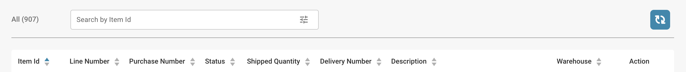

# Shipment Order Dashboard

Dieser Bereich bietet einen detaillierten Überblick über alle Versandaufträge. Er enthält eine Suchleiste mit verschiedenen Filtern, die Sie auswählen können, um Ihre Ergebnisse schnell einzugrenzen. Zusätzlich können Sie die Anordnung der Spaltenüberschriften per Drag-and-Drop anpassen, um ein noch individuelleres Anzeigeerlebnis zu erhalten.

<figure><figcaption></figcaption></figure>
