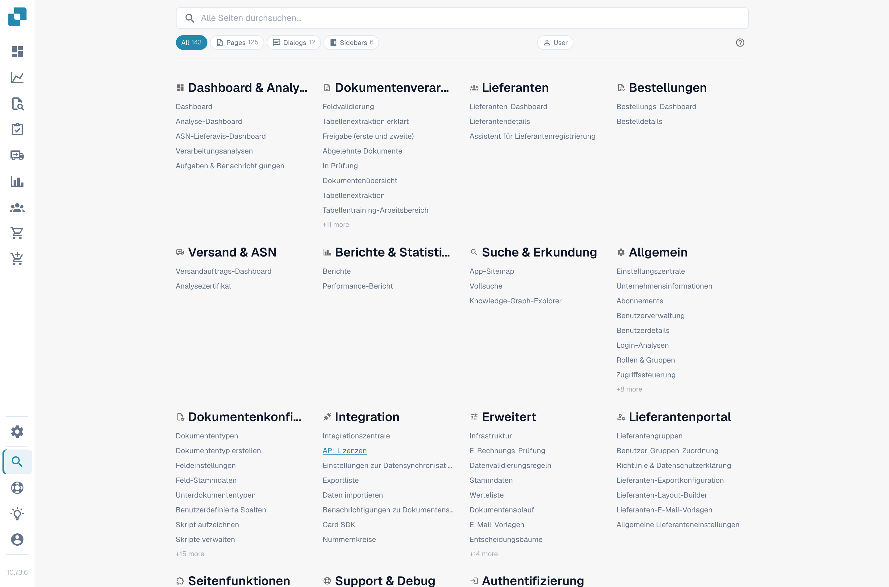
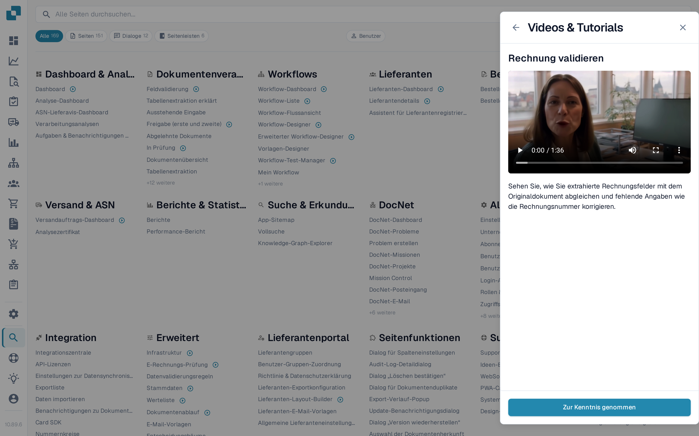

# Sitemap

Die Sitemap ist der vollständige, durchsuchbare Index aller Bereiche in DocBits — jede Seite, jeder Dialog, jeder Eintrag der Seitenleiste, jede Aktion und jede Funktion innerhalb einer Seite, gruppiert nach Kategorie. Sie ist das ausführliche Gegenstück zur [Globalen Schnellsuche](global-quick-search.md).

## Aufrufen

Öffnen Sie die Sitemap über die Seitenleiste (Eintrag im unteren Bereich) oder drücken Sie <kbd>Cmd</kbd>/<kbd>Ctrl</kbd> + <kbd>K</kbd> und wählen Sie **Alle Ergebnisse anzeigen**. Die direkte URL ist `/sitemap`.

<figure><figcaption>
Sitemap mit Kategorieübersicht und Suchkopf.
</figcaption></figure>

## Den Katalog durchstöbern

Die Sitemap ist nach Kategorien gruppiert, die der Struktur der Anwendung folgen — Einstellungen, Dokumentenverarbeitung, Workflow, Validierung und so weiter. Jede Kategorie listet zuerst ihre Seiten und danach die Funktionen innerhalb der Seiten, nach Unterkategorie gruppiert.

Einträge sind nach Typ farblich gekennzeichnet:

* **Seite** — eine vollständige Route.
* **Dialog** — ein Modal, das aus einem anderen Teil der Anwendung heraus geöffnet wird.
* **Seitenleiste / Bereich / Menü** — eine Navigations- oder Kontextoberfläche.
* **Aktion** — eine Schaltfläche oder Tastenkombination, die etwas auslöst, ohne zu navigieren.

Klicken Sie auf einen beliebigen Eintrag, um direkt dorthin zu springen. Einträge, die einen Parameter benötigen (etwa einen Dokumenttyp oder eine Dokument-ID), zeigen eine eingebettete Auswahl — wählen Sie den Wert, bevor Sie klicken.

## Trainingsvideos in der Liste

Einträge von Seiten mit einem Trainingsvideo zeigen hinter dem Namen ein Video-Symbol — nicht nur in den Einstellungen, sondern überall im Katalog, zum Beispiel auf dem Dashboard, in der Feldvalidierung oder in den Workflow-Seiten. Wählen Sie das Symbol, um das Video dieser Seite im Bereich **Videos & Tutorials** abzuspielen und auf der Sitemap zu bleiben.

<figure><figcaption>
Einträge mit Trainingsvideo tragen ein Video-Symbol; ein Klick öffnet das Video im Bereich.
</figcaption></figure>

Der Bereich listet weiterhin jedes Video nach Thema, sodass Sie die gesamte Bibliothek auch über das Symbol in der oberen Leiste durchsuchen können. Siehe [Videos & Tutorials](videos-and-tutorials.md).

## Suchen und Filtern

Der oben angepinnte Kopfbereich enthält das Suchfeld und die Filterpillen. Tippen Sie einige Zeichen, um die Liste live nach Namen und Beschreibungen zu filtern. Nutzen Sie die Typ-Pillen, um auf einen einzelnen Eintragstyp zu beschränken — zum Beispiel nur **Dialog**-Einträge.

Die aktuelle Suche und der Filter werden der URL hinzugefügt, sodass eine gefilterte Ansicht als Lesezeichen gespeichert oder geteilt werden kann.

<mark>Die Sitemap respektiert die gleiche Berechtigungsprüfung wie der Rest von DocBits. Seiten, auf die Sie keinen Zugriff haben, werden nicht angezeigt.</mark>

## Entwicklermodus

Ein Umschalter **Benutzer / Entwickler** im Kopfbereich blendet zusätzliche Informationen für Partner-Entwickler ein:

* Den internen Routenpfad jedes Eintrags.
* Parameter-Markierungen (`:docType`, `:docId`, Deep-Link-Schlüssel).

Der Entwicklermodus wird in Ihrem Browser gespeichert. Schalten Sie zurück in den Benutzermodus für die normale Leseansicht.

## Zurück nach oben

Die Sitemap ist lang. Sobald Sie die erste Bildschirmhöhe gescrollt haben, erscheint unten rechts eine Schaltfläche **Zurück nach oben**.
