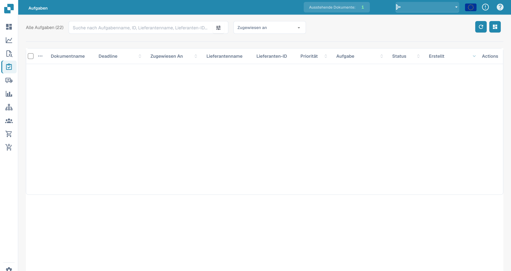
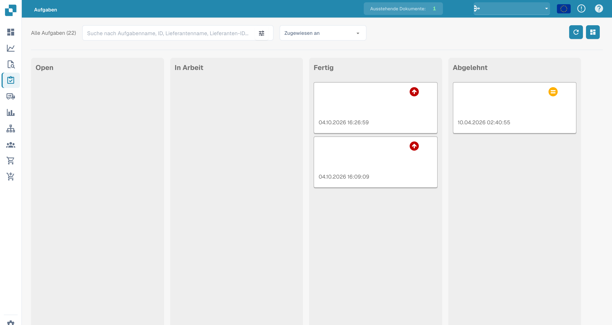

# Aufgaben


DocBits Tasks & Notifications Tutorial: Assign Work, Track Status & Handle Workflow Tasks


Hier können Sie Ihre Aufgaben im Auge behalten. Sie können zwischen zwei verschiedenen Layouts wählen – eines ist etwas detaillierter als das andere. Sie können Aufgaben auch nach verschiedenen Kriterien filtern, z. B. ob sie Ihnen zugewiesen sind oder den Status der Aufgabe.

<figure><figcaption>
Deutsche Aufgabenliste; Inhalte und Bearbeiter sind ausgeblendet.
</figcaption></figure>

<figure><figcaption>
Aufgabenübersicht als Board; persönliche Aufgabeninhalte sind ausgeblendet.
</figcaption></figure>
