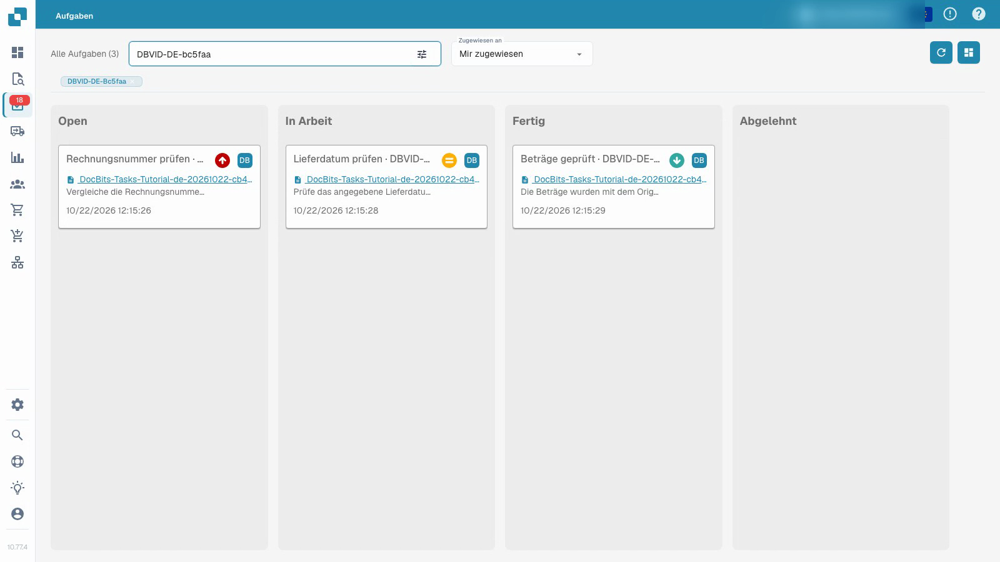
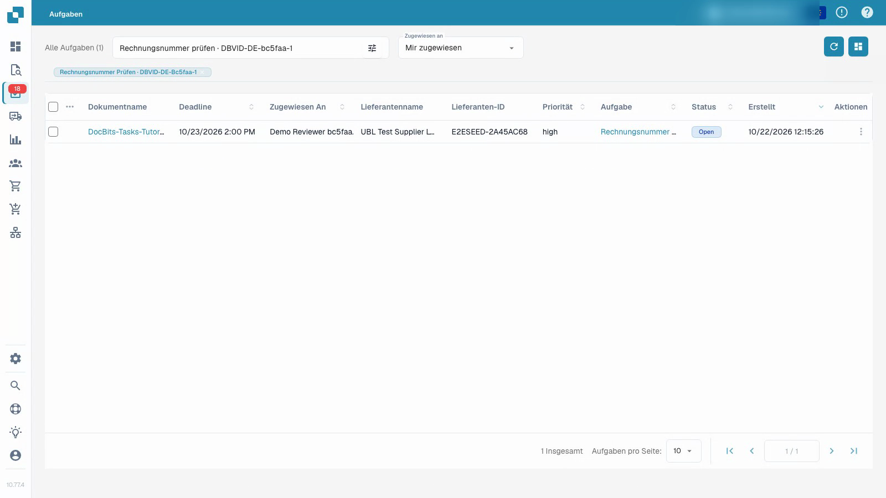

# Aufgaben

Mit einem normalen Testkonto eine Aufgabe bearbeiten, das Ergebnis festhalten, abschließen und nach dem Speichern erneut prüfen.


Aufgaben


[Mit Untertiteln ansehen](https://docbits-videos.fra1.cdn.digitaloceanspaces.com/settings-assistant/document-tasks-customer/v1/de.html)

Die Aufnahme zeigt die echte Oberfläche. Einzelne Produktbeschriftungen können noch unübersetzt sein.

In der Aufgabenübersicht finden Sie zugewiesene Arbeit und sehen den Bearbeitungsstand. Die Board-Ansicht gruppiert Aufgaben nach Status, die Liste zeigt weitere Einzelheiten. Filtern Sie nach Zuständigkeit und suchen Sie gezielt nach einer Aufgabe. Priorität und Termin helfen bei der Reihenfolge.

## Zugewiesene Dokumentaufgabe bearbeiten

1. Öffnen Sie die Aufgabe und lesen Sie Beschreibung und Zuständigkeit.
2. Vergleichen Sie die Angaben mit dem verknüpften Originalbeleg. Der Aufgabenname allein ersetzt diese Prüfung nicht.
3. Wählen Sie **In Arbeit** und speichern Sie den Bearbeitungsstand.
4. Halten Sie das Ergebnis in der Aufgabenbeschreibung fest.
5. Wählen Sie nach Abschluss **Fertig**, speichern Sie und laden Sie die Aufgabe erneut. Kontrollieren Sie Status, Rückmeldung und die Position in der Aufgabenübersicht.

Das Video verwendet ein normales Testkonto und synthetische Belege. Der Abschluss der Aufgabe ist von der Freigabe und dem Export der Rechnung getrennt. Welche Aktionen verfügbar sind, hängt von den Kontoberechtigungen ab.

<figure><figcaption>
Aufgabenübersicht mit synthetischen Beispieldaten.
</figcaption></figure>

<figure><figcaption>
Aufgabenliste mit synthetischen Beispieldaten.
</figcaption></figure>

## Weiteres Video


Aufgaben

