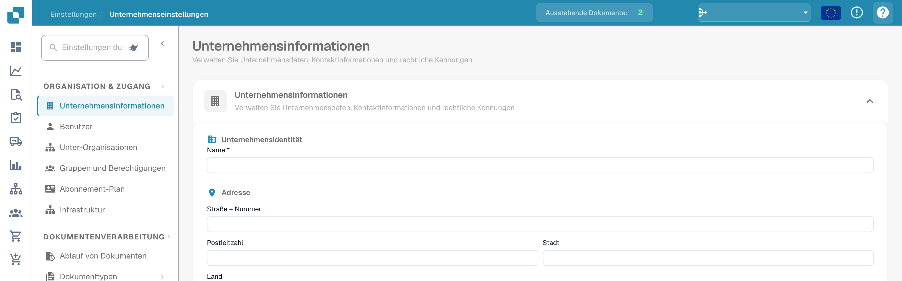

# Hilfe-Symbole

Überall in DocBits wurden Hilfe-Symbole platziert, um Ihnen dabei zu helfen, zu lernen und zu verstehen, was eine Funktion tatsächlich bewirkt und wie sie Sie bei Ihrer Dokumentenverarbeitung unterstützen kann.

Diese Hilfe-Symbole sehen wie folgt aus

<figure><figcaption>
Hilfesymbol oben rechts in den deutschen Einstellungen.
</figcaption></figure>
