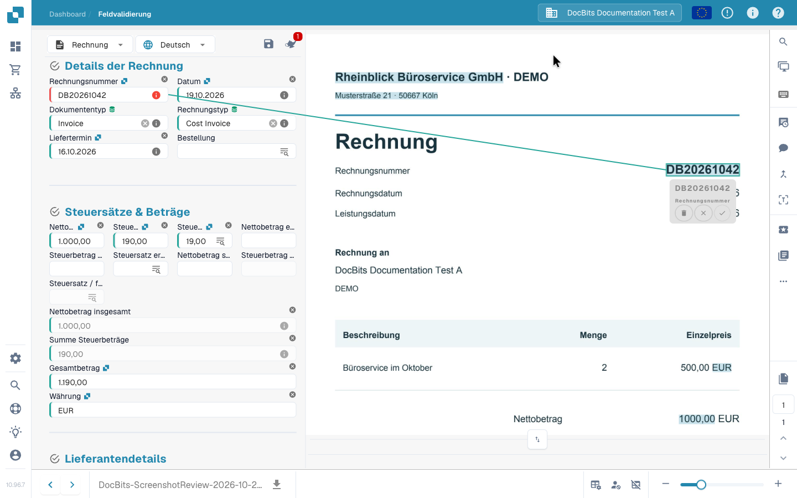

# Validierungsbildschirm

## Rechnung als Prüfer korrigieren und speichern

Vergleichen Sie die Originalrechnung mit den Feldern und drei Positionen, korrigieren Sie die Rechnungsnummer und prüfen Sie den gespeicherten Wert nach dem Neuladen. Die Aufnahme verwendet eine synthetische elektronische Rechnung und ein normales Prüferkonto. Diese Korrektur zu speichern ist getrennt von Extraktionstraining, Freigabe und Export.



[Mit Untertiteln ansehen](https://docbits-videos.fra1.cdn.digitaloceanspaces.com/settings-assistant/invoice-validation-customer/v1/de.html)

## Eine Rechnung prüfen und abschließen

Prüfe eine Rechnung vom Dashboard bis zur Übergabe: Vergleiche Lieferant, Datum, Rechnungsnummer, Beträge und Währung mit dem Original und lies einen Pflichtfeldhinweis. Übernimm die Rechnungsnummer direkt aus dem Beleg, bestätige die Zuordnung und speichere die Extraktionsregel mit **Save Rules**. Im Beispiel wird die geprüfte Rechnung anschließend zur Freigabe weitergegeben. Die verfügbaren Aktionen hängen von deinen Berechtigungen und deinem Ablauf ab.



## Validierungsansicht öffnen und bedienen

Öffne ein Dokument im Dashboard. In der **Feldvalidierung** vergleichst du die bearbeitbaren Felder mit dem Originalbeleg daneben. Dokumenttyp und konfiguriertes Layout bestimmen, welche Felder, Tabellen und Aktionsschaltflächen erscheinen. Verschiebe die Trennlinie, um den Feldern oder dem Beleg mehr Platz zu geben.

Bei mehrseitigen Belegen nutzt du die Seitensteuerung; mit dem Zoom liest du kleine Schrift. Die Pfeile am unteren Rand wechseln zwischen Dokumenten und sind von der Seitensteuerung getrennt.

### Dokumentursprung

Prüfe den **Dokumentursprung**, bevor du Datumsangaben und Beträge kontrollierst. Er bestimmt, wie DocBits Datums- und Zahlenformate interpretiert; er übersetzt den Beleg nicht und ändert nicht die Sprache der Oberfläche. Wähle den zum Beleg passenden Ursprung und vergleiche die angezeigten Werte mit dem Original.

Eine Änderung des Ursprungs öffnet einen Bestätigungsdialog. Wenn du fortfährst, startet die Dokumentverarbeitung erneut. Prüfe danach die neu gelesenen Werte.

## Ein Feld korrigieren und die Belegstelle anlernen

Wenn die Rechnungsnummer nicht richtig gelesen wurde:

1. Wähle das Feld **Rechnungsnummer**.
2. Doppelklicke auf die vollständige Nummer im Originalbeleg oder markiere den Bereich, der sie enthält.
3. Prüfe die vorgeschlagene Feldzuordnung und bestätige sie gegebenenfalls mit dem Häkchen.
4. Kontrolliere den Feldwert und die markierte Belegstelle. Wähle den Bereich erneut, wenn die Nummer unvollständig ist oder zu einem anderen Feld gehört.
5. Speichere das Dokument. Um die Extraktionsregel zu behalten, wähle zusätzlich **Save Rules** und bestätige den Dialog.

<figure><figcaption>
Die im Original ausgewählte Rechnungsnummer mit ihrer Zuordnung zum Feld. Bestätige die Zuordnung, bevor du die Regel speicherst.
</figcaption></figure>


Eine eingetippte Korrektur ändert den Wert dieses Dokuments; sie erzeugt nicht die für dieses Extraktionstraining nötige Zuordnung zur Belegstelle. Wähle den Wert im Original, bestätige die Zuordnung und speichere die Regel, damit DocBits sie bei passenden Dokumenten dieses Lieferanten wiederverwenden kann. Bei direkt aus E-Rechnungsdaten gelesenen Dokumenten steht dieses bildbasierte Training nicht zur Verfügung.


## Speichern, Regeln speichern und weitergeben

| Aktion | Wirkung |
| --- | --- |
| **Speichern** — Diskettensymbol über den Feldern | Speichert Änderungen am aktuellen Dokument. Es wird dadurch allein weder freigegeben noch exportiert. |
| **Save Rules** | Speichert Extraktionsregeln anhand des Dokuments und seiner Belegzuordnungen. Das ist vom Speichern der Feldwerte zu unterscheiden. |
| **Exportieren / Export**, Freigabe oder eine andere konfigurierte Aktion | Übergibt das Dokument nach den entsprechenden Prüfungen an den nächsten konfigurierten Verarbeitungsschritt. Aktion und Zielstatus hängen vom Ablauf und deinen Berechtigungen ab. |

Im Video wird die geprüfte Rechnung zur Freigabe eingereicht. Eine Schaltfläche mit der Beschriftung **Export** bedeutet nicht automatisch, dass die Rechnung bereits im Ziel-ERP angekommen ist. Prüfe den neuen Status im Dashboard und mögliche Verarbeitungsfehler.

## Pflichtfelder und Prüfmeldungen

Ein roter Rahmen oder ein Warnsymbol weist auf ein Feld hin. Lies die Infomeldung: Fehlt ein Pflichtwert, muss die Extraktion geprüft werden oder ist eine konfigurierte Prüfung fehlgeschlagen? Ein sichtbarer Wert allein bestätigt noch nicht, dass das Feld gültig ist.

Vergleiche Lieferant, Rechnungsnummer, Datumsangaben, Beträge und Währung mit dem Original. Prüfe bei Summen die betroffenen Kopffelder und gegebenenfalls die Positionen. Behebe vor dem Weitergeben die in der Meldung genannte Ursache. Die Prüfungen hängen vom Dokumenttyp und der Einrichtung deiner Organisation ab; siehe [Automatische Prüfungen](automatic-checks-on-the-validation-screen.md).

## Den Assistenten nutzen

Die Schaltfläche **Assistent** über den Feldern zeigt offene Prüfhinweise. Öffne sie und wähle **Zum Feld**, um das betroffene Feld zu prüfen. KI-Fragen und Vorschläge hängen von der Aktivierung für deine Organisation und deinen Berechtigungen ab. Sind sie nicht verfügbar, lies den Hinweis im Bereich. Vorschläge ändern das Formular; prüfe sie und speichere das Dokument, um die Änderungen zu behalten.

## Stammdaten über eine Suche auswählen

Felder mit einer eingerichteten Stammdatensuche können Lieferanten, Bestellungen oder andere Stammdaten durchsuchen. Öffne die Suchfunktion am Feld, grenze die Treffer ein und wähle den richtigen Datensatz. Dabei können mehrere verbundene Felder befüllt werden; kontrolliere diese ebenfalls. Die Werte stammen aus den Stammdaten und müssen nicht dem gedruckten Wortlaut entsprechen. Siehe [Fuzzy-Daten](fuzzy-data.md).

## Rechnungspositionen prüfen

Enthält das Layout Tabellen, vergleiche die gelesenen Zeilen, Beschreibungen, Mengen, Preise und Beträge mit dem Beleg. **Extrahierte Tabelle** und **KI Extrahierte Tabelle** sind verschiedene Extraktionsansichten. Ihre Verfügbarkeit hängt von den aktivierten Verfahren und dem Layout ab. Ein leerer oder fehlender Reiter erklärt allein noch nicht die Ursache eines Extraktionsproblems.

Korrigiere einzelne Zellen und fehlende oder doppelte Zeilen mit den verfügbaren Tabellenfunktionen. Diese Änderungen betreffen das aktuelle Dokument. Wiederverwendbares Tabellentraining, KI-Tags und das Training von Kopffeldern sind getrennte Vorgänge. Siehe [KI-Tabellen-Tags](../ai-table/ai-table-tags.md) und [Tabellentraining](../../../administration-and-setup/setup/document-training/training-line-fields-table-training/README.md).

Lies die Tabellenmeldungen zu Pflichtspalten, Positionsberechnungen und Summen. Beachte vor einer neuen KI-Extraktion oder erneuten Tabellenextraktion den Bestätigungsdialog: Bestehende Bestellzuordnungen müssen gegebenenfalls entfernt und neu erstellt werden.

## Belegansicht und Zusammenarbeit

Fahre über ein Symbol, um seine Bezeichnung zu lesen. Manche Werkzeuge stehen nur mit bestimmten Modulen, Dokumenttypen oder Berechtigungen zur Verfügung.

| Werkzeug | Verwendung |
| --- | --- |
| **Vergrößerungsglas** und Zoom | Kleine Details im Original lesen. |
| **Dokument in einem neuen Fenster öffnen** | Dasselbe Belegbild in einem eigenen Fenster anzeigen, etwa auf einem zweiten Monitor. Die Oberfläche kennzeichnet dies als Chrome-Funktion. |
| **Tastaturkurzbefehle** | Hilfe zu Kurzbefehlen öffnen; siehe [Tastenkombinationen](keyboard-shortcuts.md). |
| **Aufgaben** | Interne Arbeiten für eine Person oder Gruppe anlegen und verfolgen. |
| **Aktivitäts-Stream** | Aufgezeichnete Aktivitäten am Dokument ansehen. |
| **Genehmigungsverlauf** | Freigaben und Ablehnungen ansehen, wenn die Funktion aktiviert ist. |
| **Anmerkungsmodus** | Notizen auf dem Beleg ergänzen, wenn Anmerkungen aktiviert sind. |
| **Zusammenführen / Seiten hinzufügen** | Dokumente oder fehlende Seiten über den angebotenen Dialog zusammenführen. Prüfe vor dem Bestätigen die ausgewählten Seiten. |
| **OCR-Ansicht** | Bereits erkannten Text ansehen. Das Öffnen startet keine neue OCR-Extraktion. Bei bestimmten elektronischen Dokumenten ist die Funktion nicht verfügbar. |
| **Ticket erstellen** | Eine Supportanfrage mit Dokumentbezug und Fehlerbeschreibung vorbereiten. Interne Aufgaben werden getrennt bearbeitet. |
| **Skript-Logs** | Meldungen von Dokumentskripten ansehen, wenn das Skriptmodul aktiv ist. Die Ansicht zeigt Protokolle und ist kein Skripteditor. |

## Weitere Optionen und Administratoreinstellungen

Bei Rechnungen öffnet **Mehr Optionen → Dokumentenfluss** den Verarbeitungsablauf. Je nach Berechtigung und Einrichtung kann das Menü auch das Aufteilen von Dokumenten, einen Zugang zur Layoutvorlage und Extraktionseinstellungen für den Lieferanten enthalten.

**E-Text verwenden, falls verfügbar**, **Strukturierte Extraktion nutzen (KI)** und **KI-Modell** sind Lieferanteneinstellungen für die Extraktion und keine gewöhnlichen Feldkorrekturen. Nur berechtigte Administratoren können sie ändern. Beachte den Neustartdialog, wenn eine Änderung eine erneute Verarbeitung verlangt. Eine Layoutvorlage konfiguriert die Validierungsmaske; sie verändert nicht das gedruckte Rechnungslayout. Siehe [Lieferantenspezifisches KI-Modell](supplier-specific-ai-model-for-field-and-table-extraction.md).

## Wenn Bearbeiten oder Weitergeben nicht möglich ist

Lies den angezeigten Grund: Das Dokument kann gesperrt, schreibgeschützt, in einem anderen Verarbeitungsstatus oder für deine Rolle eingeschränkt sein. Behebe Prüfmeldungen und kläre Berechtigungen oder Einstellungen mit der zuständigen Person oder Administration. Bei einem verbleibenden Fehler helfen die [Fehlerbehebung](troubleshooting/README.md) oder ein Supportticket mit Dokument und genauer Meldung.
