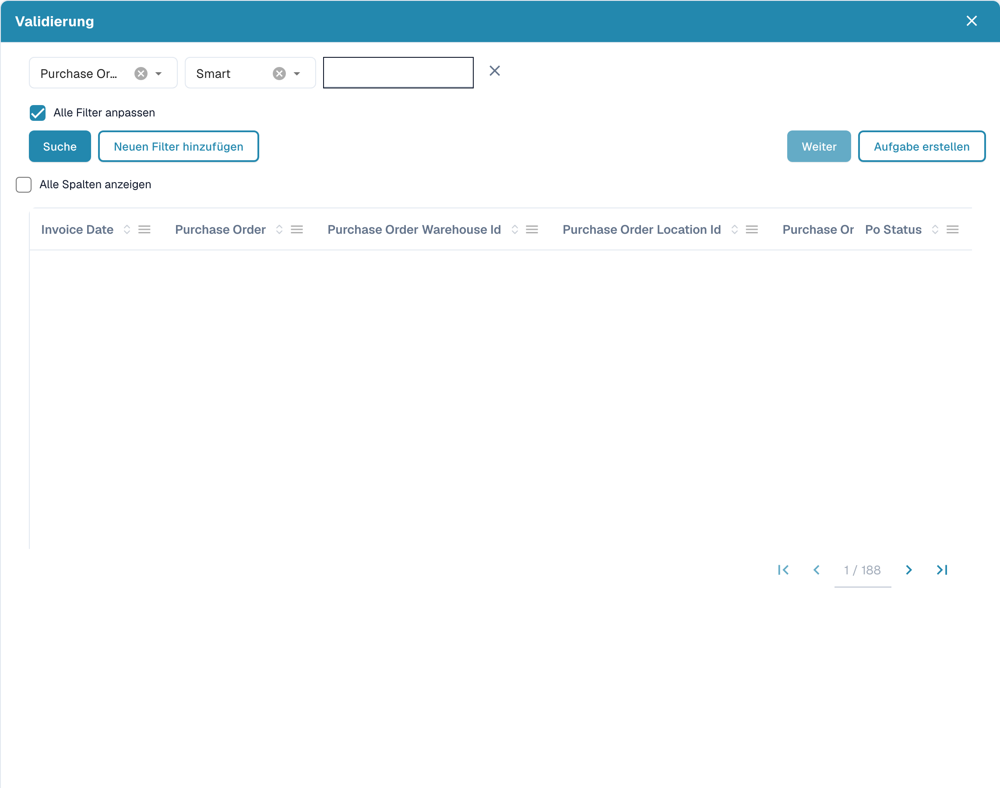

# Unscharfe Daten

### **Übersicht**

Mit Fuzzy-Data-Feldern (unscharfe Daten) können Benutzer verwandte Felder anhand ungefährer Übereinstimmungen aus den Stammdaten befüllen. Diese Felder sind an einem **blauen Symbol** neben dem Feld erkennbar.

<figure><figcaption></figcaption></figure>

### **Funktionsweise**

#### **Was bewirken Fuzzy-Data-Felder?**

* Sie befüllen verwandte Felder anhand ihres Wertes oder der Eingabe.
* Die drei Standardfelder mit Fuzzy Data sind:
  * **Bestellung**
  * **Lieferant**
  * **Vendor ID**

#### **Fuzzy-Data-Felder verwenden**

1. **Eine Bestellung auswählen**
   *   Ein Klick auf das **blaue Symbol** neben dem Feld Purchase Order öffnet ein **Auswahlfenster**.

       <figure><figcaption>
Auswahldialog für einen Stammdatenabgleich; Datensätze sind ausgeblendet.
</figcaption></figure>
   * Dieses Fenster enthält eine Tabelle mit allen Bestellungen aus der **Stammdaten-Nachschlagetabelle**.
   * Wenn Sie die Option **„Display all columns“** aktivieren, werden zusätzliche Details angezeigt.
   * Wählen Sie eine **Bestellung** aus und klicken Sie auf **Weiter**:
     * Findet das System im Dokument eine Bestellung, filtert es automatisch danach.
     * Wird keine Übereinstimmung gefunden, können Sie **eigene Filter erstellen**, um die richtige Bestellung zu finden.
     * Es können mehrere Filter hinzugefügt werden; wenn Sie **„Match all filters“** aktivieren, müssen alle Bedingungen erfüllt sein.
     * Verfügbare Filteroptionen:
       * **Smart**
       * **enthält**
       * **Genau**
       * **Beginnt mit**
       * **Endet mit**
   * Über eine Schaltfläche neben **Weiter** können Benutzer eine **neue Aufgabe/Benachrichtigung erstellen**.
2. **Einen Lieferanten oder eine Vendor ID auswählen**
   * Der Ablauf ist derselbe wie bei Bestellungen.
   * Der Unterschied: Die Felder Supplier und Vendor ID verwenden die **Lieferanten-Stammdatentabelle** statt der Stammdatentabelle der Bestellkopfdaten.

#### **Hinweis zur Befüllung von Feldern**

* Wird ein Feld per Fuzzy Data befüllt und nicht aus dem Dokument extrahiert, erscheint ein **kleiner Hinweis bzw. ein Info-Symbol**. Es zeigt an, dass die Daten **nicht aus dem Dokument extrahiert**, sondern anhand der Stammdaten befüllt wurden.

### **Konfiguration durch Administratoren**


[fuzzy-data-configuration-with-master-data.md](../../../administration-and-setup/setup/document-types/fuzzy-data-configuration-with-master-data.md)



[fuzzy-data-configuration-with-list-of-values.md](../../../administration-and-setup/setup/document-types/fuzzy-data-configuration-with-list-of-values.md)



