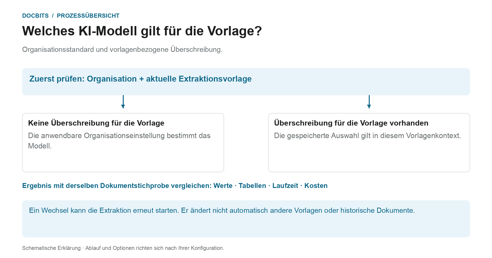

# Lieferantenspezifisches KI-Modell für Feld- und Tabellenextraktion

## Vom Organisationsstandard zum wirksamen Modell

<figure><figcaption>
Organisationsstandard und vorlagenbezogene Überschreibung. Die Grafik ist schematisch; maßgeblich sind die aktiven Einstellungen Ihrer Organisation.
</figcaption></figure>

Der Einstieg im Validierungsbildschirm heißt lieferantenspezifisches KI-Modell. Entscheidend ist jedoch der **aktuelle Extraktionsvorlagen-Kontext**: Die Überschreibung wird je Organisation und Vorlage gespeichert. Ein Lieferant kann mehrere Vorlagen mit unterschiedlichen Einstellungen haben.

1. **Kontext feststellen:** Prüfen Sie Organisation, Dokument und aktuelle Extraktionsvorlage, bevor Sie ein Modell ändern.
2. **Überschreibung prüfen:** Ist für diese Vorlage ein Modell hinterlegt, wirkt diese Auswahl in ihrem Geltungsbereich. Fehlt eine Überschreibung, gilt die anwendbare Organisationseinstellung.
3. **Änderung bewusst bestätigen:** Wählen Sie nur eine in Ihrer Umgebung verfügbare Option. Ein Wechsel kann eine Bestätigung und eine erneute Extraktion auslösen. Das Öffnen des Menüs allein verändert die Auswahl nicht.
4. **Ergebnis vergleichen:** Prüfen Sie mit einer festen Stichprobe die Feldwerte, Tabellen, Laufzeit und Kosten. Eine andere Modellstufe garantiert weder eine bessere Extraktion noch eine erfolgreiche Validierung oder einen PO-Abgleich.

**Beispiel:** Lieferant A verwendet die Vorlagen „Rechnung Inland“ und „Rechnung Ausland“. Eine Überschreibung für „Rechnung Inland“ ist keine pauschale Umstellung aller Rechnungen dieses Lieferanten. Kontrollieren Sie bei einem weiteren Dokument deshalb dessen Vorlage und wirksame Einstellung erneut.

Die Grafik zeigt die Auswahlhierarchie, keine Empfehlung für eine bestimmte Modellstufe. Informationen zum [Organisationsstandard und zu den Überschreibungen](../../../administration-and-setup/settings/document-processing/classification-and-extraction/ai-model.md) sowie die Diagnose [Welcher Extraktionspfad wurde verwendet?](../../../overview-and-basics/faq/document-processing/which-extraction-path-was-used.md) helfen bei der Einordnung des tatsächlichen Ergebnisses.

Im Werkzeugbereich des **Validierungsbildschirms** können Sie das KI-Modell für die **Feldextraktion** und **Tabellenextraktion** auswählen.\
Dieser Einstieg ändert die Überschreibung im aktuellen Extraktionsvorlagen-Kontext. Sie wird je Organisation und Vorlage (`tfidf_id`) gespeichert. Die Lieferantenzuordnung bedeutet nicht, dass damit sämtliche Vorlagen oder historischen Dokumente dieses Lieferanten geändert werden. Ohne Überschreibung gilt die anwendbare Organisationseinstellung.

Um das Modell zu ändern, öffnen Sie das Optionsmenü, indem Sie auf die Schaltfläche **Mehr Optionen** (drei Punkte) auf der rechten Seite des Bildschirms klicken, und wählen Sie dann eines der verfügbaren Modelle: 

Das Menü bietet **Full**, **Fast**, **Nexus**, **Nexus Flash**, **Auto** und **Auto Nexus**. Verfügbarkeit und Kosten richten sich nach Ihrer aktuellen Umgebung und den vereinbarten Konditionen. Keine Option ist für jedes Dokument grundsätzlich die genaueste oder schnellste; „Fast“ ist kein allgemeingültiger Organisationsstandard.

Ein Modellwechsel kann eine Bestätigung erfordern und die Extraktion erneut starten. Prüfen Sie deshalb Dokument und Geltungsbereich vor dem Bestätigen. Das bloße Öffnen des Menüs ändert die Einstellung nicht; die Abbildungen belegen keinen ausgeführten Modellwechsel.

<figure><figcaption>
Vorhandene Beispielansicht mit synthetischer Rechnung: „Mehr Optionen“ öffnet das Menü „KI-Modell“. Die Auswahl gehört zum aktuellen Vorlagenkontext. Englische Gruppenüberschriften und „Go to Layout Template“ bleiben im Beispiel sichtbar.
</figcaption></figure>

<figure><figcaption>
Vorhandene Beispielansicht des Menüs „KI-Modell“ mit Full, Fast, Nexus, Nexus Flash, Auto und Auto Nexus. Die Modellnamen sind Produktbezeichnungen; englische Gruppenüberschriften bleiben im Beispiel sichtbar. Es wurde kein Modellwechsel ausgeführt.
</figcaption></figure>

Vergleichen Sie verfügbare Modelle mit freigegebenen Testdokumenten und prüfen Sie extrahierte Werte, Laufzeit und Kosten. Ein Wechsel kann ein Dokument erneut verarbeiten und garantiert keine Verbesserung.

Um den **Organisationsstandard** zu konfigurieren oder **vorlagenbezogene Überschreibungen** zu prüfen, lesen Sie bitte die entsprechende Dokumentation [**hier**](../../../administration-and-setup/settings/document-processing/classification-and-extraction/ai-model.md).
