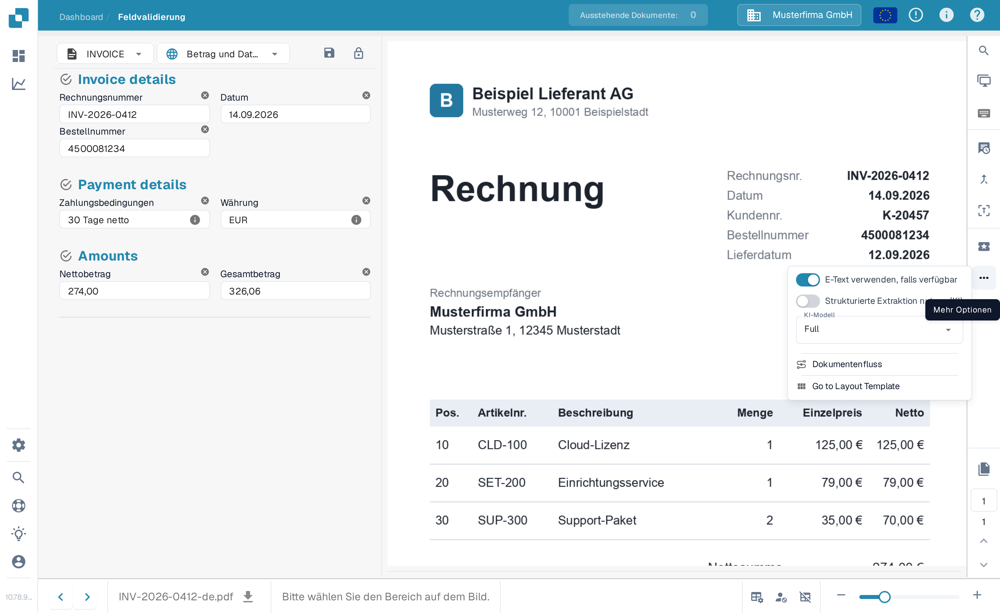

# Lieferantenspezifisches KI-Modell für Feld- und Tabellenextraktion

Im Werkzeugbereich des **Validierungsbildschirms** können Sie das KI-Modell für die **Feldextraktion** und **Tabellenextraktion** auswählen.\
Das ausgewählte **KI-Modell** wird nur auf alle Dokumente des aktuellen Lieferanten angewendet.

Um das Modell zu ändern, öffnen Sie das Optionsmenü, indem Sie auf die Schaltfläche **Mehr Optionen** (drei Punkte) auf der rechten Seite des Bildschirms klicken, und wählen Sie dann eines der verfügbaren Modelle: 

* **Full** – Höchste Genauigkeit; kostet 2 Token pro Dokument
* **Fast** – Standardstufe; kostet 1 Token pro Dokument
* **Nexus** – Kostet 1 Token pro Dokument
* **Nexus Flash** – Schnellere Stufe der Nexus-Familie; kostet 1 Token pro Dokument
* **Auto** – DocBits entscheidet pro Dokument, ob Fast ausreicht oder Full nötig ist; kostet 1 Token pro Dokument
* **Auto Nexus** – Wie Auto, aber beschränkt auf die Nexus-Modellfamilie; kostet 1 Token pro Dokument

<figure><figcaption>
Öffnen Sie das Optionsmenü und wählen Sie das KI-Modell für diesen Lieferanten.
</figcaption></figure>

<figure><figcaption>
Das Dropdown KI-Modell mit den sechs verfügbaren Optionen.
</figcaption></figure>

Wenn die Ergebnisse der **Feldextraktion** oder **Tabellenextraktion** nicht zufriedenstellend sind, versuchen Sie, zu einem anderen Modell zu wechseln, um die Genauigkeit zu verbessern.

Um das KI-Modell **global für Lieferanten ohne benutzerdefiniertes Modell** zu konfigurieren oder um zu **verwalten, welches Modell für jeden Lieferanten aktiv ist**, lesen Sie bitte die entsprechende Dokumentation [**hier**](../../../administration-and-setup/settings/document-processing/classification-and-extraction/ai-model.md).
