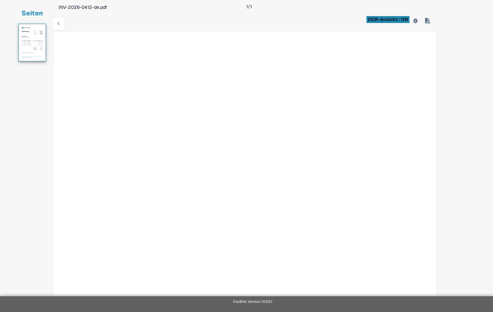

# Fehlerbehebung

Fehlt im Validierungsbildschirm ein Wert, prüfen Sie zuerst, ob der Text im Dokument sichtbar ist und ob DocBits ihn erkannt hat. So können Sie ein Leseproblem von einem Feld- oder Regelproblem unterscheiden.

1. Öffnen Sie das betroffene Dokument in der **Feldvalidierung**.
2. Vergleichen Sie das Originaldokument mit der **OCR-Ansicht**. Prüfen Sie dieselbe Seite und denselben Bereich, in dem der Wert erscheinen sollte.
3. Fehlt der Text in der OCR-Ansicht, folgen Sie der Anleitung [Fehlender Text in der OCR-Extraktion](missing-text-in-ocr-extraction.md).
4. Ist der Text in der OCR-Ansicht vorhanden, das Feld bleibt aber leer, bitten Sie einen Administrator, die Feldkonfiguration des Dokumenttyps zu prüfen. Geben Sie den Dokumenttyp, den Feldnamen, die Seite und ein unbedenkliches Testbeispiel an.

<figure><figcaption>
Aktuelle deutsche Sandbox-OCR-Ansicht einer synthetischen Test-A-Rechnung. Das Beispiel dient der Orientierung; es zeigt keine fehlgeschlagene Extraktion.
</figcaption></figure>

Fügen Sie einem Support-Screenshot keine Kundendokumente oder personenbezogenen Daten bei. Die [Übersicht zum Validierungsbildschirm](../README.md) erklärt die wichtigsten Bedienelemente, falls Sie diesen Bildschirm noch nicht kennen.
