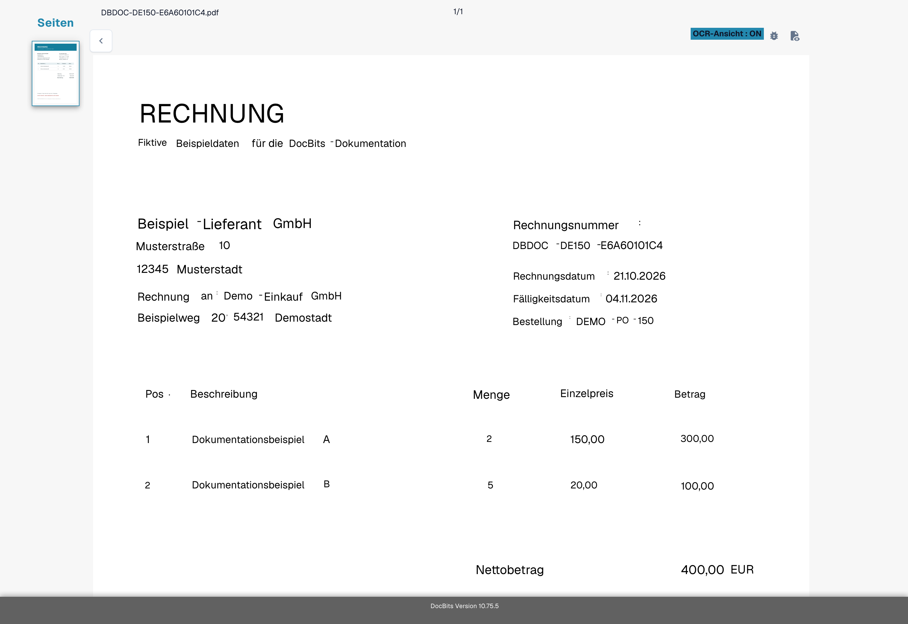
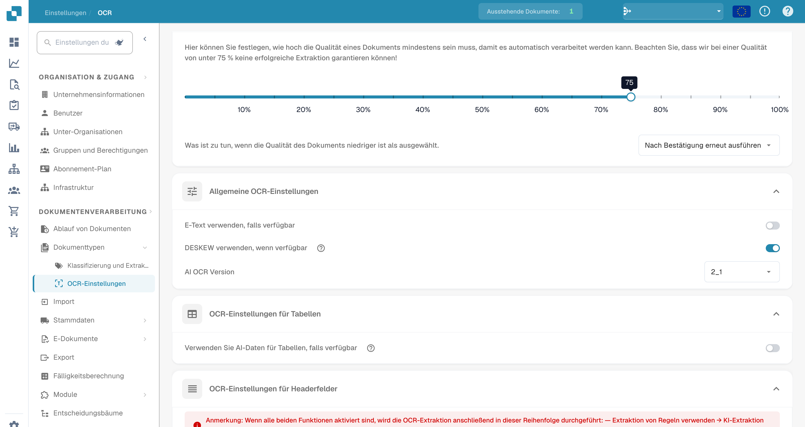
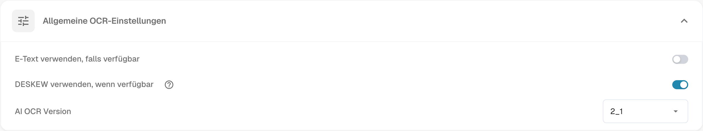

# Fehlender Text in der OCR-Extraktion

Die Abbildungen zeigen den Prüfablauf an einer fiktiven Rechnung mit vorhandenem OCR-Text. Sie stellen keinen reproduzierten Fall mit fehlendem Text dar.

## **Problem**

In einigen Fällen kann es vorkommen, dass Text in der **OCR-Ansicht** zu fehlen scheint, was die Extraktion mit der Extraktionsfunktion verhindert.

<figure><figcaption>
Validierungsansicht zur Kontrolle erkannter Felder an einer fiktiven deutschen Rechnung.
</figcaption></figure>

Um dies zu überprüfen, klicken Sie auf die Schaltfläche **OCR-Ansicht** in der Symbolleiste auf der rechten Seite. Wenn der Text dort nicht angezeigt wird, bedeutet dies, dass er nicht für die Extraktion verfügbar ist.

<figure><figcaption>
OCR-Ansicht mit erkanntem Text der fiktiven deutschen Rechnung.
</figcaption></figure>

## **Ursache**

Eine mögliche Ursache ist, dass der Text, den Sie extrahieren möchten, Teil eines Bildes (z. B. eines Logos oder eines gescannten Abschnitts) innerhalb des Dokuments ist.\
Wenn die E-Text-Funktion aktiviert ist, wird Text, der auf Bildern oder Logos erscheint, nicht in die extrahierte Textebene aufgenommen. Daher kann dieser Text nicht über die standardmäßige Extraktionslogik zugegriffen oder extrahiert werden.

## **Lösung**

Um dieses Problem zu beheben, deaktivieren Sie die E-Text-Funktion—entweder für den [spezifischen Anbieter](missing-text-in-ocr-extraction.md#e-text-fur-einen-bestimmten-anbieter-deaktivieren) oder für die [gesamte Organisation](missing-text-in-ocr-extraction.md#e-text-fur-die-gesamte-organisation-deaktivieren). Nach der Umstellung und erneuten Verarbeitung prüfen Sie die OCR-Ansicht nochmals. Ob Bildtext erkannt wird, hängt auch von Qualität und Aufbau des Dokuments ab.

### **E-Text für einen bestimmten Anbieter deaktivieren**

1. Öffnen Sie ein Dokument vom spezifischen Anbieter in der **Feldvalidierung**.
2.  Klicken Sie auf das Drei-Punkte-Menü in der Symbolleiste auf der rechten Seite.

<figure><figcaption>
Weitere Optionen der Feldvalidierung öffnen.
</figcaption></figure>

3.  Deaktivieren Sie die Option **E-Text verwenden, falls verfügbar**.

<figure><figcaption>
Option E-Text verwenden, falls verfügbar im Dokumentmenü.
</figcaption></figure>

4.  Klicken Sie auf **Bestätigen**, um die Verarbeitung für das Dokument neu zu starten.

<figure><figcaption>
Bestätigungsdialog vor einer Änderung der E-Text-Verwendung.
</figcaption></figure>

### E-Text für die gesamte Organisation deaktivieren

1.  Gehen Sie zu **Einstellungen → Verarbeitung von Dokumenten → OCR-Einstellungen**.

<figure><figcaption>
OCR-Einstellungen in der deutschen Oberfläche.
</figcaption></figure>

2.  Deaktivieren Sie unter **Allgemeine OCR-Einstellungen** die Option **E-Text verwenden, falls verfügbar**.

<figure><figcaption>
Allgemeine OCR-Einstellungen mit der Option zur Verwendung von E-Text.
</figcaption></figure>
