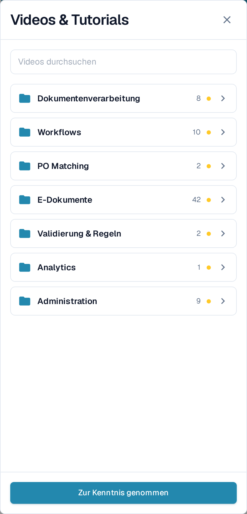
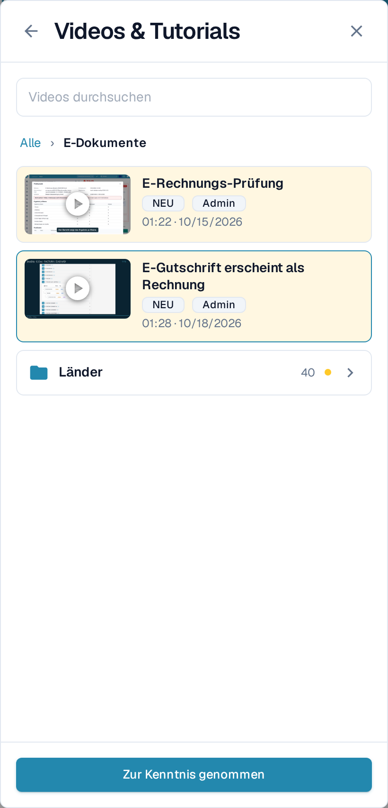
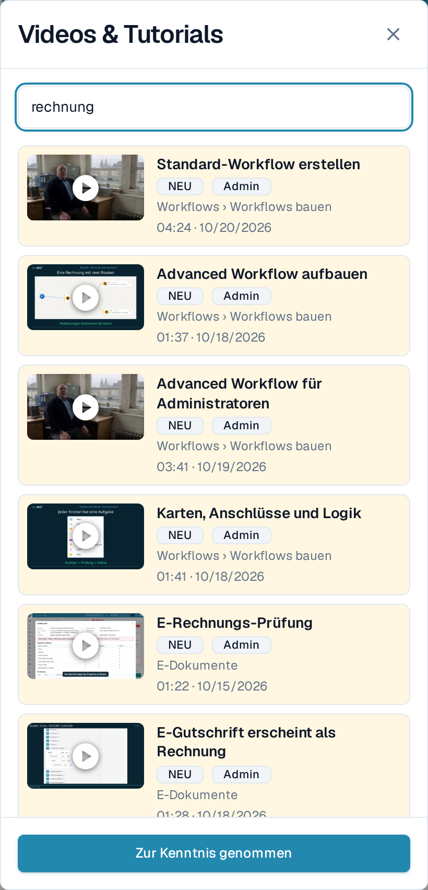
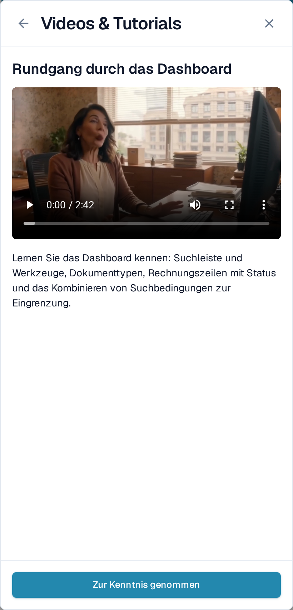

# Videos & Tutorials

**Videos & Tutorials** spielt kurze DocBits-Videos ab, ohne dass Sie die Seite verlassen, an der Sie gerade arbeiten. Die Videos sind nach Themen gruppiert, sodass Sie schnell das Video zur aktuellen Aufgabe finden.

## Bereich öffnen

Das Video-Symbol befindet sich am rechten Ende der Kopfzeile, nach dem Hilfe-Symbol.

<figure><figcaption>
Das Video-Symbol ist das letzte Symbol in der Kopfzeile.
</figcaption></figure>

* Das Symbol ist **gelb mit einem kleinen Punkt**, solange mindestens ein Video noch nicht zur Kenntnis genommen wurde.
* Es nimmt die Farbe der übrigen Symbole in der Kopfzeile an, sobald Sie jedes Video zur Kenntnis genommen haben.

Wählen Sie das Symbol, um **Videos & Tutorials** als Bereich am rechten Rand zu öffnen.

<figure><figcaption>
Der Bereich öffnet sich mit der Themenliste. Jedes Thema ist ein Ordner mit der Anzahl seiner Videos.
</figcaption></figure>

## Ein Thema durchsehen

Der Bereich öffnet sich mit den **Themenordnern**, zum Beispiel **Dokumentenverarbeitung**, **Workflows**, **E-Dokumente** oder **Administration**. Ein Ordner zeigt, wie viele Videos er enthält, und die Markierung **NEU**, solange er ein Video enthält, das Sie noch nicht zur Kenntnis genommen haben.

Wählen Sie einen Ordner, um ihn zu öffnen. Darin finden Sie die Videos dieses Themas und, bei umfangreichen Themen, weitere Ordner zur Gruppierung — etwa **Länder** unter **E-Dokumente**. Der Pfad oben und der Zurück-Pfeil führen eine Ebene nach oben. Ein Video, das Sie aus einem Ordner geöffnet haben, kehrt beim Schließen in diesen Ordner zurück.

<figure><figcaption>
Öffnen Sie ein Thema, um seine Videos und seine Unterordner zu sehen.
</figcaption></figure>

## Nach einem Video suchen

Tippen Sie in **Videos suchen**, um alle Themen auf einmal zu durchsuchen. Jedes Ergebnis nennt den Ordner, zu dem es gehört, zum Beispiel **Workflows › Workflows bauen**, sodass Sie wissen, wo das Video liegt. Die Suche findet auch Themen- und Ordnernamen und unterscheidet weder Groß- und Kleinschreibung noch Akzente.

<figure><figcaption>
Die Suche umfasst alle Themen und zeigt zu jedem Ergebnis den Ordner an.
</figcaption></figure>

Leeren Sie das Suchfeld, um zu den Themenordnern zurückzukehren.

## Ein Video ansehen und zur Kenntnis nehmen

Wählen Sie ein Video, um es im Bereich abzuspielen. Titel und eine kurze Beschreibung sagen Ihnen, worum es in dem Video geht.

<figure><figcaption>
Spielen Sie das Video im Bereich ab und nehmen Sie es anschließend zur Kenntnis.
</figcaption></figure>

Wählen Sie **Zur Kenntnis genommen**, wenn Sie das Video angesehen haben. Damit gilt es nur für Ihren Benutzer als gesehen: Die Markierung **NEU** verschwindet für Sie beim Video und bei seinem Ordner, und das Symbol in der Kopfzeile wird grau, sobald nichts mehr offen ist. Andere Benutzer sehen weiterhin ihre eigenen offenen Videos.

## Videos für Administratoren und für Benutzer

* Videos mit der Markierung **Admin** richten sich an Administratoren. Administratoren sehen im Bereich sowohl die Administrator- als auch die Endbenutzer-Videos; Endbenutzer sehen nur die Endbenutzer-Videos.
* Ist ein Video nicht in Ihrer Oberflächensprache verfügbar, wird die englische Fassung mit einem Sprachkürzel wie **EN** angezeigt.


Die Screenshots zeigen die DocBits-Testorganisation mit deutscher Spracheinstellung in der Anwendung.

