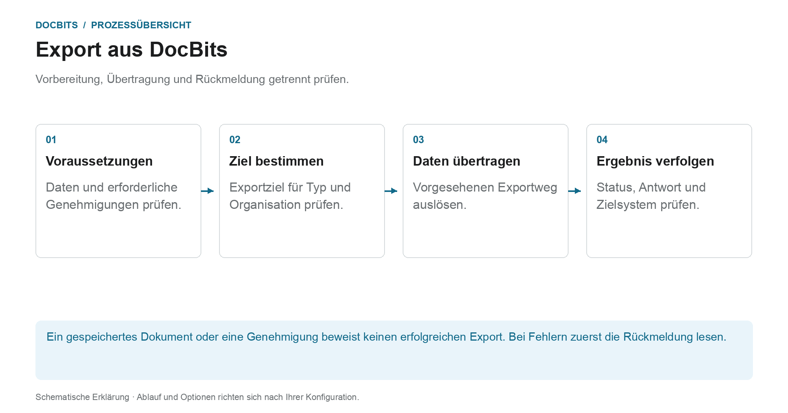

# Exportieren in DocBits

## Vom geprüften Dokument zum Zielsystem

<figure><figcaption>
Vorbereitung, Übertragung und Rückmeldung getrennt prüfen. Die Grafik ist schematisch; maßgeblich sind die aktiven Einstellungen Ihrer Organisation.
</figcaption></figure>

Beim Export übergibt DocBits Dokumente und Daten an eine eingerichtete Verbindung. Ob ein Export angeboten oder automatisch ausgelöst wird, hängt vom Dokumenttyp, Status, Workflow und der Exportkonfiguration ab.

1. **Voraussetzungen prüfen:** Kontrollieren Sie die Dokumentdaten, offenen Aufgaben und die in Ihrem Prozess erforderlichen Genehmigungen. Ein erfolgreicher PO-Abgleich ersetzt diese Schritte nicht.
2. **Exportziel klären:** Prüfen Sie, welche Konfiguration für Dokumenttyp und Organisation beziehungsweise Unterorganisation gilt. Die Exportverwaltung unterstützt unter anderem Infor, Infor & IDM, Webhook und SFTP. Der tatsächliche Lieferumfang hängt von der eingerichteten Verbindung ab.
3. **Übertragung auslösen:** Verwenden Sie die vorgesehene Dokumentaktion oder den konfigurierten Workflow. Ein alternativer Export wird separat eingerichtet; sein Verfügbarkeitsstatus ist nicht der nach dem Export zu setzende Status.
4. **Rückmeldung kontrollieren:** Prüfen Sie den Dokumentstatus und verfügbare Empfängerantworten. Für eine Ende-zu-Ende-Prüfung kontrollieren Sie auch den zugehörigen Vorgang im Zielsystem. Bei Infor können weitere Verarbeitungsschritte in ION und im ERP folgen.

### Wenn der Export fehlschlägt

Öffnen Sie die Fehlerdetails, bevor Sie erneut exportieren. Eine falsche Zuordnung oder eine Ablehnung durch den Empfänger wird durch wiederholtes Senden nicht behoben. Klären Sie Dokumentwerte, Mapping und Zielkonfiguration anhand der Rückmeldung und prüfen Sie, ob im Ziel bereits ein Vorgang angelegt wurde.

### Weiterführende Anleitungen

- [Exportmodul](export-module.md): Einstieg in die Verwaltung.
- [Exportkonfiguration](../../administration-and-setup/settings/document-processing/export.md): Verbindungen und Geltungsbereiche.
- [Alternativer Export](alternate-export.md): gesonderter Exportweg je Dokumenttyp und Status.
- [Export nach Infor](../exporting-to-infor/README.md): nachgelagerte Infor-Verarbeitung.
