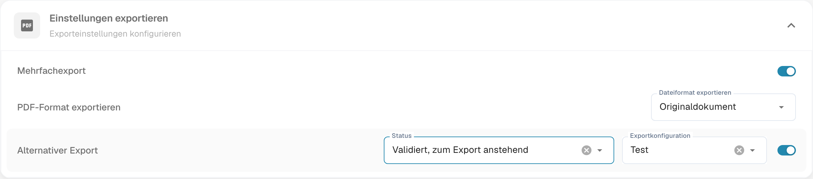

# Alternativer Export

## **Schritt 1: Neuen Export erstellen**

1. Navigieren Sie zu **Einstellungen → Dokumentenverarbeitung → Export**.
2. Klicken Sie auf **Neuer Export**, um eine neue Exportkonfiguration zu definieren.
3. Speichern Sie die Konfiguration und stellen Sie sicher, dass der Export **deaktiviert** ist.

<!-- Obsolete illustration retired: Historical create-export or matching result not verified in this read-only configuration review -->

### **Schritt 2: Alternativen Export aktivieren**

1. Gehen Sie zu **Einstellungen → Dokumenttypen** und öffnen Sie über das Zahnrad die Einstellungen des gewünschten Typs.
2. Öffnen Sie **Einstellungen exportieren** (gemeint: Exporteinstellungen) und bei Bedarf **Alternativer Export**. Prüfen Sie zuerst die Zielkonfiguration.
3. Konfigurieren Sie Folgendes:
   * **Status**: Legen Sie fest, in welchem Dokumentstatus dieser alternative Export verfügbar ist. Dies ist nicht der Status, der nach dem Export geschrieben werden soll.
   * **Exportkonfiguration**: Wählen Sie die neu erstellte Exportkonfiguration, die für den alternativen Export verwendet werden soll.

<figure><figcaption>
Aktuelle deutsche Einstellungen zum alternativen Export. Die Überschrift lautet fehlerhaft „Einstellungen exportieren“ und meint Exporteinstellungen. Status legt die Verfügbarkeit fest; „Test“ ist eine Beispielkonfiguration. Es wurde kein Export ausgeführt.
</figcaption></figure>

## Den alternativen Export verwenden

**Im PO-Matching-Bildschirm**

* Nach der Aktivierung des alternativen Exports können Sie den alternativen Export direkt im **PO-Matching**-Bildschirm auswählen.

<!-- Obsolete illustration retired: Historical create-export or matching result not verified in this read-only configuration review -->

**Mit der Workflow-Karte**

* Die Workflow-Karte für den **alternativen Export** kann ebenfalls verwendet werden, um diesen Vorgang zu automatisieren. Konfigurieren Sie die Karte nach Bedarf, um die Logik des alternativen Exports in Ihrem Workflow anzuwenden.
