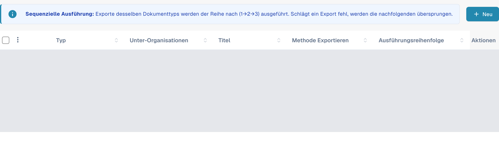
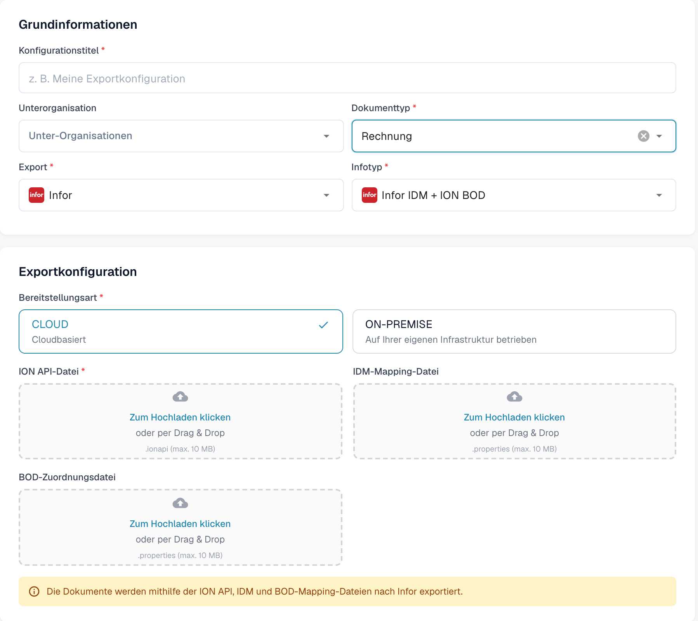

# Erstellen eines Infor-ION-API-Endpunkts für DocBits-Exporte

Ein Infor-Administrator richtet den API-Gateway-Endpunkt für die **bestimmte DocBits-Umgebung und -Organisation** ein. Die alten Bilder auf dieser Seite zeigten einen einzelnen historischen Infor-Tenant, ein festes `api.docbits.com`-Beispiel und ein älteres DocBits-Exportformular. Verwenden Sie die freigegebene Ziel-URL, den freigegebenen API-Schlüssel und das OpenAPI-Dokument für Ihre tatsächliche Umgebung. Für diese Aktualisierung wurde kein Infor-Tenant verbunden und kein Endpunkt gespeichert.

## Vor dem Start

Ermitteln Sie bei Ihrem Integrations-Administrator die Ziel-DocBits-API-URL, den freigegebenen API-Schlüssel samt seinem Header-Namen, die OpenAPI-URL sowie die vorgesehenen Infor- und DocBits-Umgebungen. Bewahren Sie Schlüssel und `.ionapi`-Dateien nicht in Tickets, Screenshots oder dem Git-Repository auf. Stellen Sie sicher, dass ein Test-Endpunkt nicht in die Produktion leiten kann.

## Infor API Gateway konfigurieren

1. Erstellen Sie in **Available APIs** eine API-Suite des Typs **Custom or Non-Infor** für die Zielumgebung. Siehe Infor-Anleitung [API suite instructions](https://docs.infor.com/inforos/2025.x/en-us/useradminlib_cloud/apigatewayag_cloud/gyy1489512842881.html).
2. Fügen Sie der Suite einen Endpunkt mit der freigegebenen **Target Endpoint URL** hinzu. Wählen Sie den Authentifizierungstyp, den dieser Endpunkt verlangt. Bei **API Key** fragt Infor nach **Key Name** und **Key Value**; verwenden Sie den im DocBits-API-Vertrag festgelegten Namen und den für diese Organisation ausgestellten Schlüssel. Siehe Infor-Anleitung [endpoint fields](https://docs.infor.com/inforos/2024.x/en-us/useradminlib_cloud/apigatewayag_cloud/bmg1489588707659.html). Übernehmen Sie keinen Schlüssel aus einer anderen Umgebung.
3. Tragen Sie die OpenAPI-/Swagger-URL der Umgebung unter den **Documentation**-Einstellungen des Endpunkts ein, gemäß Infor-Anleitung [documentation instructions](https://docs.infor.com/inforos/2025.x/en-us/useradminlib_cloud/apigatewayag_cloud/tzr1489597424134.html). Prüfen Sie, dass der Endpunkt in den [API metadata](https://docs.infor.com/inforos/2025.x/en-us/useradminlib_cloud/apigatewayag_cloud/tdr1489674063627.html) erscheint.
4. Prüfen Sie gemeinsam mit dem Infor-Administrator die Ziel-URL, Authentifizierung, Proxy-Pfad und einen sicheren Aufruf außerhalb der Produktion, bevor Sie den Endpunkt in einem ION-Dokumentenfluss verwenden. Eine nur gespeicherte API-Suite belegt noch nicht, dass ein Dokument ausgeliefert wurde.

## Export in DocBits konfigurieren

Öffnen Sie in der vorgesehenen DocBits-Organisation **Einstellungen → Export** und wählen Sie **Neu**. Bestehende Konfigurationsdaten sind in der Abbildung abgedeckt.

<figure><figcaption>
Neu öffnet eine ungespeicherte Exportkonfiguration. Bestehende Konfigurationsdaten sind in dieser aktuellen nativen Aufnahme abgedeckt.
</figcaption></figure>

Geben Sie einen **Konfigurationstitel** ein, wählen Sie **Dokumenttyp** und bei Bedarf **Unterorganisation**. Wählen Sie unter **Export** den angezeigten Wert **Infor** für Infor und unter **Infotyp** die Option **Infor IDM + ION BOD**. Die Abbildung verwendet **Rechnung**.

Wählen Sie unter **Bereitstellungsart** das passende Cloud- oder lokale Bereitstellungsmodell. Das Formular zeigt **ION API-Datei** (`.ionapi`, Pflicht), **IDM-Mapping-Datei** (`.properties`) und **BOD-Zuordnungsdatei** (`.properties`). Die mandantenspezifischen Dateien erhalten Sie vom Administrator. Titel, Unterorganisation und alle drei Uploads sind in der Abbildung leer.

<figure><figcaption>
Aktuelles natives Formular Infor IDM + ION BOD: Rechnung und die Cloud-Variante sind ausgewählt; Titel, Unterorganisation und alle drei Uploads sind leer. Das Formular wurde mit Abbrechen ohne Speichern geschlossen.
</figcaption></figure>

Nachdem der Administrator die ION-Route geprüft hat, speichern Sie die Konfiguration und testen Sie ein Dokument außerhalb der Produktion. Prüfen Sie dessen Status in DocBits und in Infor ION. Ein gespeichertes Formular oder ein Eintrag in den API-Metadaten belegt keinen erfolgreichen Export.

Für die Dokumentationsprüfung wurden Liste und neues Formular nur lesend geprüft. Kein Datei-Upload, Speichern, Aktivieren, Verbindungstest, Infor-Tenant-Login oder tatsächlicher Dokumentexport wurde ausgeführt.
