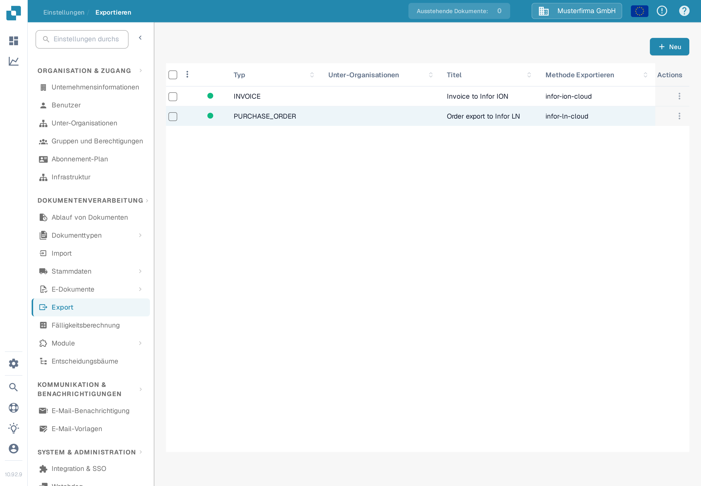
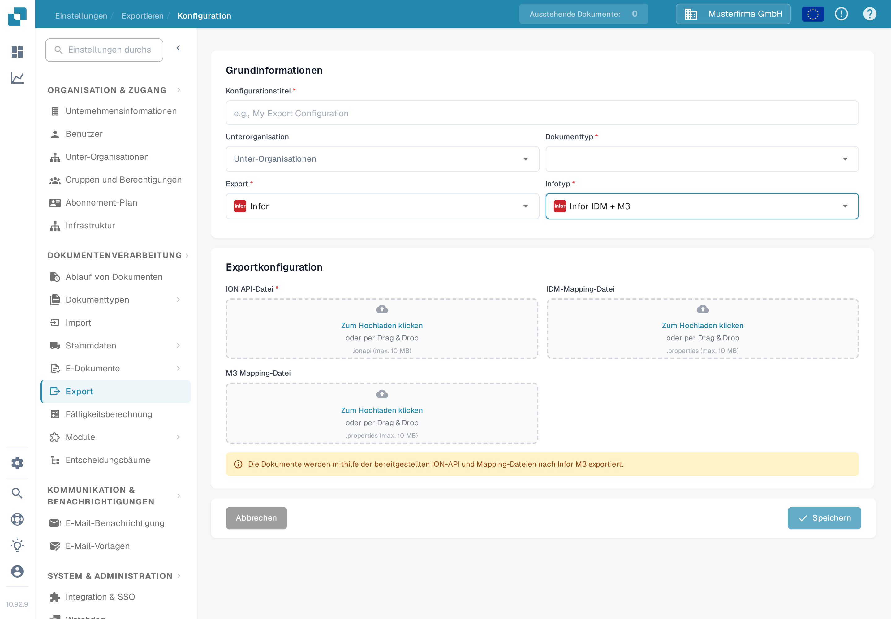

# Infor-M3-Export konfigurieren

Diese Seite erklärt die Schritte, mit denen eine DocBits-Exportkonfiguration mit einem Infor-ION-Dokumentenfluss für M3 verbunden wird. Die frühere Seite enthielt 38 Screenshots aus einem älteren Infor-Mandanten, darunter umgebungsspezifische API- und Mapping-Einstellungen. Sie können die Konfiguration in Ihrem Mandanten nicht belegen, deshalb verweist die aktuelle Anleitung auf die Anweisungen von Infor und zeigt das geprüfte deutsche DocBits-Formular. Für diese Aktualisierung wurden keine Infor-Verbindung und kein Rechnungsexport getestet.

## Infor-Mandanten vorbereiten

Fordern Sie beim Infor-Administrator den freigegebenen **ION API-Endpunkt**, die mandantenspezifische `.ionapi`-Datei, die `.properties`-Dateien für **IDM-Mapping** und **M3-Mapping** sowie die Namen der BOD-Mappings an, die im Rechnungsfluss dieses Unternehmens verwendet werden. Die `.ionapi`-Datei enthält Zugangsdaten; halten Sie sie aus Screenshots, Jira-Anhängen und Git heraus. Ihr `ci`-Wert ist die Client-ID, wie in [Infors Referenz zu den Zugangsdaten-Feldern](https://docs.infor.com/crm/9.4.x/en-us/webclient/upi1639111995644.html) beschrieben.

Der Administrator sollte in ION Desk Folgendes tun:

1. Importieren und genehmigen Sie die Mapping-Versionen, die der aktuelle Mandant verlangt. Prüfen Sie die Eingabe- und Ausgabe-BOD-Namen der Mappings, statt Namen aus einem alten Screenshot zu übernehmen.
2. Prüfen Sie die Verbindungspunkte für DocBits und M3, deren umgebungsspezifische logische IDs, Dokument-Abonnements und Berechtigungen.
3. Erstellen Sie den Dokumentenfluss mit den genehmigten Mappings und den erforderlichen Filtern. Infor erklärt [Verbindungspunkte, Mappings und Dokumentenflüsse](https://docs.infor.com/inforos/2024.x/en-us/useradminlib_cloud/iondeskceug_cloud_osm/lnj1556623308383.html).
4. Speichern, prüfen und [aktivieren Sie den Dokumentenfluss](https://docs.infor.com/depm/2024.x/en-us/depmolh/configuring_ion/jex1510174562552.html) erst, nachdem die Routen geprüft wurden. Aktivieren ist etwas anderes als ein erfolgreicher Dokumentenexport.

Ein historisches ION-Beispiel finden Sie unter [Export nach Infor M3](README.md). Vergleichen Sie jeden Infor-Bildschirm dort mit Ihrem Mandanten, bevor Sie der Anleitung folgen.

## Export in DocBits konfigurieren

Öffnen Sie in der vorgesehenen DocBits-Organisation **Einstellungen → Export** und wählen Sie **Neu**. Die hier gezeigte deutsche Sandbox-Testorganisation hat keine gespeicherte Exportkonfiguration.

<figure><figcaption>
Exportliste in den deutschen DocBits-Einstellungen: noch keine Konfiguration gespeichert, oben rechts die Schaltfläche „Neu“.
</figcaption></figure>

Geben Sie einen **Konfigurationstitel** ein, wählen Sie den **Dokumenttyp** (für diesen Fluss die Rechnung) und wählen Sie eine **Unterorganisation** nur bei Bedarf. Setzen Sie **Export** auf **Infor** und **Infotyp** auf **Infor IDM + M3**. Das aktuelle Formular fragt nach einer **ION API-Datei** (`.ionapi`, Pflicht), einer **IDM-Mapping-Datei** (`.properties`) und einer **M3-Mapping-Datei** (`.properties`). Beschaffen Sie nur Dateien für diesen Mandanten und prüfen Sie sie vor dem Speichern. Das Bild lässt alle Uploads bewusst leer.

<figure><figcaption>
Exportformular „Infor IDM + M3“ in der deutschen Sandbox-Oberfläche; die Felder für ION API-, IDM- und M3-Datei sind leer gelassen.
</figcaption></figure>

Testen Sie nach dem Aktivieren des Infor-Flusses eine einzelne Rechnung außerhalb der Produktion. Prüfen Sie ihr Ergebnis in DocBits, ION und M3. Eine gespeicherte Konfiguration oder ein aktivierter Fluss allein zeigt noch nicht, dass die Rechnung angekommen ist.
