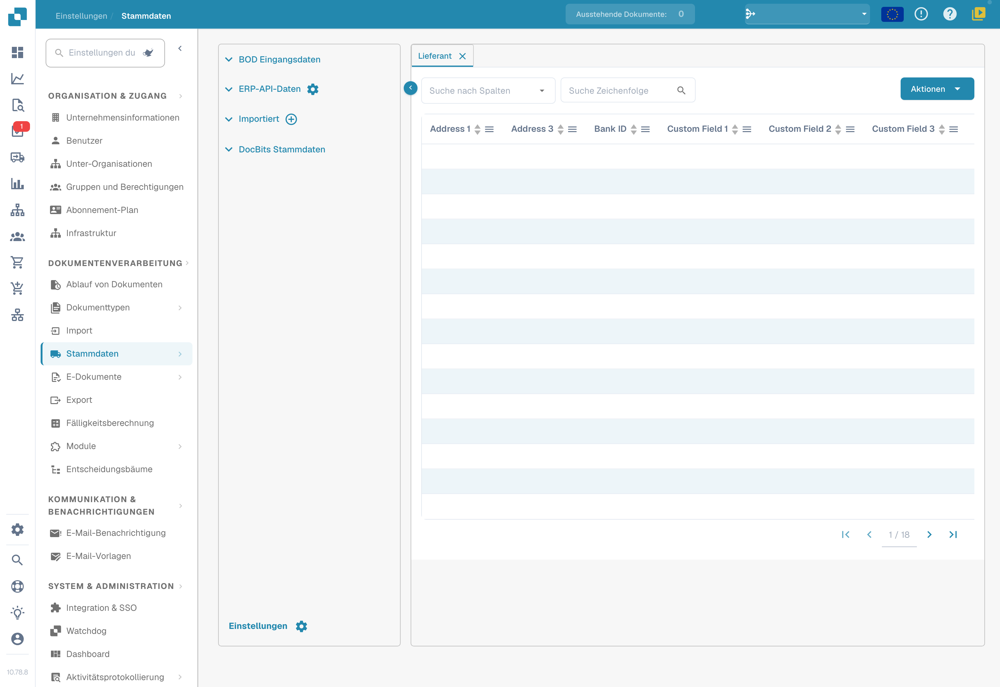

# Benutzerdefinierte Stammdaten

#### Benutzerdefinierte Stammdaten aktivieren 

Navigieren Sie vom Dashboard zu Settings → Document Processing → Module.

.png>)

<figure><figcaption>
Module der Dokumentintegration: Skripte, Dokumentenscan, Barcode-Erkennung und benutzerdefinierte Stammdaten.
</figcaption></figure>

Aktivieren Sie im Bereich Module die Option Custom Master Data, indem Sie wie unten gezeigt auf den Schieberegler klicken.

#### Funktionsübersicht 

Um eigene Stammdaten in DocBits hinzuzufügen, navigieren Sie in den Settings zu Master Data Lookup.

<figure><figcaption>
Deutsche Stammdatenansicht mit ausgeblendeten Datensätzen. Spaltenbezeichnungen der Datenquelle wie Address und Custom Field bleiben im Bild englisch.
</figcaption></figure>

Klicken Sie auf „Custom Master Data“.

<figure><figcaption></figcaption></figure>

Anschließend haben Sie die Möglichkeit, ein Template oder einen Endpoint zu erstellen.

<figure><figcaption></figcaption></figure>

#### Ein Template erstellen 

Im ersten Schritt wählen Sie, ob Sie die ION-API-Datei Ihrer Organisation verwenden oder OAuth2 nutzen und die erforderlichen Daten eingeben.

<figure><figcaption></figcaption></figure>

Als Nächstes konfigurieren wir die Voreinstellungen. Hier geben Sie den Namen der Stammdatentabelle und die URL des API-Aufrufs ein.

<figure><figcaption></figcaption></figure>

Danach müssen Sie den JSON-Pfad in Punktnotation angeben. Weitere Informationen zur Punktnotation finden Sie [hier](https://docs.hevodata.com/sources/engg-analytics/streaming/rest-api/writing-jsonpath-expressions/).

Zum Schluss ordnen Sie die Daten den Spalten zu, die Sie erstellen möchten, wie im folgenden Beispiel.

<figure><figcaption></figcaption></figure>

Klicken Sie danach auf Done, damit Ihre neuen Stammdaten erstellt und befüllt werden.

#### Einen Endpoint erstellen 

Im ersten Schritt wählen Sie, ob Sie die ION-API-Datei Ihrer Organisation oder OAuth2 verwenden oder dieses Feld leer lassen und die erforderlichen Daten eingeben.

<figure><figcaption></figcaption></figure>

Als Nächstes konfigurieren wir die Voreinstellungen. Hier geben Sie den Namen der Stammdatentabelle und die URL des API-Aufrufs ein.

<figure><figcaption></figcaption></figure>

Danach müssen Sie den JSON-Pfad in Punktnotation angeben. Weitere Informationen zur Punktnotation finden Sie [hier](https://docs.hevodata.com/sources/engg-analytics/streaming/rest-api/writing-jsonpath-expressions/).

Zum Schluss ordnen Sie die Daten den Spalten zu, die Sie erstellen möchten, wie im folgenden Beispiel.

<figure><figcaption></figcaption></figure>

Klicken Sie danach auf Done, damit Ihre neuen Stammdaten erstellt und befüllt werden.
