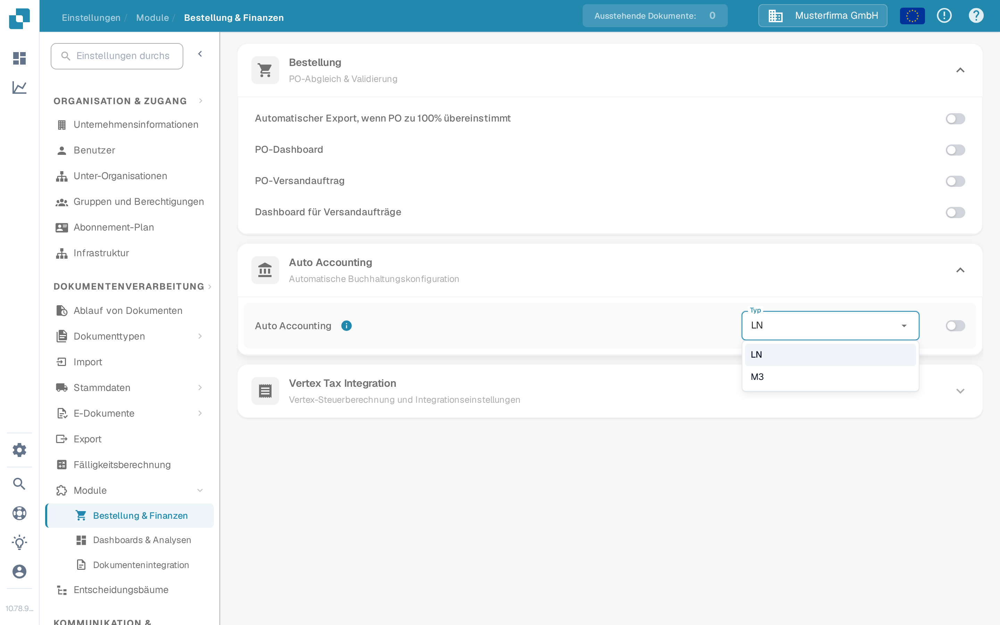

# Auto Accounting mit Infor LN

Verwenden Sie diese Anleitung, wenn ein Infor-LN-Administrator DocBits so konfigurieren möchte, dass importierte Finanzstammdaten für die automatische Kontierung (Auto Accounting) verwendet werden. Die alte Seite zeigte 48 Bildschirme aus einem bestimmten Infor-Mandanten. Verbindungspunkt-Namen, Zuordnungen, Zugangsdaten und Endpunktadressen dieses Mandanten sind keine wiederverwendbare Konfiguration.

## Einstellung in DocBits finden

Öffnen Sie **Einstellungen → Module → Bestellung & Finanzen → Auto Accounting** mit einem Administratorkonto. Das Menü **Typ** bietet **LN** und **M3** an. Prüfen Sie für eine LN-Integration, dass der ausgewählte Typ **LN** ist. Aktivieren Sie den Schalter erst, nachdem die beabsichtigte LN-Gesellschaft, der BOD-Datenfluss und die importierten Stammdaten geprüft wurden. Eine Änderung des Typs oder Schalters kann das Buchhaltungsverhalten beeinflussen; folgen Sie daher dem Änderungsprozess Ihrer Organisation.

Die folgenden Screenshots stammen aus der synthetischen Sandbox **DocBits Documentation Test A**. In dieser Organisation war **LN** ausgewählt und Auto Accounting **aus**. Das Menü wurde geöffnet, ohne einen anderen Wert auszuwählen; keine Einstellung wurde gespeichert.

<figure><figcaption>
Auto Accounting auffinden und den ausgewählten Typ prüfen, bevor es aktiviert wird.
</figcaption></figure>

<figure><figcaption>
LN und M3 sind die in dieser Sandbox verfügbaren Typen; keine Auswahl wurde geändert.
</figcaption></figure>

## LN und ION vorbereiten

1. Bestätigen Sie die LN-Gesellschaft, die Buchhaltungseinheit, die DocBits-Organisation und die Zielumgebung. Stimmen Sie mit Ihrem DocBits-Administrator ab, welche aktuelle API-Operation und welches Feldmapping Konten und Dimensionen empfängt. Bewahren Sie API-Zugangsdaten im zugelassenen Secret-Speicher auf, niemals in einem Screenshot oder Jira-Anhang.
2. Konfigurieren Sie die BOD-Veröffentlichung in LN und prüfen Sie das Publishing Data Setup. Infor dokumentiert **BOD Parameters (tcbod0100m000)** und **Validate Publishing Data Setup (tcbod0300m000)** in seinem [LN-BOD-Veröffentlichungshandbuch](https://docs.infor.com/ln/10.7.in/en-us/lnolh/help/tc/onlinemanual/000520.html).
3. Prüfen Sie, welche Nouns Ihre LN-Version und die DocBits-Empfangsoperation benötigen. Das frühere Beispiel verwendete `Sync.ChartOfAccounts` und `Sync.CodeDefinition` für Kontenplan- und Dimensionsdaten. Infor listet in [Publish Financial Master Data (tfbia0200m000)](https://docs.infor.com/ln/2025.x/en-us/lnolh/tfolh/help/tf/bia/tfbia0200m000.html) die Optionen Chart of Accounts und CodeDefinition auf. Einige CodeDefinition-Reiter erscheinen erst, nachdem die Dimensionszuordnung angegeben und genehmigt wurde. Bestätigen Sie die exakten Dokumentversionen und Felder in Ihrem Mandanten, bevor Sie sie routen.
4. Verbinden Sie in **ION Desk → Connect → Connection Points** die LN-Quelle mit dem zugelassenen DocBits-API-Ziel. Routen Sie in **Data Flows** die ausgewählten Dokumente, prüfen Sie Filter und Mapping und speichern und aktivieren Sie dann. Infor unterscheidet zwischen [dem Speichern und dem Aktivieren eines Flows](https://docs.infor.com/inforos/latest/en-us/useradminlib_cloud/iondeskceug/lsm1436532178755.html).
5. Verwenden Sie in LN einen nicht sensiblen Testbezeichner. Verwenden Sie in **Publish Financial Master Data** zunächst **Count** oder **Simulate**, um die Auswahl zu prüfen, und veröffentlichen Sie (**Publish**) nur im Rahmen der vom Administrator genehmigten Änderung. Die Veröffentlichungsaktion ist nicht zielabhängig: Infor liefert an alle Abonnenten. Verfolgen Sie diesen Bezeichner und etwaige Fehler in [ION OneView](https://docs.infor.com/inforos/latest/en-us/useradminlib_cloud/iondeskceug/lsm1436532196155.html).

## Ergebnis in DocBits bestätigen

Bitten Sie den DocBits-Administrator, den empfangenen Datensatz, die Organisation und die Buchhaltungsfelder in den aktuellen Import- oder API-Protokollen zu prüfen. Wo die betreffende Nachschlagetabelle zugänglich ist, suchen Sie denselben Bezeichner unter **Einstellungen → Dokumentenverarbeitung → Stammdaten**. Ein erfolgreich aktivierter ION-Flow allein beweist nicht, dass DocBits einen Datensatz akzeptiert hat. Fehlt ein Wert, vergleichen Sie den Quell-BOD, das ION-Mapping, die API-Antwort und die Zielorganisation, bevor Sie Auto Accounting einschalten.

Für einen End-to-End-Test waren kein LN-Mandat und keine echte finanzielle BOD-Übertragung verfügbar. Die neuen Sandbox-Bilder bestätigen nur die aktuellen DocBits-Steuerungen. Der Mandantenadministrator muss das endgültige Mapping und das Buchhaltungsergebnis validieren.
