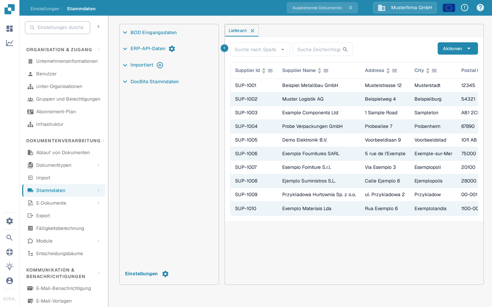
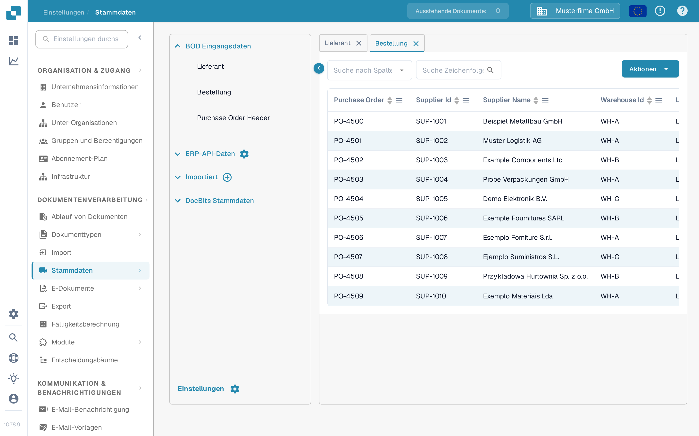

# Stammdaten aus Infor M3 über die ION-API importieren

Verwenden Sie diese Anleitung, wenn Sie als Infor-M3-Administrator ausgewählte BODs über Infor ION und API Gateway an DocBits übermitteln möchten. Die frühere Version dieser Seite enthielt 42 Screenshots aus einem älteren Infor-Tenant und feste Sandbox-API-Adressen. Diese Bilder und Adressen sind keine sichere Konfigurationsvorlage für einen anderen Tenant.

Der zu prüfende Weg ist **M3 sendet einen BOD → ION leitet ihn weiter → API Gateway ruft die DocBits-API auf → DocBits zeigt den importierten Datensatz**. Jede Stufe hat ihren eigenen Status. Einen Datensatz in DocBits zu sehen ist die endgültige Prüfung; ein aktiver ION-Datenfluss allein beweist noch keinen Import.

## Bevor Sie den Datenfluss einrichten

1. Bestätigen Sie die M3-Gesellschaft, den ION-Tenant, die DocBits-Organisation und die Umgebung, die Sie verbinden möchten. Fragen Sie einen DocBits-Administrator nach der aktuellen API-Basis-URL und der benötigten API-Operation aus der OpenAPI-Beschreibung dieser Umgebung. Regionale Hosts können abweichen; kopieren Sie keinen Host und keinen API-Gateway-Proxy-Pfad aus einem alten Screenshot.
2. Legen Sie fest, welche Dokumenttypen die Organisation benötigt. Lieferanten- und Bestellungsstammdaten können in DocBits geprüft werden. Ergänzen Sie Liefer- und Buchungsbelege nur, wenn ihr Einsatzzweck und die empfangende Operation bestätigt sind.
3. Richten Sie ein Infor-Service-Konto mit Berechtigung für die ausgewählte API-Operation ein sowie ein DocBits-API-Zugangsrecht mit minimal erforderlichen Rechten. Geben Sie Zugangsdaten nur im dafür vorgesehenen Konfigurationsbildschirm ein. Fügen Sie niemals eine vollständige `.ionapi`-Datei oder einen API-Schlüssel in eine Dokumentationsseite, ein Jira-Ticket oder einen Screenshot ein.
4. Halten Sie für jeden gewählten BOD einen unkritischen Test-Identifier bereit, damit Sie denselben Datensatz in M3, ION OneView und DocBits nachverfolgen können.

## Dokument und empfangende Operation wählen

Das alte Tenant-Beispiel verwendete diese BODs. Prüfen Sie jede Zuordnung anhand der aktuellen API-Metadaten und Ihres Integrationsdesigns, bevor Sie einen Connection Point anlegen:

| BOD im alten Beispiel                                                                       | Vorgesehene DocBits-Daten                           | Wo das Empfangsformat prüfbar ist                                                                                                                                      |
| ------------------------------------------------------------------------------------------- | --------------------------------------------------- | ---------------------------------------------------------------------------------------------------------------------------------------------------------------------- |
| `Sync.SupplierPartyMaster`, `Sync.RemitToPartyMaster`                                       | Lieferantenstammdaten                               | [Supplier BOD Import](../../../administration-and-setup/importing-customer-master-data/importing-via-the-api/supplier-bod.md)                                          |
| `Sync.PurchaseOrder`                                                                        | Bestellungen                                        | [Purchase Order BOD Import](../../../administration-and-setup/importing-customer-master-data/importing-via-the-api/purchase-order-bod.md)                              |
| `Sync.ReceiveDelivery`                                                                      | Wareneingangsdaten                                  | [Receive Delivery BOD Import](../../../administration-and-setup/importing-customer-master-data/importing-via-the-api/receive-delivery-bod.md)                          |
| `Sync.AdvanceShipNotice`, `Sync.ChartOfAccounts`, `Sync.CodeDefinition-AccountingDimension` | Zusätzliche Stammdaten für konfigurierte Funktionen | [Stammdaten-XML-Import](../../../administration-and-setup/importing-customer-master-data/importing-via-the-api/master-data-xml.md) und die API-Metadaten Ihres Tenants |

`Acknowledge.SupplierInvoice` gehört zu einem Rechnungs-Bestätigungsfluss und sollte getrennt von einem M3-zu-DocBits-Stammdatenimport konfiguriert werden. Die alte Seite hat diese Richtungen vermischt und einen tenant-spezifischen Request-Body enthalten; übernehmen Sie diesen Body nicht in einen neuen Fluss, ohne den Endpoint-Vertrag und die Zugriffskontrollen geprüft zu haben.

## Infor OS und ION konfigurieren

1. Bereiten Sie in Infor OS das API-Gateway-Ziel für die **bestätigte** DocBits-API-Operation vor. Prüfen Sie Ziel-URL, Request-Methode, Request-Format und Authentifizierung mit dem DocBits-Administrator. Verwenden Sie für die Gateway-Steuerung den aktuellen [Infor API Gateway Guide](https://docs.infor.com/inforos/2025.x/en-us/useradminlib_cloud/apigatewayag_cloud/ionapi_2025.x_apigatewayag_cloud_en-us.pdf).
2. Erstellen oder wählen Sie in **ION → Connect → Connection Points** den Connection Point für die DocBits-API. Fügen Sie unter **Documents** nur die gewählten BODs hinzu, wählen Sie die passende Gateway-Operation und konfigurieren Sie den Request-Payload, den die Operation erwartet. Infors [Anleitung zum API-Element](https://docs.infor.com/inforos/latest/en-us/useradminlib_cloud/iondeskceug/hqg1491985489422.html) erklärt Service-Konto und Request-Einstellungen.
3. Verbinden Sie in **ION → Connect → Data Flows** die M3-Quelle mit dem API-Ziel. Prüfen Sie Dokumentliste, Filter und Mappings; speichern und aktivieren Sie anschließend den Datenfluss. Infor unterscheidet das [Speichern vom Aktivieren eines Datenflusses](https://docs.infor.com/inforos/latest/en-us/useradminlib_cloud/iondeskceug/lsm1436532178755.html).
4. Senden Sie einen freigegebenen Test-BOD aus M3. Finden Sie diesen Identifier in **ION OneView** und bestätigen Sie, welcher Connection Point, welches Mapping und welcher API-Aufruf ihn behandelt hat. Siehe [Infor OneView](https://docs.infor.com/inforos/latest/en-us/useradminlib_cloud/iondeskceug/lsm1436532196155.html). Wenn keine Route oder ein Fehler angezeigt wird, korrigieren Sie zuerst den ION-Datenfluss, bevor Sie DocBits prüfen.

## Das Ergebnis in DocBits prüfen

Öffnen Sie **Einstellungen → Dokumentenverarbeitung → Stammdaten**. Erweitern Sie **BOD Eingangsdaten**, wählen Sie den passenden Typ und suchen Sie den Test-Identifier. Die unten gezeigten Tabs **Lieferant** und **Bestellung** sind aktuelle deutsche Ansichten in der synthetischen Testorganisation **DocBits Documentation Test A**. Ihre vorhandenen Demo-Zeilen sind **kein Nachweis eines M3-Imports**.

<figure><figcaption>
Wählen Sie den Tab „Lieferant“, wählen Sie in „Suche nach Spalten“ das Feld und geben Sie den Test-Lieferanten-Identifier in „Suche Zeichenfolge“ ein.
</figcaption></figure>

<figure><figcaption>
Wählen Sie den Tab „Bestellung“ und suchen Sie die Testbestellung; die abgebildeten Zeilen sind synthetische Demo-Daten.
</figcaption></figure>

In beiden Tabs wählen Sie mit **Suche nach Spalten** das Feld, **Suche Zeichenfolge** nimmt den Identifier an, und die Lupe startet die Suche. Die Tabellenüberschriften sortieren die sichtbaren Zeilen; die Pfeile unten blättern zwischen Seiten. **Aktionen** öffnet Tabellenoperationen und wird für diese schreibgeschützte Prüfung nicht benötigt. Das **×** auf einem Tab schließt ihn. Der Plus-Button unter **Importiert** dient CSV-Uploads, nicht dem Empfang eines ION-BOD.

Wenn der BOD in OneView erscheint, der Datensatz in DocBits aber fehlt, prüfen Sie API-Operation und Antwort, Organisation/Umgebung, Dokumenttyp, Payload-Format und den für die Suche verwendeten Identifier. Fordern Sie vom DocBits-Administrator das zugehörige Importprotokoll an. Schließen Sie Erfolg nicht aus einem HTTP-Aufruf oder einem Screenshot einer fremden Demo-Zeile.

Diese Seite wurde anhand der aktuellen DocBits-Sandbox-Steuerung und der Infor-Dokumentation aktualisiert. Für einen End-to-End-Test standen weder ein Infor-Tenant noch ein echter M3-zu-DocBits-BOD-Transfer zur Verfügung; ein Tenant-Administrator muss das finale Mapping und Ergebnis bestätigen.
