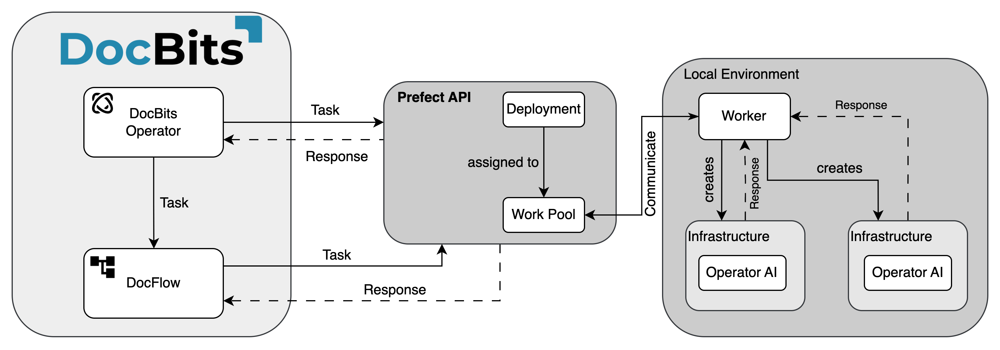
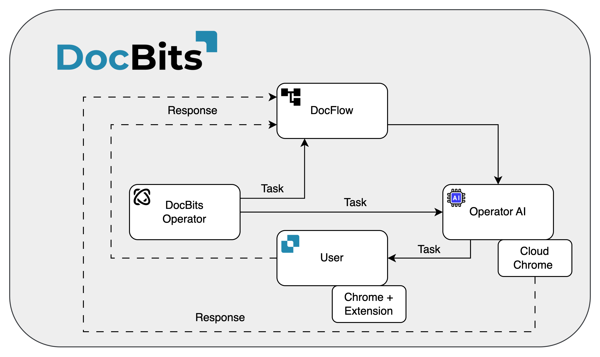

# Architektur

## Cloud-Kunde

<figure><figcaption></figcaption></figure>

## On-Premise-Kunde

<figure><figcaption></figcaption></figure>

Doc**Bits** integriert sich nahtlos mit Infor LN/M3 über die ION API, ION Desk und Infor Standard BODs. Unsere API-Integration ermöglicht es uns, Daten an Infor zu exportieren und die Stammdatenvalidierung in Doc**Bits** durchzuführen.

## **DocBits Operator** Architektur

Alle Verbindungen zwischen den Komponenten sind durch branchenübliche Verschlüsselungsprotokolle gesichert. SSH, HTTPS und andere sichere Kanäle gewährleisten die Integrität und Vertraulichkeit der Daten im gesamten System.

**On-Premise:**

<figure><figcaption></figcaption></figure>

**Cloud:**

<figure><figcaption></figcaption></figure>

## Datenexport nach Infor

Wir verwenden die ION API, um das PDF mit Attributen an IDM und das BOD Sync.CaptureDocument an ION Desk zu senden. In ION Desk transformieren wir das Sync.CaptureDocument in die gewünschten Ziel-BODs basierend auf dem verarbeiteten Dokumenttyp. Diese transformierten Infor BODs werden dann automatisch in LN oder M3 importiert.


Export nach [Infor](../../infor-integration-and-configuration/exporting-to-infor-1/)


## Stammdatenvalidierung in DocBits

Um den Lieferanten zu identifizieren oder Einkaufsbestellzeilen zu vergleichen/abzugleichen, aktivieren wir einen Trigger in LN/M3, der die BODs Sync.RemitToPartyMaster, Sync.SupplierPartyMaster und Sync.PurchaseOrder an Doc**Bits** sendet. Wir konfigurieren diesen Prozess in ION Desk, indem wir den Datenfluss zu einem bestimmten Verbindungspunkt zu Doc**Bits** definieren.

<figure><figcaption></figcaption></figure>


[Stammdatenvalidierung](../../infor-integration-and-configuration/importing-customer-master-data/)


## E-Mail-Import OAuth Office365

