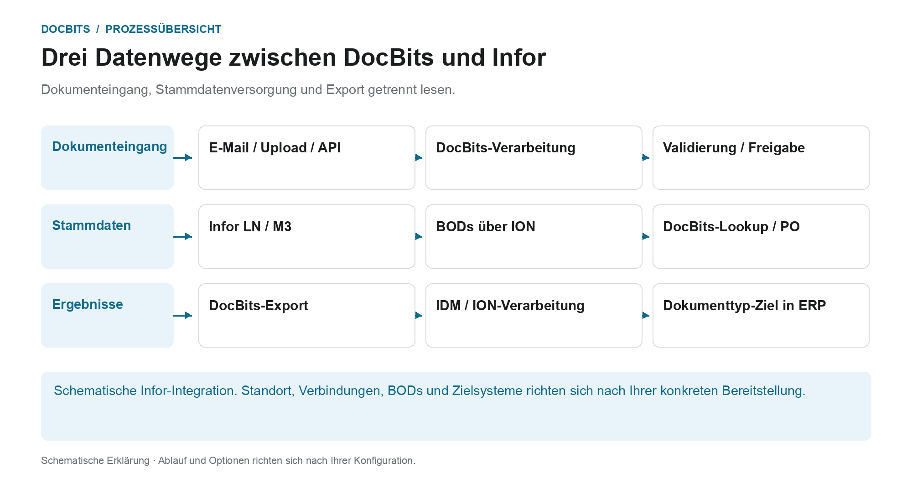
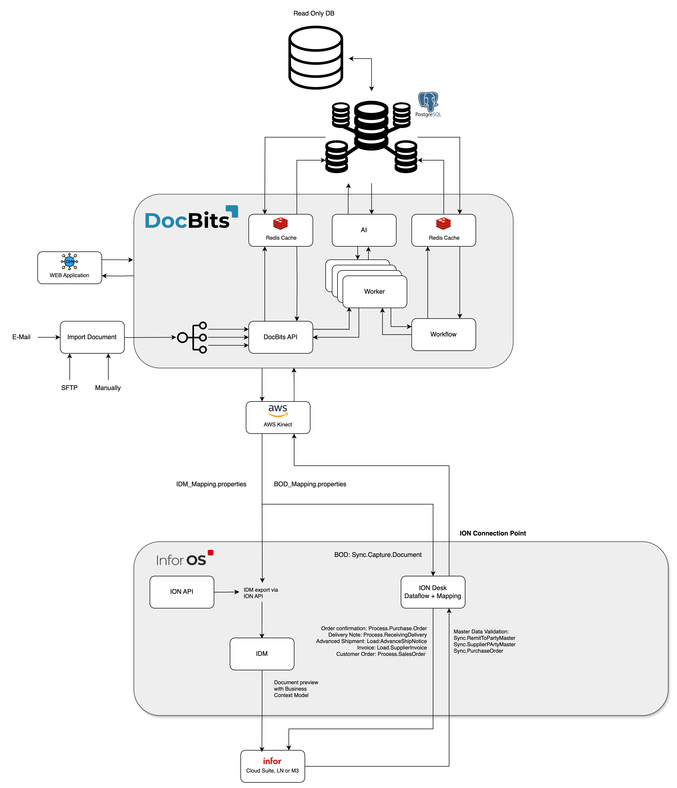

# Architektur

## Die Architektur als drei getrennte Datenwege

<figure><figcaption>
Dokumenteingang, Stammdatenversorgung und Export getrennt lesen. Die Grafik ist schematisch; maßgeblich sind die aktiven Einstellungen Ihrer Organisation.
</figcaption></figure>

Die Architektur enthält mehrere Datenflüsse mit unterschiedlichen Aufgaben. Ein Dokument wird zur Verarbeitung importiert; Stammdaten kommen aus der ERP-Integration; erkannte und geprüfte Ergebnisse werden über den eingerichteten Exportweg zurückgegeben. Diese Wege sind nicht dieselbe Verbindung und sollten bei der Diagnose getrennt verfolgt werden.

| Datenweg | Richtung und Zweck | Kontrollpunkt |
| --- | --- | --- |
| **Dokumenteingang** | E-Mail, Upload oder Schnittstelle → DocBits. Dokumente werden dem vorgesehenen Verarbeitungsprozess zugeführt. | Ist das richtige Dokument in der richtigen Organisation angekommen? |
| **Stammdatenversorgung** | LN/M3 → BODs und ION-Datenfluss → DocBits. Lieferanten und Bestellungen werden für Identifikation und Abgleich bereitgestellt. | Wurde der benötigte Datensatz übertragen und von DocBits akzeptiert? |
| **Ergebnisexport** | DocBits → konfigurierte Infor-Verbindung → IDM beziehungsweise ION und ERP. Dokument und Geschäftsdaten können unterschiedliche nachgelagerte Wege nehmen. | Sind die Übertragung und die jeweilige Verarbeitung im Ziel nachgewiesen? |

Beim hier beschriebenen Infor-Export werden das PDF mit Attributen an IDM und `Sync.CaptureDocument` an ION Desk übergeben. In ION erfolgt die dokumenttypabhängige Transformation in die benötigten Ziel-BODs. Ob LN oder M3 den Vorgang akzeptiert hat, muss im jeweiligen Zielsystem nachvollzogen werden; ein DocBits-Schritt allein belegt nicht jede nachgelagerte Verarbeitung.

**So nutzen Sie die Übersicht bei Fehlern:** Fehlt ein Beleg, beginnen Sie beim Import. Fehlen Lieferanten oder Bestellpositionen, verfolgen Sie den Stammdatenweg. Scheitert die Rückgabe, prüfen Sie Exportkonfiguration, Empfängerantwort und ION-/ERP-Verarbeitung. Die darunterstehenden Architekturdiagramme ergänzen diese fachliche Übersicht um die Bereitstellung und Komponenten.

Weiterführend: [Dokumente importieren](../../end-user-and-partner-section/end-user-section/how-to-import-documents/README.md), [Kundenstammdaten importieren](../../infor-integration-and-configuration/importing-customer-master-data/README.md) und [Export aus DocBits](../../infor-integration-and-configuration/exporting-in-docbits/README.md).

## **DocBits Cloud-Kunde**

<figure><figcaption></figcaption></figure>

## DocBits On-Premise

<figure><figcaption></figcaption></figure>

Doc**Bits** integriert sich nahtlos in Infor LN/M3 über die ION API, ION Desk und die Infor-Standard-BODs. Unsere API-Integration ermöglicht es uns, Daten nach Infor zu exportieren und die Stammdatenvalidierung in Doc**Bits** durchzuführen.

## **DocBits Operator-Architektur**

Alle Verbindungen zwischen den Komponenten werden mit branchenüblichen Verschlüsselungsprotokollen gesichert. SSH, HTTPS und andere sichere Kanäle gewährleisten die Datenintegrität und Vertraulichkeit im gesamten System.

**On-Premise:**&#x20;

<figure><figcaption></figcaption></figure>


[Anforderungen an die lokale Prefect-Einrichtung](prefect-local-setup-requirements.md)


**Cloud**:

<figure><figcaption></figcaption></figure>

## Daten nach Infor exportieren

Wir verwenden die ION API, um das PDF mit Attributen an IDM und die BOD Sync.CaptureDocument an ION Desk zu senden. In ION Desk transformieren wir die [Sync.CaptureDocument](../../infor-integration-and-configuration/exporting-in-docbits/) je nach verarbeitetem Dokumenttyp in die gewünschten Ziel-BODs. Diese transformierten Infor-BODs werden anschließend automatisch in LN oder M3 importiert.


Export nach [Infor](../../infor-integration-and-configuration/exporting-to-infor/)


## Stammdatenvalidierung in DocBits

Um den Lieferanten zu identifizieren oder Bestellpositionen zu vergleichen/abzugleichen, aktivieren wir in LN/M3 einen Trigger, der die BODs Sync.RemitToPartyMaster, Sync.SupplierPartyMaster und Sync.PurchaseOrder an Doc**Bits** sendet. Wir konfigurieren diesen Prozess in ION Desk, indem wir den Datenfluss zu einem bestimmten Verbindungspunkt zu Doc**Bits** definieren.

<figure><figcaption></figcaption></figure>


[Stammdatenvalidierung](../../infor-integration-and-configuration/importing-customer-master-data/)


## E-Mail-Import OAuth Office365

<figure><figcaption></figcaption></figure>
